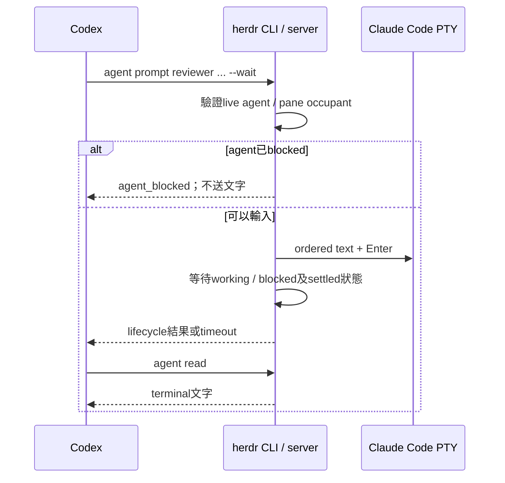
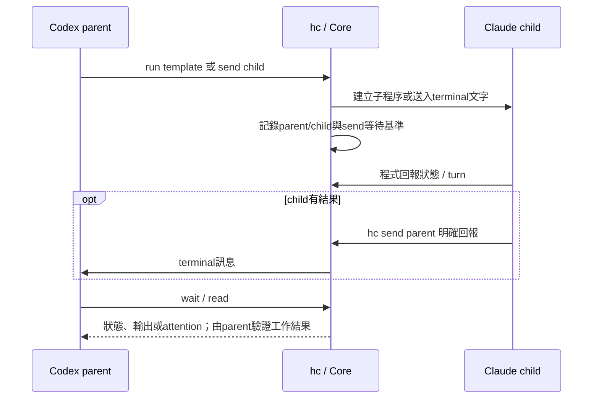
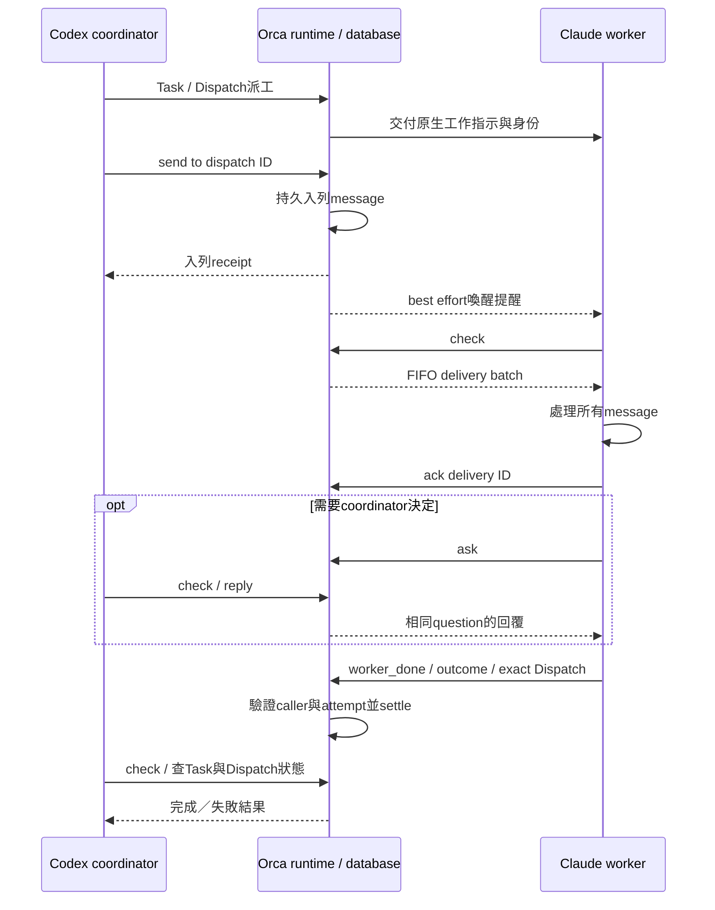
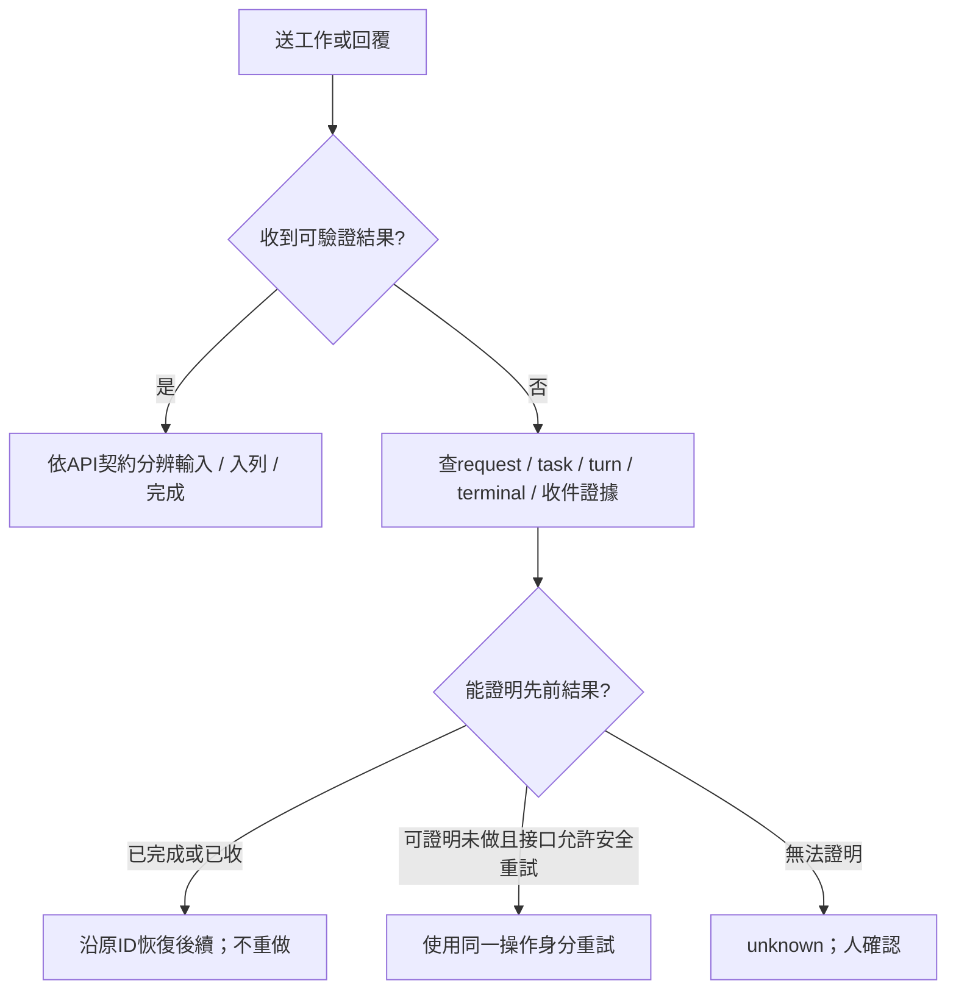

# Codex ↔ Claude Code：Herdr 與 Orca 的通訊、協定及錯誤處理

研究日期：2026-11-01。延續 [選型比較](herdr-vs-orca-study.md)，聚焦兩個 agent 如何派工作、提問、回覆及處理錯誤。固定版本：Herdr TUI `ee5bfb5041bb3e4a49d591c72308aae3c81ecdde`；Core `7a54c2975225a859b7e7d67302df5efc249fb9d0`；Orca 1.4.244 `b8ec5c8d170bcb9988e65de547a3a4e98b2885a9`。本次為原始碼與文件查核，未執行雙 agent 或跨機實測。

## 1. 核心差異

> 後續本機版本查核：目前 `orca --version` 為1.4.245。該binary的`worker-start --help`及`skills get orca-cli`明確指出worker可為structured chat或terminal，依使用者的Chat UI設定選擇，部分情境會fallback。下文固定1.4.244的研究不要解讀為「Orca所有agent都只透過PTY」。目前版本細節與持久worker操作見第8節。

**兩個 agent 都透過 runtime 中介交換資料。**Codex 在自己的 shell/tool 執行 Herdr／hc／Orca CLI，由 runtime 路由至另一個 agent。Claude Code 要依收到的任務及使用說明讀取／回覆；安裝 runtime 不代表兩個 LLM 自動共享 context，也不表示兩個 agent 原生彼此認得。

| 產品路徑 | Codex 如何給 Claude 工作 | Claude 如何回覆 | 主要協作保證 |
| --- | --- | --- | --- |
| Herdr TUI `herdr` | `agent prompt`，server 將文字與 Enter 寫入 Claude 的 PTY | Codex `agent read` 讀畫面；或 Claude 呼叫相同 CLI prompt Codex／寫結果檔 | 終端輸入完成、agent lifecycle 觀察；未找到持久 task mailbox/ACK |
| Herdr App 的 Core `hc` | `hc send` 或透過 template/run 建 child；core 中介 terminal 輸入 | child 明確 `hc send` 回 parent；parent 可 read/wait | 有 parent/child、turn 等待、attention notes；不等於 Orca Task/Dispatch 模型 |
| Orca 一般 terminal 操作 | `terminal send` 等輸入途徑 | 讀 terminal/transcript 或自行回報 | 必須依該 terminal 介面看保證，不能當作 mailbox |
| Orca orchestration | Task/Dispatch 派工，`send --to dispatch:...` 放入持久 mailbox | worker `check` 讀取，`ask/reply` 提問，`worker_done` 正式結束 attempt | 持久訊息、delivery batch ACK、請求恢復與 attempt 身分限制 |

MCP 或 A2A 不是這些路徑必然使用的 agent-to-agent wire protocol。它們可另作工具介面，但此處實際接點是產品 CLI、runtime RPC 和 terminal/mailbox。JSON 是編碼，不能單憑使用 JSON 推論交付可靠性相同。

## 2. 分層 Stack 與 Protocol

| 層級 | Herdr TUI | Herdr Core / App | Orca orchestration |
| --- | --- | --- | --- |
| 業務／工作層 | pane、agent、prompt、lifecycle | terminal、parent/child、send、turn、status | Run、Task、Dispatch、Message、Delivery、gate |
| 呼叫工具 | `herdr agent ...` | `hc run/send/read/wait`；App主要負責畫面 | `orca orchestration ...` |
| API 格式 | 自訂 NDJSON `{id,method,params}`；不應稱為標準 JSON-RPC 2.0 | JSON-RPC 2.0；OpenRPC/JSON Schema | 自訂 JSON runtime RPC；包含認證、能力、契約及獨立 mutation request ID |
| 同機 transport | Unix domain socket／Windows named pipe | Unix socket／Windows named pipe | Unix socket／Windows named pipe |
| 跨機 transport | SSH stdio API bridge | `hc connect` 經 SSH stdio；core 管遠端 machine | 已配對 Remote Runtime 走 WebSocket RPC；SSH execution host 是另一條部署路徑 |
| 實際送到 agent | PTY 的文字與 Enter | terminal paste/submit | mailbox讀取；notify/nudge只有提醒，派工另有原生注入流程 |
| 畫面 transport | TUI另用長度+bincode frame，不等於 automation API | attach使用多channel binary frame，RPC在channel 0 | UI/terminal streams各有格式；不等同 mailbox envelope |
| runtime 技術 | Rust、Tokio、portable-pty、Zig terminal state | Rust core/holders；GUI為Rust GPUI | Node/TypeScript runtime、SQLite orchestration、原生terminal模組 |

Orca 的單次 transport `id` 與 `orchestrationRequestId` 不同：前者對應某次請求/回應，後者用於受支援的 durable mutation 身分與恢復。Herdr TUI 的 `Request.id` 只做 correlation；Core 的 JSON-RPC id 也不能直接當應用去重鍵。

```mermaid
flowchart TB
    subgraph HERDR[Herdr TUI]
        H1[Codex shell tool] --> H2[herdr CLI]
        H2 -->|NDJSON / socket or pipe| H3[Rust server]
        H3 -->|文字 + Enter| H4[Claude Code PTY]
        H4 -->|畫面 / lifecycle| H3
        H3 -->|agent read / wait| H2
    end
    subgraph CORE[Herdr App / Core]
        C1[Codex parent] --> C2[hc CLI]
        C2 -->|JSON-RPC 2.0| C3[Core / terminal holder]
        C3 -->|send / submit| C4[Claude child]
        C4 -->|hc send parent / OSC status| C3
        C3 -->|read / wait / notes| C2
    end
    subgraph ORCA[Orca orchestration]
        O1[Codex coordinator] --> O2[Orca CLI]
        O2 -->|JSON runtime RPC| O3[Runtime + 持久 mailbox / Task / Dispatch]
        O3 <-->|check / send / ask / reply| O4[Claude worker 的 Orca CLI]
        O4 <--> O5[Claude Code]
    end
```



來源：[Herdr精確查核](herdr-source-findings.md)、[Core API](https://github.com/herdrdev/herdr-core/blob/7a54c2975225a859b7e7d67302df5efc249fb9d0/schema/README.md)、[Orca local transport](https://github.com/stablyai/orca/blob/b8ec5c8d170bcb9988e65de547a3a4e98b2885a9/src/cli/runtime/transport.ts)、[Orca remote transport](https://github.com/stablyai/orca/blob/b8ec5c8d170bcb9988e65de547a3a4e98b2885a9/src/cli/runtime/websocket-transport.ts)。

## 3. Herdr TUI：透過終端控制互相溝通

假設已建立可用 pane，Claude 的 live agent 名稱為 `reviewer`。Codex 可以執行：

```text
herdr agent prompt reviewer "檢查這次修改，結果寫入 review.md" --wait --timeout 120000
herdr agent read reviewer --source recent-unwrapped --lines 120
```

這只是語法示例，結果檔協定由工作指示決定，Herdr 不保證自動產生 `review.md`。跨機則每個 discovery、prompt、read 都加相同的 `--machine <profile>`。agent名/pane ID是server-local，必須先查詢，不能把另一台同名agent當成同一對象。



`prompt` 成功代表文字及Enter寫入；不是Claude接受獨立task的持久ACK。`--wait`有防race與occupant檢查，但不追蹤個別turn。原本已working時，前一輪完成也可能滿足等待；blocked也在預設settled之內。Codex必須檢查結果，不可將「等待返回」當成review通過。

若Claude需要主動回覆Codex，可依既有路由呼叫 `herdr agent prompt <codex-agent> ...`，或寫檔讓Codex讀；這是建立於API的協作方式，不是原生持久信箱。雙方同步等待對方可能形成工作流程僵局；建議指定一個coordinator，避免互相等待同一輪。

來源：[Herdr agent automation](https://github.com/herdrdev/herdr/blob/ee5bfb5041bb3e4a49d591c72308aae3c81ecdde/docs/versions/0.9.5/website/src/content/docs/agent-automation.mdx)、[prompt handler](https://github.com/herdrdev/herdr/blob/ee5bfb5041bb3e4a49d591c72308aae3c81ecdde/src/app/api/agents.rs)。

## 4. Herdr Core：原生parent/child與terminal send

App本身負責視窗；兩個agent的執行與協作走 `hc`。Core有parent/child、templates、send/read/wait，與TUI的pane lifecycle機制不同。`hc send`仍將文字送到terminal，不等於獨立持久mailbox。正常工作結果要由child明確回報；不可只依賴自動attention通知推論成功。

Core有依caller/terminal保存的last-send turn等待語意。遠端 `send --wait` 的lost-line分支會在原deadline內等待重連並續接 `terminal.wait`，不重送整段文字。這不涵蓋所有失敗；對方core若同時重啟，last_send已清空，不能假定仍配對原turn。last_send、messages、waiting是runtime記憶體狀態，不是跨重啟的持久工作ledger。這比TUI只觀察settled lifecycle更有結構，但與Orca Task/Dispatch完成契約仍不同。

Core每個terminal的自動輸入有自己的queue，會等人員停止打字約3秒，再串行paste/Enter，期間的人員按鍵暫存後交回。預設拒絕blocked程式，也可用狀態前提避免在意外狀態輸入。這處理輸入競爭，不能保證文字已被LLM當成正確工作接受；不應用force繞過本來要由人決定的approval。

last_send是每個 `(caller,target)` 的最近一次值，不能同時關聯任意多筆並行訊息；target已working時再送，也可能在同一turn內。`wait`逾時是check-in，程式繼續跑；回覆訊息可以讓wait以 `reason:message` 提前返回，此時child可能還在工作。跨機 `wait --children all` 也不能直接當作所有遠端成功，因不可達machine會被略過。呼叫端要逐項核對終端、狀態與結果。

自動notes針對blocked/error/program exit；live child的正常done不會自動產生成果摘要。遠端離線notes有保存於peers.json的outbox，但在線note是無id的JSON-RPC notification，沒有端到端note receipt；收端待投的afar_notes亦是記憶體資料。這套局部去重與outbox不能當成所有hc send都有持久收件匣。完整細節見下方原始碼查核。



Core protocol是JSON-RPC 2.0；terminal attach額外協商channel frame和流量控制。OSC 7501是程式回報status的terminal sequence，不是Codex↔Claude共用的網路協定。程式不回報時core不猜品牌或畫面，整合安裝與版本很重要。

Core的送信、note持久化與錯誤邊界另見 [Core messaging原始碼查核](herdr-core-messaging-findings.md)。來源：[Core README](https://github.com/herdrdev/herdr-core/blob/7a54c2975225a859b7e7d67302df5efc249fb9d0/README.md)、[API與status](https://github.com/herdrdev/herdr-core/blob/7a54c2975225a859b7e7d67302df5efc249fb9d0/schema/README.md)。

## 5. Orca：透過持久mailbox與Task/Dispatch交換工作

Codex先作coordinator建立Run/Task，將工作派給Claude worker。後續指示可送到確切 `dispatch:<id>`。Claude要在自然checkpoint呼叫 `check`，處理整個batch再ACK；不能假設每則訊息都會立即打斷正在執行的LLM turn。



這是「agent遵守原生協作規則」的路徑。若只用Orca `terminal send`將文字打入另一個pane，仍需依該terminal接口解讀，不會自動獲得Task/mailbox全部保證。

四種成功須區分：

1. RPC回應成功：該方法執行返回。
2. `send`成功：訊息已持久入列；提醒是best effort，不保證已讀。
3. delivery ACK：接收流程已處理該batch；不是部署等副作用的唯一執行證明。
4. `worker_done`被接受：該Dispatch正式settle；內容仍須驗收，不能只看模型宣稱成功。

來源：[messaging規則](https://github.com/stablyai/orca/blob/b8ec5c8d170bcb9988e65de547a3a4e98b2885a9/skill-guides/orchestration/references/messaging-and-gates.md)、[worker契約](https://github.com/stablyai/orca/blob/b8ec5c8d170bcb9988e65de547a3a4e98b2885a9/skill-guides/orchestration/references/worker-contract.md)。

## 6. Error handling比較

| 情況 | Herdr TUI | Herdr Core | Orca orchestration |
| --- | --- | --- | --- |
| 目標不存在／被替換 | 驗證live agent/occupant，拒絕錯目標 | terminal地址、狀態、caller關係依API檢查 | Task/Dispatch/caller能力與consumer fencing |
| agent正在approval對話框 | 一般prompt回agent_blocked，不送輸入 | send預設回blocked；狀態前提不符可回status_mismatch，需先inspect | worker可ask；用原訊息ID等待reply，不偽裝完成 |
| 等待timeout | 文字可能已送，先read再決定 | ended:false/reason:timeout是check-in；not_started也不證明未送，先read | query mutation/Dispatch；ask原question仍pending可resume |
| SSH／網路中斷 | 重連server；mutation不自動replay；read-only probe可重試 | machine重連，send後等待中斷可重新wait | 遠端unverifiable不等於死亡；查原request/Dispatch，不能另開duplicate |
| 發送回應遺失 | 沒有已查證持久request去重；結果unknown | 不因JSON-RPC id宣稱可重送輸入；依原send/狀態查證 | 支持的mutation有caller+requestId+payloadHash receipt；相同身份恢復 |
| 相同request ID但內容不同 | TUI id只有correlation | JSON-RPC id本身沒有工作去重保證 | mutation store拒絕request_mismatch |
| 訊息尚未ACK就接收端中斷 | 無同等持久mailbox batch | send/notes與terminal等待有自己的邊界，非同等mailbox | 未ACK batch重播；重複ACK為no-op |
| 狀態事件遺失 | events_lost後重訂閱並read/snapshot | missed後重新snapshot；seq跨core process會重設 | mailbox/Task作查證；不能只依喚醒事件 |
| 完成狀態誤判 | idle/done/blocked不等於指定任務成功 | status/turn也是觀察；結果需child明確回報及parent驗證 | 成功settle與測試／產品驗收仍須分開 |
| 接收程序重啟 | layout/resume不等於原命令唯一執行證據 | holder/core/kept terminal恢復各有範圍 | DB保留訊息/receipt但仍須核對runtime、caller及attempt |
| 關機／突然斷電 | 不能承諾未提交資料或程序存活 | 不能承諾所有input/notes在所有中斷點不丟不重 | 持久入列不等於每筆資料已經fsync，見下節 |
| 任務連續失敗 | 由外層coordinator決策與限次 | 由parent/外層策略決策 | 原生worker-start context有連續失敗circuit-break規則，勿用新Task繞過 |

### Orca的keyed recovery具體做什麼？

transport每次產生自己的RPC id；durable mutation另有穩定 `orchestrationRequestId`。SQL receipt以caller fingerprint+request ID查詢，核對method/payload hash，保存pending/completed。回應遺失時CLI提供 `request-show`／`worker-show` 與適用時的 `--retry-request` 恢復提示。

`completed`先讀receipt；`pending`依原命令及同ID恢復；`absent`只代表此runtime在該caller下查不到，不能證明沒執行。`consumer_fenced`代表失去該Dispatch所有權，應停止該worker流程；不能一直重試舊身分。某些受支持mutation有安全的重試路徑，不代表agent寫檔、deploy或所有外部API都自動冪等。

固定版worker_done會對短暫runtime_unavailable使用相同request ID、有限時間與退避重試；不能將這條特例當成所有send的通用無限重試。一般unknown結果仍須先查證。

來源：[mutation request重試](https://github.com/stablyai/orca/blob/b8ec5c8d170bcb9988e65de547a3a4e98b2885a9/src/cli/handlers/orchestration/mutation-request.ts)、[receipt store](https://github.com/stablyai/orca/blob/b8ec5c8d170bcb9988e65de547a3a4e98b2885a9/src/main/runtime/orchestration/db/mutation-receipts/mutation-receipt-store.ts)、[unknown恢復](https://github.com/stablyai/orca/blob/b8ec5c8d170bcb9988e65de547a3a4e98b2885a9/src/cli/orchestration-mutation-recovery.ts)、[recovery規則](https://github.com/stablyai/orca/blob/b8ec5c8d170bcb9988e65de547a3a4e98b2885a9/skill-guides/orchestration/references/recovery-and-cleanup.md)。

### 突然斷電的具體限制

固定Orca版本的orchestration DB設定為 `journal_mode=WAL`、`synchronous=NORMAL`。SQLite官方說明此組合可維持一致性，但系統當機／斷電時已提交交易仍可能回滾；不能把應用程序重啟的恢復能力等同硬體斷電保證。這是由原始碼設定及SQLite語意推得的限制，本次未做斷電實測，也未修改其設定。

因此我們的bridge不能只看到「send成功」就宣稱能對任何斷電保證零遺失。需要在公司確定持久化、保留與對帳責任，或接受查不到時unknown的設計。

依據：[Orca DB設定](https://github.com/stablyai/orca/blob/b8ec5c8d170bcb9988e65de547a3a4e98b2885a9/src/main/runtime/orchestration/db/orchestration-db.ts#L34)、[SQLite synchronous](https://www.sqlite.org/pragma.html#pragma_synchronous)。

## 7. 對FTP／itcp設計的含意

**優先橋接結構化工作／訊息，不橋接連續的PTY畫面與按鍵stream。**所有選項都需要檔案完整發布、可信路由、穩定message_id、retry、receipt及未知狀態查證。

| 接點 | 可以沿用 | 仍要驗證/新增 |
| --- | --- | --- |
| Herdr TUI | 本地/遠端agent控制與狀態 | 持久收件、任務關聯、回覆、dedup；terminal送入的中斷空窗 |
| Core | parent/child、send/turn wait、機器地址及API文件 | notes與send不等於任意跨網durable mailbox；可研究doc API，仍需交易邊界 |
| Orca | 持久mailbox、Task/Dispatch、mutation receipt | 檔案ID到request/caller/Dispatch的映射、ACK所有權、主機斷電證據 |

Orca跨runtime federation有內部連續sequence與ACK，且要求caller/attachment。公司外層seq只記log、不等缺號，兩者不能直接套同一個數字。Core event sequence與TUI completion/event sequence也不是檔案收件確認。

共同錯誤處理流程：



本次新增查核使Orca原生mutation恢復能力更明確，但不代表公司bridge已完成驗證。下一個可實測問題是：同一份Codex→Claude工作，在API送出前、寫入後回應前、工作完成後回報前分別中斷，各產品能用什麼穩定ID查到什麼證據。

## 8. Orca 1.4.245：agent接點與「持久worker」的意思

本節另以當前安裝binary的`--version`、`skills get orca-cli`、`skills get orchestration`，以及`worker-start/worker-retain/terminal send/run-use --help`核對。沒有啟動worker或修改設定。

### 與Codex、Claude交換的兩種接點

| 執行模式 | 工作如何送入 | 回覆如何讀取 |
| --- | --- | --- |
| 互動terminal/TUI | 對已辨識agent的text+Enter，CLI說明為bracketed paste，經PTY送入；不是使用系統剪貼簿 | terminal output、hook、可驗證的provider transcript等 |
| structured/native chat | 透過provider adapter的結構化session介面，不依靠在TUI輸入框貼字 | provider事件、session journal/transcript |

Orca v1.4.245原始碼包含Codex app-server connection/thread startup與Claude stream-json connection/startup。這些是Orca到provider的接點，不能和agent呼叫Orca CLI的runtime RPC、或Orca mailbox協定混為一談。

`worker-start`依使用者的新agent tab／Chat UI設定選擇執行方式，沒有此命令的`--surface`切換旗標；一般`agent launch`等啟動命令另有surface選項，不能混用。所有受監督worker仍透過orchestration的派工、mailbox與生命週期介面操作。不能把所有worker handle傳給terminal命令；讀取用`worker-read --source auto`，實際執行結果依receipt核對。

來源：[Codex adapter](https://github.com/stablyai/orca/blob/v1.4.245/src/main/codex/codex-structured-session-start.ts)、[Claude adapter](https://github.com/stablyai/orca/blob/v1.4.245/src/main/claude/structured/claude-structured-session-startup.ts)、本機1.4.245版本相符CLI guide與help。

### 持久化分三件事

| 想保留什麼 | 實際做法與邊界 |
| --- | --- |
| 任務／訊息紀錄 | orchestration的Run/Task/Dispatch/mailbox本來就記錄狀態，無需加`--persistent-worker`；恢復自己的Run用`run-use`，不等於重跑工作 |
| 任務完成後留著worker | 已settle後可`worker-retain`登記使用者要求保留的例外；命令不啟動或重啟程序，不是永遠存活保證 |
| 主機重啟後原process繼續 | 無法保留原RAM/process；依原生session/resume和Task/Dispatch證據恢復，無法確定執行結果則unknown |

示例應在Orca管理的coordinator agent上下文執行；以下為說明，未實際啟動：

```powershell
orca orchestration run-create --objective "Codex協調Claude檢查程式" --json
orca orchestration worker-start --spec "唯讀檢查目前專案，回報問題，不修改檔案" --worktree current --agent claude --json
```

成功只以receipt的ready為準，保留真實Run ID及Dispatch ID。worker完成後，若使用者要留著其受支持資源，再執行：

```text
orca orchestration worker-retain --dispatch <實際dispatch-id> --json
```

coordinator重新啟動後，恢復自己的Run並查狀態：

```text
orca orchestration run-use --id <實際run-id> --json
orca orchestration worker-show --dispatch <實際dispatch-id> --json
```

worker在`worker_done`後結束該次工作並idle；新任務必須建立新的Task/Dispatch。retain不會讓worker自動在背景永遠check；若要常駐收件服務，應由有明確生命周期的coordinator/bridge負責，不能把無限polling塞進已完成Dispatch。

## 9. 關掉UI再打開，能看到最新agent畫面嗎？

**Orca終端模式及Herdr TUI都支持重新接上仍存活的終端，看關閉UI期間產生的新輸出。**條件是擁有PTY的daemon/server與主機持續運作；這與還原歷史畫面不同。

| 情境 | Orca 1.4.245終端agent | Herdr TUI 0.9.5 |
| --- | --- | --- |
| 普通關閉/離開client，再打開 | daemon持有PTY，重新warm attach；包含期間輸出與layout | detach後server持續運作，重新herdr attach得到live畫面與layout |
| 明確停止session/server | Quit Completely/kill all sessions關閉terminal；不能期待原tab與程序重現 | server stop結束pane程序；下次是snapshot/history/session resume |
| 主機重新開機、daemon/server死亡 | 原agent程序結束；可還原layout與last-persisted scrollback，另行resume | 原程序結束；layout可還原，歷史及agent resume依設定/整合 |

Orca文件明確區分一般quit和Quit Completely；Windows的Quit Completely在File/應用程式選單或tray選單。單純重新開畫面不需要worker-retain，retain處理的是orchestration工作完成後的清理責任。上述PTY保活文件不能自動延伸成所有structured/native chat provider process的同等承諾。

Herdr正常detach為先Ctrl+B、再q；重新執行`herdr`連回同一session。pane_history預設關閉：只有需要在server重啟後回放近期terminal畫面時，才在config設`[experimental] pane_history = true`。正常live reattach不需要此選項。native agent session restore預設啟用，但需有效官方整合/原生session reference；不符合條件時只是新shell，不是原agent仍在跑。

這些為官方文件查核，未在使用者工作階段實際quit/reopen測試。來源：[Orca session restore](https://github.com/stablyai/orca/blob/v1.4.245/docs/site/content/docs/model/session-restore.mdx)、[Herdr session state](https://github.com/herdrdev/herdr/blob/ee5bfb5041bb3e4a49d591c72308aae3c81ecdde/docs/versions/0.9.5/website/src/content/docs/session-state.mdx)。

## 10. 除SSH之外的連線方式

| 產品 | 同機 | 跨機內建與擴充 |
| --- | --- | --- |
| Herdr TUI | Unix socket／Windows named pipe | 查核的saved machine endpoint為Local或SSH；未找到可直接指定HTTP/WebSocket server的官方遠端入口 |
| Herdr Core | Unix socket／Windows named pipe | 預設SSH；Unix 呼叫端另有 `hc machine add --via <command>` 自訂 connection command，需原樣雙向傳遞 stdin/stdout 並在目的地主機執行 core 連線命令；查核版本的原生 Windows 呼叫端會拒絕 `--via` |
| Orca | Unix socket／Windows named pipe runtime RPC | SSH workspace/execution host；或直接配對Remote Orca Server，透過WebSocket RPC，不要求目標主機一定開SSH Server |

Core 的 `--via` 是 Unix 呼叫端可用的 transport 擴充接口，不是預設 HTTP/WS listener，也不是任意檔案通道。補查 `27fea26` 的 `machines::check_target`，`via` 分支會因 `cfg!(windows)` 直接拒絕；安裝 Git Bash 不會解除這個限制。官方提供的雲端 remote-exec 與 Vercel Sandbox helper 例子不能直接當成原生 Windows 免 SSH 方案。若另一台 Windows 禁用 SSH，需另做 sidecar＋App mod，或正式新增 Windows transport 接點；不能只改 `--via` 設定。[Windows via 判斷](https://github.com/herdrdev/herdr-core/blob/27fea26efe498dce7e1555948fa75c3994fb8a9c/crates/herdr-core/src/machines.rs#L121-L130)

Codex-only 的本機＋SSH Linux 操作、App 顯示條件及免 SSH Windows 的兩種方案見 [多機操作指南](herdr-codex-multimachine-guide.md)；[連線／狀態補查](herdr-core-connection-status-notes.md) 另列原生 OSC 7501 版本證據。`herdr-app status` 是視窗狀態，agent 狀態與輸出需用 `hc get/read`。

Orca Remote Server可以由桌面App分享runtime，也可用`orca serve`啟動；client在公司允許的LAN/VPN路由上配對連線。Tailscale/WireGuard提供網路路徑，不是另一種agent訊息協定；SSH forwarding可用來承載該連線，卻不是Direct Remote Server的必要條件。直接配對時，被控Windows要有Orca runtime與允許的runtime連線，不必僅為此安裝sshd。

三者的即時原生方式都不能直接替代本案FTP／itcp bridge；Core`--via`需要持續雙向byte stream，不能把1s/5s檔案polling當成相同保證。來源：[TUI endpoint](https://github.com/herdrdev/herdr/blob/ee5bfb5041bb3e4a49d591c72308aae3c81ecdde/src/client/endpoint.rs#L73)、[Core自訂connection](https://github.com/herdrdev/herdr-core/blob/7a54c2975225a859b7e7d67302df5efc249fb9d0/docs/machines.md#use-another-way-in)、[Orca Remote Servers](https://github.com/stablyai/orca/blob/v1.4.245/docs/site/content/docs/remote-servers.mdx)。
