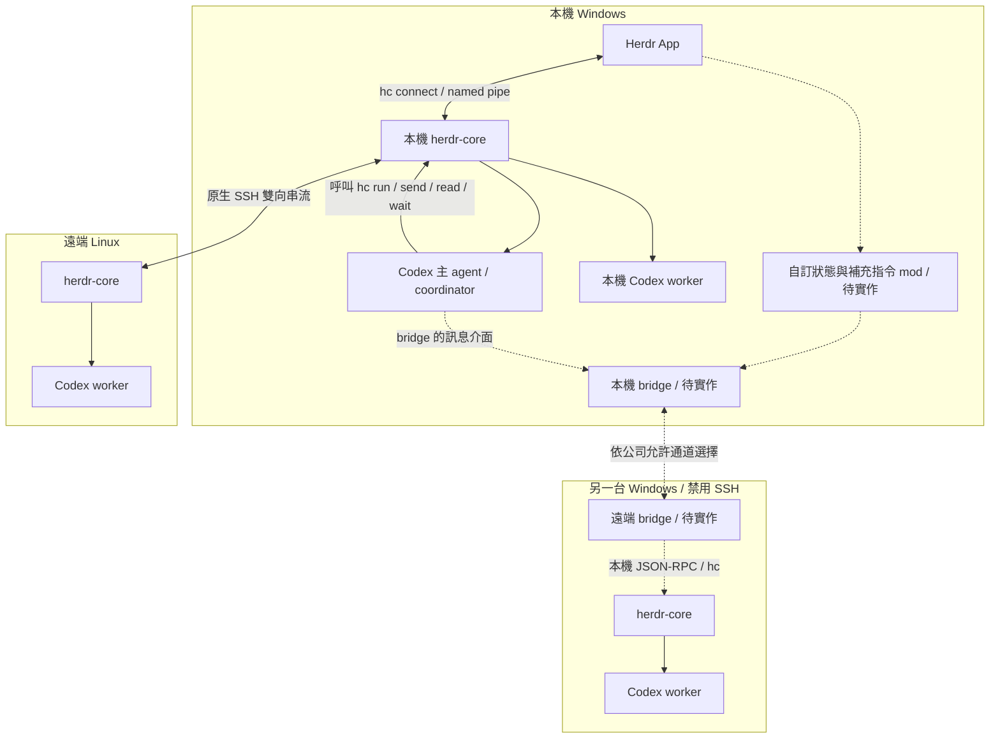
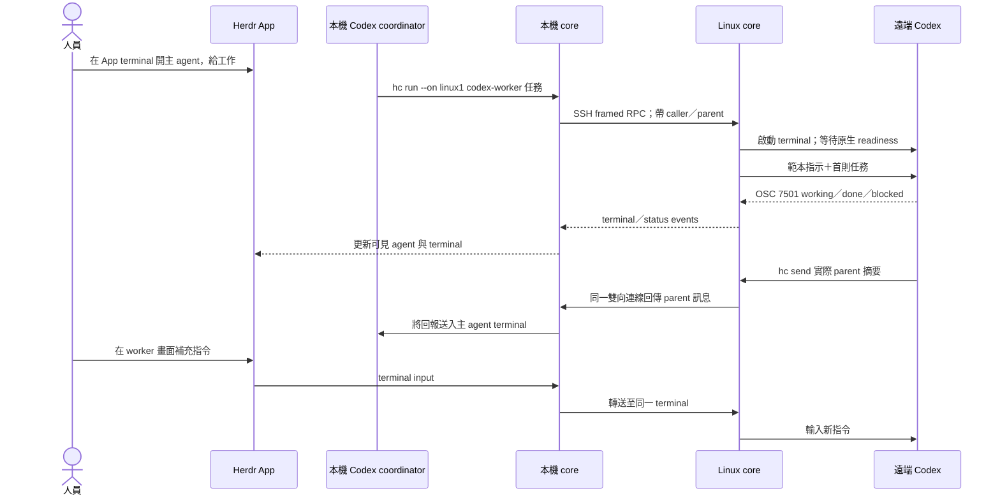
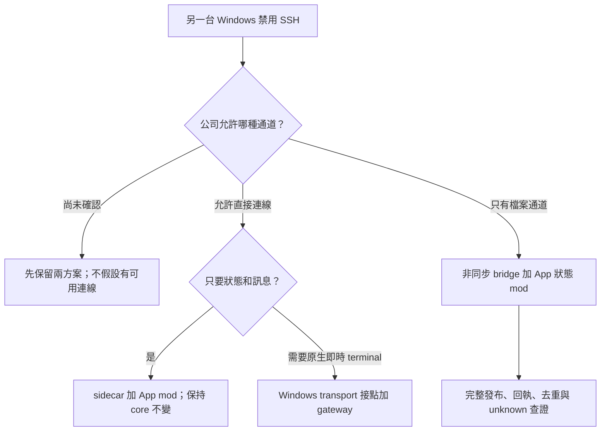

# Herdr App／Core：本機與遠端 Codex 操作流程

日期：2026-11-01。狀態：文件與固定版本原始碼查核；尚未啟動 core、App、Codex 工作階段或實測公司連線。所有命令是操作範例，主機、路徑、terminal 位址必須換成實際值。

文件整理更新：2026-11-02。本文件是使用者操作入口；需要逐項原始碼證據時讀 [連線與狀態筆記](herdr-core-connection-status-notes.md)，需要比較 Herdr TUI／App／Core 與 Orca 時讀 [選型研究](herdr-vs-orca-study.md)。公司後續實作與故障驗收另見 [handoff](handoff.md)。

## 1. 已確認需求與目前可用範圍

- 本機 Windows：herdr-core、Codex、Herdr App；App 查看狀態與畫面，人員可以繼續輸入補充指令。
- 遠端 Linux：允許 SSH；執行 herdr-core 與 Codex，不需要 Linux 桌面或 Herdr App。
- 另一台 Windows：禁止 SSH；可用通道尚未確認，保留直接 HTTPS／WSS／TCP 與共享資料夾／FTP／itcp 兩種分支。
- 使用者只使用 Codex，本文不要求 Claude。每台執行 Codex 的主機都需要公司允許且可用的 Codex 登入、模型存取、工作目錄與工具；不假設本機登入會自動傳到遠端。
- 「更新」指查看狀態後補充或修改 agent 工作指令，沒有要求更新 binary。

| 路徑 | 現成功能 | 待補範圍 |
|---|---|---|
| 本機 App → 本機 core → 本機 Codex | 有 | 完整安裝、Codex 登入與狀態驗收 |
| 本機 core → SSH → Linux core → Codex | 有 | SSH key、遠端安裝／登入、路徑與中文輸入驗收 |
| 本機 Windows core → 免 SSH 的 Windows core | 這版沒有現成可直接設定的 TCP／HTTP／WSS machine 入口 | 依可用通道開發 bridge／transport adapter |
| App 原生顯示免 SSH Windows 的即時 terminal | 尚未具備 | 完整 machine transport 適配；只接文字 RPC 不等於 terminal streaming |
| App mod 顯示免 SSH Windows 回傳的狀態／摘要，並送補充訊息 | 可作為提案 | 自製 bridge＋mod；必須標示時間、連線及 unknown 狀態 |

固定版本：Core `27fea26efe498dce7e1555948fa75c3994fb8a9c`、App `1581a587919dddd6f1efd5f78eb542c4b2b02cb5`。來源：[machines](https://github.com/herdrdev/herdr-core/blob/27fea26efe498dce7e1555948fa75c3994fb8a9c/docs/machines.md)、[API](https://github.com/herdrdev/herdr-core/blob/27fea26efe498dce7e1555948fa75c3994fb8a9c/schema/README.md)、[Windows via 限制](https://github.com/herdrdev/herdr-core/blob/27fea26efe498dce7e1555948fa75c3994fb8a9c/crates/herdr-core/src/machines.rs#L121-L130)。詳細查核見 [連線與狀態筆記](herdr-core-connection-status-notes.md)。

## 2. 架構與 coordinator

Herdr App 使用獨立的 herdr-core／hc；Herdr TUI 使用 `herdr` 自己的 server。這份指南的命令不要混用成 `herdr machine ...`，也不能把 TUI session 直接接到 App。來源：[Core manual](https://github.com/herdrdev/herdr-core/blob/27fea26efe498dce7e1555948fa75c3994fb8a9c/crates/herdr-core/src/SKILL.md#L1-L12)、[App README](https://github.com/herdrdev/herdr-app/blob/1581a587919dddd6f1efd5f78eb542c4b2b02cb5/README.md)。

App 啟動時尋找已安裝的 core，執行 `hc connect`；該程序透過本機 named pipe 連 Windows core，必要時啟動它。App 以此取得本機及已加入 machines 的資料；本機 core 負責維持遠端連線。另一台不必安裝 App，但必須有可用的 core 與通道。來源：[App connect 實作](https://github.com/herdrdev/herdr-app/blob/1581a587919dddd6f1efd5f78eb542c4b2b02cb5/src/hc.rs#L273-L302)、[machines](https://github.com/herdrdev/herdr-core/blob/27fea26efe498dce7e1555948fa75c3994fb8a9c/docs/machines.md#what-runs-where)。

實線為原生流程；虛線為尚未實作的免 SSH Windows 擴充。主 agent 負責拆工作與收結果，core 負責執行與傳輸；沒有自動選主／故障接管承諾。



App 的本機／SSH Linux terminal 可以即時查看。另一台 Windows 在 bridge 完成前只能各自在該機操作；虛線不能當成已可使用的功能。

## 3. 先完成本機與 SSH Linux

### 3.1 安裝與啟動前提

下載 source repo 不等於已安裝可執行檔。各機先確認 `hc --version` 與 `codex --version`；本機再確認 `herdr-app --help`。Windows 的範本命令透過 `sh` 啟動，因此需要 `sh` 在 PATH，例如 Git for Windows。Linux 遠端使用的 template 必須放在 Linux，不能只放本機。

安裝來源：[Core README](https://github.com/herdrdev/herdr-core/blob/27fea26efe498dce7e1555948fa75c3994fb8a9c/README.md)、[App README](https://github.com/herdrdev/herdr-app/blob/1581a587919dddd6f1efd5f78eb542c4b2b02cb5/README.md)。

在 Linux 已安裝並登入 Codex 的前提下，可從 Windows PowerShell 明確啟動遠端 core：

```powershell
ssh user@linux-host "hc server start"
hc server start
hc machine add user@linux-host --name linux1
hc machine ls
```

`hc connect` 也能按需要啟動 core。SSH 非互動連線需可用的 key／ssh-agent；本機 Windows 只需要 SSH client，Linux 需要 SSH server。本機不必為此開 SSH server。不要為免 SSH 的另一台 Windows 安裝 SSH 作為前提。

### 3.2 建立 Codex worker 範本

建立 `codex-worker.md`，兩台有執行 worker 的主機各放一份：

- Linux：`~/.config/herdr-core/templates/codex-worker.md`。
- Windows：`%APPDATA%\herdr-core\templates\codex-worker.md`。
- 設定 `XDG_CONFIG_HOME` 時依該設定定位。

```markdown
---
description: Codex worker，依指派範圍工作並回報 parent。
command: codex --no-daemon
---
先讀取 hc --skill。
只處理指派的檔案與工作範圍，不自行開更多 agent。
查詢自己的 terminal 記錄，取得實際 parent 地址；自己的 HC_TERMINAL_ID 不是 parent。
完成或卡住時，用 hc send 將摘要與結果檔路徑回報該 parent。
結果檔在你執行的主機，回報時註明所在機器。
沒有可查證的 parent 時先回報問題，不猜地址。
```

Core manual 要求 Codex 使用 `--no-daemon`，讓它的命令留在 hc 管理的執行脈絡。範本預設等待 OSC 7501 回報，首則任務是否送入必須檢查 `first_message.sent`。`false` 時先讀畫面確認是否有登入／trust dialog；回應不明時不可直接重送。來源：[templates](https://github.com/herdrdev/herdr-core/blob/27fea26efe498dce7e1555948fa75c3994fb8a9c/docs/templates.md)、[manual](https://github.com/herdrdev/herdr-core/blob/27fea26efe498dce7e1555948fa75c3994fb8a9c/crates/herdr-core/src/SKILL.md)、[範本首訊實作](https://github.com/herdrdev/herdr-core/blob/27fea26efe498dce7e1555948fa75c3994fb8a9c/crates/herdr-core/src/templates.rs#L136)。

### 3.3 在 App 裡啟動主 agent

開啟 Herdr App，在本機建立 space／terminal，工作目錄使用實際專案路徑。在這個 App 的 shell 裡執行：

```powershell
codex --no-daemon
```

主 agent 必須在 hc 管理的 terminal 裡，後續 `hc run` 才能自動記錄 parent／child。從 App 建立它也能保留 App 的 space／tab labels。

可交給主 agent 的指示：

> 先讀 hc --skill。你是 coordinator，先以 hc machine ls 確認 linux1 可用。使用 codex-worker 範本啟動一個本機 worker 與一個 linux1 worker，各自唯讀研究不同檔案；給明確範圍，要求用 hc send 回報實際 parent。檢查 first_message.sent、狀態與結果。收到完整回報後再整合，不因 done／timeout 就推論成功。另一台禁止 SSH 的 Windows 尚未接 bridge，不派工作給它。

在主 agent 的 shell 工具裡，派工範例：

```powershell
hc run --bg --json --name local-review --cwd "C:\work\project" codex-worker "唯讀檢查 src/a.rs，回報問題與檔案路徑。"
hc run --bg --json --on linux1 --name linux-review --cwd /srv/project codex-worker "唯讀檢查 src/b.rs，回報問題與檔案路徑。"
```

這兩個命令必須由主 agent 的 hc terminal 內呼叫；從一般外部 PowerShell 呼叫不會自動變成該主 agent 的孩子。工作目錄、檔案內容及模板都不會因派工而自動同步。

### 3.4 讀狀態、補充指令與查看畫面

以下的 `linux1/t7` 只是假設的回傳地址。實作使用 `run`／`hc ls` 回傳的真正地址；名字可能重用，異常恢復時先查實際 ID。

```powershell
hc ls
hc get linux1/t7
hc read linux1/t7 --lines 100
hc send linux1/t7 "補充：請一併檢查錯誤處理，仍然不要修改檔案。"
```

在 App 點選 agent／子 agent 可 peek，或使用：

```powershell
herdr-app do terminal.peek --terminal linux1/t7
```

peek 可查看同一個實際 terminal；人員可在畫面補充輸入。要給它固定 pane，先切換到 linux1 的 space，再用 `terminal.keep`；terminal 的 pane 必須留在它自己的機器。`hc attach linux1/t7` 也可人工接管，`Ctrl+\` 離開且保留程序。

已獨立從 hc 啟動、沒有 parent 或 App labels 的 terminal 不一定出現在 App；需要在正確 machine 的 space 收納它。已在 App 的主 agent，其子 agent 可不另加 App labels，但 Agents 清單仍需原生 status。來源：[App 操作手冊](https://github.com/herdrdev/herdr-app/blob/1581a587919dddd6f1efd5f78eb542c4b2b02cb5/src/SKILL.md)、[App 資料模型](https://github.com/herdrdev/herdr-app/blob/1581a587919dddd6f1efd5f78eb542c4b2b02cb5/defaults/AGENTS.md#L130-L160)。

`hc send` 是 paste＋submit，送新訊息不保證取消舊工作；若要停止當輪，使用 `hc interrupt <實際地址>`，再確認狀態與畫面後給新指令。`blocked` 需要人處理，不用 `--force` 自動越過權限／問題。人員與 coordinator 應先確認同一輪誰負責送指令，避免語意互相衝突；core 的輸入序列化不能解決兩份指示的矛盾。

`herdr-app status` 查的是畫面、焦點、overlay 與 mod 錯誤；agent 執行情況使用 `hc get/read`。來源：[send 指令](https://github.com/herdrdev/herdr-core/blob/27fea26efe498dce7e1555948fa75c3994fb8a9c/docs/commands.md#hc-send)。

## 4. Codex 狀態與雙向通訊驗收

- Codex CLI 0.163.0 官方 changelog 列出 OSC 7501 支援；本機唯讀查到 `codex-cli 0.166.0`，`--help` 有 `--no-daemon`，但沒有啟動真實 agent 驗證回報。遠端版本未知。
- `hc get` 需能觀察到 agent 的 status／reported，測試 idle → working → done 及需要人員處理時的 blocked。沒有 status 不能視為 idle；`hc wait` 對無回報的長駐程序可能只等到程序退出。
- App 的 agent 清單以 OSC 回報識別 agent；有 terminal 畫面不等於已有完整 agent 狀態。
- 使用完整官方 Windows 套件驗收 ConPTY／probe 回覆，不把 source repo 或單獨一個 exe 當成完整套件。

來源：[Codex CLI 0.163.0 changelog](https://learn.chatgpt.com/docs/changelog?date=2026-10-15)、[Core OSC tests](https://github.com/herdrdev/herdr-core/blob/27fea26efe498dce7e1555948fa75c3994fb8a9c/crates/ghostty-vt/src/tests.rs#L156-L172)、[Core manual](https://github.com/herdrdev/herdr-core/blob/27fea26efe498dce7e1555948fa75c3994fb8a9c/crates/herdr-core/src/SKILL.md)。



跨機 callback 可沿既有 core 連線回到 parent；這條 parent 回報路徑不要求本機 Windows 開入站 SSH server，也不代表任意多機全互通。來源：[remote.rs callback methods](https://github.com/herdrdev/herdr-core/blob/27fea26efe498dce7e1555948fa75c3994fb8a9c/crates/herdr-core/src/remote.rs#L548)、[notes](https://github.com/herdrdev/herdr-core/blob/27fea26efe498dce7e1555948fa75c3994fb8a9c/crates/herdr-core/src/notes.rs)。

## 5. 免 SSH Windows：兩種待定方案

### A. 若公司允許直接 HTTPS／WSS／TCP

這版 core 原生只聽本機 Unix socket／Windows named pipe，沒有現成 HTTP／WSS listener。`--via` 在原生 Windows 的 `check_target` 被拒絕；安裝 Git Bash 不會解除該判斷。`HC_SSH` 在 source 標成測試替代工具，不能當成正式部署的免 SSH 設定。不要提供不存在的 `hc connect --host/--port` 命令。

依需求選最小範圍：

| 需求 | 建議研究接點 | 代價／限制 |
|---|---|---|
| 只要派工、回覆、狀態與文字輸出 | 兩端 sidecar 呼叫本機 core 公開 API；本機 App 加 mod | 可保持 core 不變；遠端不會自動成為 App 原生 machine／terminal |
| 完整原生 App machine、即時畫面、鍵盤、resize、peer callbacks | remote gateway 包裝 hc connect；本機 core 正式新增 Windows 可用的 transport 接點 | 需改 core、實作驗證與 Windows 測試；握手、framed stream、credit、events、重連、docs 及 parent 地址都要相容 |

網路端點使用公司允許的認證、加密及帳號權限。stdout 必須是原協定 bytes，log 另走 stderr；HTTPS JSON RPC 呼叫若未承載 streams，不能宣稱已支援原生 attach。這些是提案，尚無可直接執行的成品命令。

### B. 若只允許共享資料夾／FTP／itcp

採非同步 bridge：補充工作、回覆、狀態快照與結果路徑作為檔案傳送；遠端 bridge 呼叫該機 core，App 以自訂 mod 顯示回傳內容。

- 活動 polling 約 1 秒、idle 約 5 秒，均可設定；idle 門檻與 itcp 格式待公司實測。
- 沿用既有跨網設計的 stable message ID、seq 僅記錄、retry 計數、完整發布與 receipt／結果分離的原則；Herdr 沒有因此自動取得 Orca 的 mailbox／mutation receipt 語意。
- 接收檔案後到 `terminal.send`／`terminal.run` 之間仍有中斷空窗；core input 沒有跨檔案交易／idempotency 保證。結果不明須先查原生 terminal／工作證據，無法查證則 unknown，不自動重做副作用。
- 快照包含觀察時間與連線狀態；過期狀態顯示 stale／unknown。新補充訊息到達不保證舊工作已取消或尚未開始。
- 不把原生 terminal framed bytes 塞進 polling 檔案來假裝同一個即時連線。此方案提供非同步狀態／摘要，沒有原生互動 terminal 體驗。

原則參考：[跨網設計](orca-cross-network-mail-design.md)、[Core 訊息可靠性查核](herdr-core-messaging-findings.md)。Orca 設計是需求參考，Herdr 接點必須另外驗證。



## 6. 公司 Agent 的驗收與待辦

1. 記錄各機 core／App／Codex 版本；確認完整套件、PATH、Git sh、登入、模型及工作路徑。
2. 本機與 Linux 先做一組唯讀小任務，驗證 OSC status、first_message.sent、parent、回報與 App 可見性。
3. 在 App 觀察 worker，手動補充指令；驗證普通補充、interrupt 後改派，以及 blocked 時保留人工處理。
4. SSH 中斷後驗證遠端工作仍在、重新連線取新狀態；timeout／失聯不能當作工作未執行，也不能當全部 children 已成功。
5. 確認另一台 Windows 允許的通道與方向，再選 sidecar＋mod 或完整 transport，不能預先承諾改設定就能用。
6. 非同步模式沿用故障注入：半檔、重送、回執遺失、送入 terminal 前後中斷、人工已完成後重播、雙 bridge 實例與主機重啟；每項記錄查證來源與允許的恢復動作。

2026-11-01 本機查核只執行 `codex --version`／`--help` 等唯讀查詢，確認 Codex 0.166.0。當時 PATH 沒有找到 `hc` 或 `herdr-app` 命令；不能據此判定其它位置沒有安裝，也不能宣稱已跑通 core／App。2026-11-02 的文件整理與發布沒有啟動 agent、更新 binary 或修改公司連線；上傳文件不代表公司環境驗收通過。
