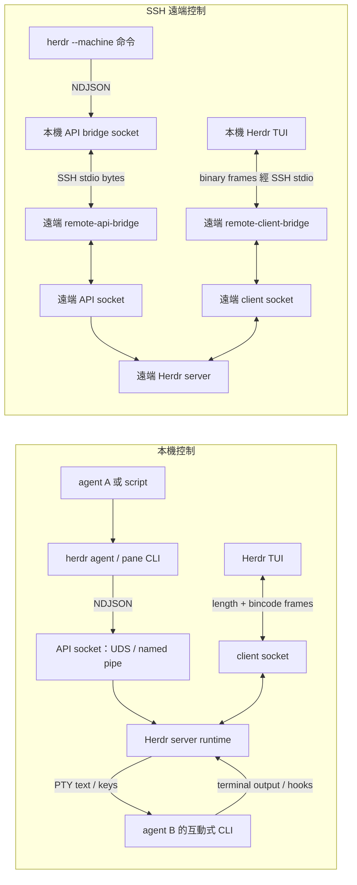

# Herdr 原始碼研究：遠端、多機與 agent 指揮

研究日期：2026-11-01。來源 checkout：`C:/Users/swche/orca/projects/orca_study/herdr`。固定 commit：`ee5bfb5041bb3e4a49d591c72308aae3c81ecdde`，commit 日期 2026-10-29；origin 為 `https://github.com/herdrdev/herdr.git`。研究前後未修改該 checkout。已讀根目錄 `AGENTS.md`；本工作只讀原始碼與文件，未執行遠端安裝、SSH 操作或 build。

## 判斷基準

- **官方已實作**：該 commit 的 Rust 原始碼與公開操作文件可以互相印證。
- **官方 stable 文件**：引用 `docs/versions/0.9.5/`。這些是 checkout 內的版本文件，不將 `docs/next` 草稿等同 stable。`Cargo.toml:3` 是 0.9.5；本地 `distribution/latest.json` 宣告 stable 0.9.5、protocol 22、endpoint generation 1。這只是固定 checkout 的狀態，沒有據此宣稱今天網站或 release 最新狀態。
- **推論／未見實作**：從已檢查的 method catalog、routing、request dispatch、prompt、event hub 推論；不把搜尋不到當成整個 ecosystem 不可能有外掛。
- **外掛／客製需求**：可建立在既有 API 上，但本研究未驗證第三方外掛的可靠性或維護狀況。

## 可直接用於比較的結論

| 問題 | 結論 | 類別 |
| --- | --- | --- |
| 一個 client 同時連 Local 與多台 Herdr server | 內建 saved SSH machines；每台機器維持自己的 server、session、process，斷一台不連帶斷其他台 | 官方已實作，stable 文件 |
| Windows client 用 SSH 連 Linux 執行 Claude Code | 支援；本機繪 TUI，Linux server 擁有 pane 與 agent process。SSH 功能不用第三方外掛；遠端仍須具備 Claude executable 與登入條件 | 官方已實作；實際環境未 smoke test |
| agent 控制其他 agent | CLI/API 可建立 workspace/pane、`agent start`、`prompt`、`send-keys`、`read`、`wait`，另一個 agent 可以呼叫同一組 CLI | 官方已實作 |
| 相同命令自動選本機或遠端 | 用全域 prefix `--machine <saved-profile>` 明確選遠端；沒有 prefix 就沿用呼叫 process 的 session/socket。TUI 選取不會改變既有 pane 裡 CLI 的目標 | 官方已實作 |
| 跨機建立／啟動 agent | 支援 `--machine … pane split`、`workspace create`、`worktree create`、`agent start`。`agent start` 需要已存在且回到 shell prompt 的 pane | 官方已實作 |
| durable task/message、agent inbox、完成 ACK、exactly-once delivery | 檢查的核心沒有這類 task/message method 或持久 delivery contract；有 API response、PTY 寫入完成回覆和 lifecycle wait，語意有限 | 推論；可靠 orchestration 需另加一層 |
| 跨 TUI／多 server 形成任意節點 mesh | CLI 一次指定一台 saved machine；官方明載 combined listings 與透過另一個 TUI 的連線 routing 不包含在內 | stable 文件明示 |
| Windows 原生 build | 已有 Rust MSVC + Zig + ConPTY 的原生路徑與 CI；並非僅 Linux/WSL 專案，也非只裝 Rust 就足夠 | 官方已實作，未在此機實測 build |

## 1. 多 client、多 server 與身分

官方 stable 文件寫明，一個視窗可切換 Local 與已儲存 SSH machines；每台機器有自己的 server、sessions 和 running processes。多個 Herdr clients 也能各自查看同一 server 的不同 tab。見 [connecting-machines.mdx:6-8](https://github.com/herdrdev/herdr/blob/ee5bfb5041bb3e4a49d591c72308aae3c81ecdde/docs/versions/0.9.5/website/src/content/docs/connecting-machines.mdx#L6)、[同檔:66](https://github.com/herdrdev/herdr/blob/ee5bfb5041bb3e4a49d591c72308aae3c81ecdde/docs/versions/0.9.5/website/src/content/docs/connecting-machines.mdx#L66)。

這是 client 管理多個獨立 runtime 的模型。程式中 `ClientEndpointId` 只有 `Local` 與 `Ssh(ProfileId)`，endpoint registry 用 `HashMap<ClientEndpointId, EndpointConnection>` 儲存連線。見 [src/client/endpoint.rs:73-88](https://github.com/herdrdev/herdr/blob/ee5bfb5041bb3e4a49d591c72308aae3c81ecdde/src/client/endpoint.rs#L73)、[src/client/endpoint/registry.rs:85-87](https://github.com/herdrdev/herdr/blob/ee5bfb5041bb3e4a49d591c72308aae3c81ecdde/src/client/endpoint/registry.rs#L85)。`AGENTS.md` 的相容性 guardrail 提到 Cloud，不足以證明此 commit 已提供另一個 Cloud endpoint backend；不可只憑該文字宣稱已有完整 cloud control plane。

身分分成三層：

1. **本機 saved profile**：32 位小寫十六進位 opaque ID，包含 label、SSH target、remote session、enabled。`ProfileId` 由 process id、時間、序號的 SHA-256 摘要取 16 bytes；這是 client 端 profile identity，不能當成全域 server、agent 或使用者身分。見 [src/client/endpoint.rs:25-59](https://github.com/herdrdev/herdr/blob/ee5bfb5041bb3e4a49d591c72308aae3c81ecdde/src/client/endpoint.rs#L25)、[src/client/endpoint/catalog.rs:18-40](https://github.com/herdrdev/herdr/blob/ee5bfb5041bb3e4a49d591c72308aae3c81ecdde/src/client/endpoint/catalog.rs#L18)。catalog 上限為 64 profiles，這是資料結構限制，不能當成 64 台效能保證，見同檔 :12-15。
2. **SSH 登入身分**：正常 OpenSSH authentication；profile 不儲存 password、private key、agent ticket。見 [stable connecting-machines.mdx:120](https://github.com/herdrdev/herdr/blob/ee5bfb5041bb3e4a49d591c72308aae3c81ecdde/docs/versions/0.9.5/website/src/content/docs/connecting-machines.mdx#L120)。catalog validator 也拒絕 SSH target 內嵌 password，見 [catalog.rs:61-69](https://github.com/herdrdev/herdr/blob/ee5bfb5041bb3e4a49d591c72308aae3c81ecdde/src/client/endpoint/catalog.rs#L61)。
3. **單一 server 內的 workspace/tab/pane 與 agent name**：兩台機器都能有 `w1:p1` 或 `reviewer`。agent name 只是目前 agent 在 pane 內的 alias，退出、釋放或替換會清除；名字須在 live agents 間唯一。見 [stable connecting-machines.mdx:116](https://github.com/herdrdev/herdr/blob/ee5bfb5041bb3e4a49d591c72308aae3c81ecdde/docs/versions/0.9.5/website/src/content/docs/connecting-machines.mdx#L116)、[stable agent-automation.mdx:36-40](https://github.com/herdrdev/herdr/blob/ee5bfb5041bb3e4a49d591c72308aae3c81ecdde/docs/versions/0.9.5/website/src/content/docs/agent-automation.mdx#L36)。

因此可把跨機 agent target 理解為 `(saved profile / remote session, server-local agent name or pane ID)`。這個 tuple 是依 routing 行為整理的推論，公開 JSON Request 沒有一個統一 global agent URI。

## 2. API 與遠端 routing 的實際路徑

本機 API 是 newline-delimited JSON，Unix 用 Unix domain socket，Windows 用 named pipe。請求是 `{id, method, params}`；成功和可解析的失敗會 echo `id`。見 [stable socket-api.mdx:608-654](https://github.com/herdrdev/herdr/blob/ee5bfb5041bb3e4a49d591c72308aae3c81ecdde/docs/versions/0.9.5/website/src/content/docs/socket-api.mdx#L608)、[src/api/schema.rs:36-41](https://github.com/herdrdev/herdr/blob/ee5bfb5041bb3e4a49d591c72308aae3c81ecdde/src/api/schema.rs#L36)、[src/ipc.rs:39-55](https://github.com/herdrdev/herdr/blob/ee5bfb5041bb3e4a49d591c72308aae3c81ecdde/src/ipc.rs#L39)。

實際 `herdr --machine linux agent prompt reviewer "..." --wait` 路徑：

```text
同一組 CLI parser / agent command
  -> --machine 解析 saved profile，建立 command-local TargetScope
  -> ApiClient 指向本機 temporary bridge socket / named pipe
  -> SSH stdio bridge
  -> remote `herdr --session <saved-session> remote-api-bridge`
  -> 遠端 Herdr session 的本機 JSON API socket
  -> 同一組 agent.prompt handler -> 遠端 pane 的 PTY
```

- `maybe_run` 取出 machine prefix、載入 catalog、建立 `TargetScope`，再對去掉 prefix 的 args 呼叫原本 `super::maybe_run`，見 [src/cli/target.rs:27-54](https://github.com/herdrdev/herdr/blob/ee5bfb5041bb3e4a49d591c72308aae3c81ecdde/src/cli/target.rs#L27)。
- `api_client()` 沒有 target 就 `ApiClient::local()`；有 target 就建立 `SavedSshApiBridge`，改用 `ConnectionTarget::SocketPath(bridge.socket_path())`。見 [target.rs:66-100](https://github.com/herdrdev/herdr/blob/ee5bfb5041bb3e4a49d591c72308aae3c81ecdde/src/cli/target.rs#L66)。共用 `send_request` 先檢查 server compatibility，再 `client.request_value(request)`，見 [src/cli.rs:775-787](https://github.com/herdrdev/herdr/blob/ee5bfb5041bb3e4a49d591c72308aae3c81ecdde/src/cli.rs#L775)。
- bridge 從 profile target/session 找遠端 executable，建立本機 endpoint，再啟動 SSH command，見 [src/remote/saved.rs:69-113](https://github.com/herdrdev/herdr/blob/ee5bfb5041bb3e4a49d591c72308aae3c81ecdde/src/remote/saved.rs#L69)。遠端命令明確帶 session 和 `remote-api-bridge`，見 [src/remote/attach.rs:2915-2941](https://github.com/herdrdev/herdr/blob/ee5bfb5041bb3e4a49d591c72308aae3c81ecdde/src/remote/attach.rs#L2915)。
- 遠端 `run_remote_api_bridge` 接上 `crate::api::socket_path()`，將 stdio 轉送該 stream，見 [src/remote.rs:15-32](https://github.com/herdrdev/herdr/blob/ee5bfb5041bb3e4a49d591c72308aae3c81ecdde/src/remote.rs#L15)。這條路徑沒有開放 HTTP/REST listener。

**遠端 start / send 確實支援。** `validate_machine_command` 接受所有 agent subcommands，僅排除 interactive `attach` 和本機 `explain --file`；也接受 workspace/worktree/tab/pane/notification、部分 plugin/server commands。見 [target.rs:291-318](https://github.com/herdrdev/herdr/blob/ee5bfb5041bb3e4a49d591c72308aae3c81ecdde/src/cli/target.rs#L291)。共用 dispatch 明列 Start、Prompt、SendKeys、Read、Wait，見 [src/cli/agent.rs:52-63](https://github.com/herdrdev/herdr/blob/ee5bfb5041bb3e4a49d591c72308aae3c81ecdde/src/cli/agent.rs#L52)；`agent start` 發 `Method::AgentStart`，見同檔 :283-292。

官方 stable 文件對這些限制也講得明確：[cli-reference.mdx:70-85](https://github.com/herdrdev/herdr/blob/ee5bfb5041bb3e4a49d591c72308aae3c81ecdde/docs/versions/0.9.5/website/src/content/docs/cli-reference.mdx#L70)。其中包括：

- selector 必須是 enabled saved profile ID 或唯一、區分大小寫的 label；不能直接填任意 SSH hostname。
- `--machine` 不能和 `--session` / `--remote` 混用，session 來自 saved profile。
- 不需要開 TUI；JSON payload 不插入 SSH shell command；bridge 不安裝、不啟動、不重啟 remote server。
- 失敗不 fallback Local；`--current` 不會把本機 caller pane 帶到遠端。
- 一次 prefix 指定一台 machine；沒有 combined listings，也沒有透過另一個 TUI 的 connections 路由。

**對 agent A 指揮遠端 agent B 的含義：** A 所在 process 可以呼叫這套 CLI，但執行 CLI 的主機必須有自己的 saved profile 與可用 SSH authentication。Windows TUI 裡保存的遠端連線不會自動變成 Linux pane 裡 agent 可用的 routing catalog。這是從 command-local catalog/bridge 和上列禁止跨 TUI routing 的契約推論而來；需要雙向 A↔B 時，要分別配置路由，或自己實作 coordinator。

## 3. Windows client → SSH Linux → Claude Code

此工作流為官方內建。stable 文件支援 Linux/macOS/Windows clients 連 Linux/macOS x86_64 或 aarch64 servers，以及 Windows x86_64 servers。遠端 server 持有 pane 與 session state，本機 client 繪 UI。見 [stable persistence-remote.mdx:46-80](https://github.com/herdrdev/herdr/blob/ee5bfb5041bb3e4a49d591c72308aae3c81ecdde/docs/versions/0.9.5/website/src/content/docs/persistence-remote.mdx#L46)、[stable windows-beta.mdx:28-50](https://github.com/herdrdev/herdr/blob/ee5bfb5041bb3e4a49d591c72308aae3c81ecdde/docs/versions/0.9.5/website/src/content/docs/windows-beta.mdx#L28)。

兩個入口都內建：

```text
herdr --remote workbox
herdr machine add workbox --label linux --remote-session agents
herdr --machine linux agent list
herdr --machine linux agent start worker --kind claude --pane <remote-shell-pane-id>
herdr --machine linux agent prompt worker "完成指定工作並回報" --wait --timeout 120000
herdr --machine linux agent read worker --source recent-unwrapped --lines 120
```

這些是說明語法，未實際執行。`agent start` 必須有現存且回到互動 shell prompt 的 pane；可先用相同 `--machine` prefix 建 workspace 或 split pane，取 JSON 回傳的真實 ID。它不會自己建立 layout。`claude` 是受支援 kind，見 [stable agent-automation.mdx:16-18、36-46](https://github.com/herdrdev/herdr/blob/ee5bfb5041bb3e4a49d591c72308aae3c81ecdde/docs/versions/0.9.5/website/src/content/docs/agent-automation.mdx#L16)。

Herdr 不把本機 executables、config 或 secrets 複製到遠端；遠端 agent executable 與憑證須在遠端可用，見 [stable connecting-machines.mdx:112](https://github.com/herdrdev/herdr/blob/ee5bfb5041bb3e4a49d591c72308aae3c81ecdde/docs/versions/0.9.5/website/src/content/docs/connecting-machines.mdx#L112)。缺 Herdr 時，interactive remote attach/setup 可以詢問後安裝；背景 reconnect 只 discover installed package。這不等於替你安裝或登入 Claude。

Windows OpenSSH 沒有 Unix client 的 per-attach ControlMaster socket reuse，見 [stable persistence-remote.mdx:78](https://github.com/herdrdev/herdr/blob/ee5bfb5041bb3e4a49d591c72308aae3c81ecdde/docs/versions/0.9.5/website/src/content/docs/persistence-remote.mdx#L78)。saved-machine 的 shared SSH authentication recovery 在 Windows client 尚未支援，見 [stable connecting-machines.mdx:12-16](https://github.com/herdrdev/herdr/blob/ee5bfb5041bb3e4a49d591c72308aae3c81ecdde/docs/versions/0.9.5/website/src/content/docs/connecting-machines.mdx#L12)。這些限制不會取消基本 Windows→Linux remote attach 支援。

不要把 **full Herdr remote TUI attach** 和 **direct terminal attach** 混淆。後者 `agent attach` / direct terminal session 在 native Windows 尚未提供，stable 文件明列 [persistence-remote.mdx:115-117](https://github.com/herdrdev/herdr/blob/ee5bfb5041bb3e4a49d591c72308aae3c81ecdde/docs/versions/0.9.5/website/src/content/docs/persistence-remote.mdx#L115)。

## 4. Agent 協作、task delegation 與 ACK 的界線

官方 stable automation 文件直接說，腳本或另一個 agent 可以建立工作、查看狀態、收集結果。它的三個 primitive 是 Layout、Pane、Agent。見 [agent-automation.mdx:6-18](https://github.com/herdrdev/herdr/blob/ee5bfb5041bb3e4a49d591c72308aae3c81ecdde/docs/versions/0.9.5/website/src/content/docs/agent-automation.mdx#L6)。核心 method catalog 有 agent start/prompt/send_keys/read/wait 與 events subscribe/wait，沒有 task.create/claim/complete、message.send/receive/ack 一類 method。見 [src/api/schema.rs:45-148](https://github.com/herdrdev/herdr/blob/ee5bfb5041bb3e4a49d591c72308aae3c81ecdde/src/api/schema.rs#L45)。

三種「回覆」必須分開：

| 機制 | 可以證明什麼 | 不能據此承諾什麼 |
| --- | --- | --- |
| API response 的 request `id` | response 對應哪個 request；成功或錯誤由該 API handler 回覆 | idempotency key、唯一 delivery ID、durable receipt |
| `agent prompt` 成功 | prompt text 和 encoded Enter 以 ordered submission 寫入 PTY 完成 | LLM 收到獨立任務、理解內容、開始正確 turn、完成工作 |
| `agent prompt --wait` / `agent wait` | 指定 live agent occupant 到達 lifecycle state | 對應本次 prompt 的 task 完成、結構化結果或任務成功 |

`AgentPromptParams` 只有 target、text、可選 wait；`AgentStartParams` 只有 name/kind/pane/args/timeout，見 [src/api/schema/agents.rs:184-207](https://github.com/herdrdev/herdr/blob/ee5bfb5041bb3e4a49d591c72308aae3c81ecdde/src/api/schema/agents.rs#L184)。這些欄位沒有 task/message identity、delivery attempt 或 application ACK。

PTY 寫入 ACK 的原始碼證據：`submit_agent_prompt` 將 text、Enter、delay 和 deadline 交給 `queue_user_input_submission`，取得 completion receiver；deferred handler 等 `completion.recv()` 成功才回 `AgentPrompted`，見 [src/app/api/agents.rs:99-117](https://github.com/herdrdev/herdr/blob/ee5bfb5041bb3e4a49d591c72308aae3c81ecdde/src/app/api/agents.rs#L99)、[同檔:250-268](https://github.com/herdrdev/herdr/blob/ee5bfb5041bb3e4a49d591c72308aae3c81ecdde/src/app/api/agents.rs#L250)。

`--wait` 已做合理的 race 防護：先讀 agent、保存 event sequence，再送 prompt，核對 terminal/name/kind occupant；若起始非 working，要求五秒內觀察到 working/blocked，否則 `agent_prompt_stalled`。見 [src/api/wait.rs:196-275](https://github.com/herdrdev/herdr/blob/ee5bfb5041bb3e4a49d591c72308aae3c81ecdde/src/api/wait.rs#L196)。但 stable 文件明載**不追蹤 individual turns**；如果本來已 working，既有 turn 完成就可能滿足 wait。`blocked` 也在預設 settled states 內，因此成功等到 settled 不等於任務成功。見 [stable agent-automation.mdx:72-82](https://github.com/herdrdev/herdr/blob/ee5bfb5041bb3e4a49d591c72308aae3c81ecdde/docs/versions/0.9.5/website/src/content/docs/agent-automation.mdx#L72)。

### Request 去重、斷線與重送

核心未見 request-id 去重 cache 或 durable receipt ledger。這是以下已檢查路徑的結論：

- CLI 的 prompt request 固定用 `id: "cli:agent:prompt"`，send-keys 固定用另一字串；可重複呼叫，顯示 `id` 為 correlation 而非一次性 delivery token。見 [src/cli/agent.rs:595-608](https://github.com/herdrdev/herdr/blob/ee5bfb5041bb3e4a49d591c72308aae3c81ecdde/src/cli/agent.rs#L595)。
- `ApiClient.request_value` 每次連線、write request、read response；server 解析每個新 connection 的 request 後直接進入 method handler/dispatch，沒有按 `id` 取既有 response 的分支。見 [src/api/client.rs:55-60](https://github.com/herdrdev/herdr/blob/ee5bfb5041bb3e4a49d591c72308aae3c81ecdde/src/api/client.rs#L55)、[src/api/server.rs:341-382](https://github.com/herdrdev/herdr/blob/ee5bfb5041bb3e4a49d591c72308aae3c81ecdde/src/api/server.rs#L341)、[同檔:461-518](https://github.com/herdrdev/herdr/blob/ee5bfb5041bb3e4a49d591c72308aae3c81ecdde/src/api/server.rs#L461)。server comment 的「duplicate IDs」是在拒絕單一 JSON 裡模糊重複欄位，不是跨 request 去重。
- routing code 明確註解，只能重試 read-only probe；後續 request 遇到模糊 SSH failure 絕不 replay，見 [src/cli/target.rs:117-148](https://github.com/herdrdev/herdr/blob/ee5bfb5041bb3e4a49d591c72308aae3c81ecdde/src/cli/target.rs#L117)。stable 文件同樣宣告不自動 retry request，且 timeout/stalled 不證明 input 沒送出，見 [cli-reference.mdx:83](https://github.com/herdrdev/herdr/blob/ee5bfb5041bb3e4a49d591c72308aae3c81ecdde/docs/versions/0.9.5/website/src/content/docs/cli-reference.mdx#L83)、[agent-automation.mdx:82](https://github.com/herdrdev/herdr/blob/ee5bfb5041bb3e4a49d591c72308aae3c81ecdde/docs/versions/0.9.5/website/src/content/docs/agent-automation.mdx#L82)。

因此無法用 Herdr 核心承諾持久 delivery、at-least-once 或 exactly-once 任務執行；應用層若自行盲目重送，可能重複輸入。需要先查遠端狀態，或自行加 task ID、收件箱／結果儲存、去重與完成確認。

### Event stream 持久性

`EventHub` 是 `Arc<Mutex<EventHubState>>`，state 裡只有 sequence 與記憶體 `Vec`，最多 **512 events**，超出直接 drain 舊事件。見 [src/api/event_hub.rs:1-30](https://github.com/herdrdev/herdr/blob/ee5bfb5041bb3e4a49d591c72308aae3c81ecdde/src/api/event_hub.rs#L1)。

官方 stable 文件直接宣告 event history 不持久，新訂閱不 replay 先前事件；subscriber 落後時回 `events_lost` 並關該 connection，需要重新 subscribe 加 snapshot reconciliation。snapshot 與 event 沒有共同 sequence boundary；恢復的是現在狀態，無法復原遺失歷史。見 [socket-api.mdx:789-817](https://github.com/herdrdev/herdr/blob/ee5bfb5041bb3e4a49d591c72308aae3c81ecdde/docs/versions/0.9.5/website/src/content/docs/socket-api.mdx#L789)。

**比較用語建議：** Herdr 內建「可被 agent 呼叫的跨機終端／agent 控制 primitive」，可以做 delegation；「具 durable mailbox、task DAG、claim/ack、重送去重的協作協定」需要額外 coordinator/外掛。後一句是需求 gap 推論，不是宣稱官方永遠不做或第三方完全不存在。

## 5. Windows Rust build 與平台界線

這個 checkout 已有 native Windows 實作、stable channel 和 CI。stable Windows 文件宣告 generally available、使用 ConPTY；不應再用歷史上 preview-only 的說法概括整個產品。見 [stable windows-beta.mdx:6-24](https://github.com/herdrdev/herdr/blob/ee5bfb5041bb3e4a49d591c72308aae3c81ecdde/docs/versions/0.9.5/website/src/content/docs/windows-beta.mdx#L6)。

原始碼建置依賴：

- Rust 2021 專案；CI 固定 Rust **1.96.1**，此數字是 CI toolchain，不能推成已宣告 MSRV。見 [Cargo.toml:1-5](https://github.com/herdrdev/herdr/blob/ee5bfb5041bb3e4a49d591c72308aae3c81ecdde/Cargo.toml#L1)、[.github/workflows/ci.yml:12-19](https://github.com/herdrdev/herdr/blob/ee5bfb5041bb3e4a49d591c72308aae3c81ecdde/.github/workflows/ci.yml#L12)。
- vendored `libghostty-vt` 由 Cargo build script 執行 `zig build`，錯誤訊息明定 **Zig 0.16.0**，可用 `ZIG` 指定路徑。支援 `x86_64-pc-windows-msvc` 和 `aarch64-pc-windows-msvc` target mapping；不代表 ARM64 stable package、整套 runtime 或所有測試都同等支援。見 [crates/ghostty-vt/build.rs:6-18](https://github.com/herdrdev/herdr/blob/ee5bfb5041bb3e4a49d591c72308aae3c81ecdde/crates/ghostty-vt/build.rs#L6)、[同檔:72-115](https://github.com/herdrdev/herdr/blob/ee5bfb5041bb3e4a49d591c72308aae3c81ecdde/crates/ghostty-vt/build.rs#L72)。
- native Windows 使用 Visual Studio Build Tools 的 SDK；Unix cross-compile 用 xwin 下載 SDK/CRT，再 `just setup-windows-cross`，見 [CONTRIBUTING.md:122-137](https://github.com/herdrdev/herdr/blob/ee5bfb5041bb3e4a49d591c72308aae3c81ecdde/CONTRIBUTING.md#L122)。
- Windows `just build` 呼叫 Python ConPTY package helper，Windows lint/check 呼叫 PowerShell script；不是單一純 Rust binary 的完整發行流程。見 [justfile:38-41、70-89](https://github.com/herdrdev/herdr/blob/ee5bfb5041bb3e4a49d591c72308aae3c81ecdde/justfile#L70)。Windows CI 有 `cargo build --locked --target x86_64-pc-windows-msvc`，見 [ci.yml:277-278](https://github.com/herdrdev/herdr/blob/ee5bfb5041bb3e4a49d591c72308aae3c81ecdde/.github/workflows/ci.yml#L277)。
- 正式 Windows release 必須是 zip，含 `herdr.exe` 和 app-local ConPTY runtime，不能只發 bare executable，見 [AGENTS.md:307-315](https://github.com/herdrdev/herdr/blob/ee5bfb5041bb3e4a49d591c72308aae3c81ecdde/AGENTS.md#L307)。

使用上的重要限制來自官方 stable 文件：direct terminal attach 無 native Windows；插件仍標 preview/best-effort，Unix shell commands 要 Windows 替代；live cwd 的一般 process inspection、CJK IME anchoring 和某些 cursor/clipboard/graphics 行為仍有限制。見 [windows-beta.mdx:46、65-98、104-112](https://github.com/herdrdev/herdr/blob/ee5bfb5041bb3e4a49d591c72308aae3c81ecdde/docs/versions/0.9.5/website/src/content/docs/windows-beta.mdx#L65)。若 pane 與 Claude 在 Linux server，主要 agent/process runtime 在 Linux，但本機 Windows TUI、OpenSSH 和外層 terminal 的限制仍適用。

## 驗證範圍

這是固定 commit 的靜態 source/document audit。沒有在 Windows 完成編譯，也沒有真實 Windows→Linux SSH→Claude 的連線、延遲、CPU/RAM 或可靠性測試。因此「官方支援／程式碼已實作」與「在使用者機器上實測通過」需分開表述。

## 6. 補充：TUI、CLI、SSH 與 web serve 的 protocol 分層

本段仍只描述固定 commit 的 **Herdr terminal repo**，不涵蓋另行發行的 Herdr App / `herdr-core hc`，也不能把 App 的 parent/child/message 功能套到這份 TUI 原始碼。

### 6.1 同一套 runtime 有兩個不同 endpoint

| 使用入口 | 傳輸 socket | 應用協定 | 相容性判斷 |
| --- | --- | --- | --- |
| 一般 automation CLI，例如 `herdr agent prompt` | JSON API socket；Unix UDS / Windows named pipe | 一行 JSON request、一行 JSON response；events 可長連線串流 | 目前共用 `send_request` 先 ping，要求 `PROTOCOL_VERSION` 整數相等 |
| 完整 Herdr TUI，本機或 SSH | client protocol socket，與 API socket 不同 | 4-byte little-endian length + bincode message；部分控制內容是嵌入的 JSON string | stable endpoint generation 1，協商命名 core codecs、methods、capabilities |
| direct terminal attach / internal operations | client / internal 路徑 | binary framed message；direct terminal 使用 `TerminalHello` | private numbered protocol，目前 22 |

兩個 local sockets 是刻意區分：client socket 從 API socket path 衍生，例如 `herdr.sock` 對應 `herdr-client.sock`。見 [src/server/socket_paths.rs:14-23、50-57](https://github.com/herdrdev/herdr/blob/ee5bfb5041bb3e4a49d591c72308aae3c81ecdde/src/server/socket_paths.rs#L14)。API server 綁 `socket_path()` 的 local listener，見 [src/api/server.rs:81-93](https://github.com/herdrdev/herdr/blob/ee5bfb5041bb3e4a49d591c72308aae3c81ecdde/src/api/server.rs#L81)。完整 TUI 的 `attach_request.is_none()` 會啟用 client-rendered shell，見 [src/client/mod.rs:188-203](https://github.com/herdrdev/herdr/blob/ee5bfb5041bb3e4a49d591c72308aae3c81ecdde/src/client/mod.rs#L188)。



圖中的兩條 SSH bridge 保持各自 payload；SSH 是承載 bytes 的加密／驗證通道，不會把所有上層訊息統一改成 JSON。

### 6.2 TUI：JSON 握手內容包在 binary frame 裡

`protocol::write_message` 的實作先 `bincode::serde::encode_to_vec(..., bincode::config::standard())`，再寫 `u32::to_le_bytes()` 的長度、payload、flush。讀取反向執行，限制長度並拒絕 trailing bytes。見 [src/protocol/wire.rs:1656-1709](https://github.com/herdrdev/herdr/blob/ee5bfb5041bb3e4a49d591c72308aae3c81ecdde/src/protocol/wire.rs#L1656)。

stable endpoint hello 為 `ClientMessage::EndpointControl { kind: "endpoint.hello.v1", data: serde_json::to_string(&hello) }`，然後仍由 `protocol::write_message` 發出；welcome 同樣從 `ServerMessage::EndpointControl` 的 JSON `data` 解碼。見 [src/client/handshake.rs:190-231](https://github.com/herdrdev/herdr/blob/ee5bfb5041bb3e4a49d591c72308aae3c81ecdde/src/client/handshake.rs#L190)、[同檔:241-286](https://github.com/herdrdev/herdr/blob/ee5bfb5041bb3e4a49d591c72308aae3c81ecdde/src/client/handshake.rs#L241)。因此「JSON handshake」指內層 schema，不能把它說成直接在 socket 上傳 NDJSON。

generation 1 命名 core codecs 是 `shell.snapshot.v1`、`shell.surface.v1`、`shell.input.semantic.v1`、`shell.blob.v1`。hello 廣告可支援的 codecs；welcome 回選定 codec、server version、methods、capabilities。見 [src/protocol/endpoint.rs:15-29](https://github.com/herdrdev/herdr/blob/ee5bfb5041bb3e4a49d591c72308aae3c81ecdde/src/protocol/endpoint.rs#L15)、[同檔:46-106](https://github.com/herdrdev/herdr/blob/ee5bfb5041bb3e4a49d591c72308aae3c81ecdde/src/protocol/endpoint.rs#L46)。snapshot 本身也可以是 `EndpointControl` 裡的 JSON string，見同檔 :109-113；TUI 發某些 API operation 時也把 JSON Request 包在 `ClientShellEndpointRequest`，見 [src/client/endpoint/activation/protocol.rs:233-241](https://github.com/herdrdev/herdr/blob/ee5bfb5041bb3e4a49d591c72308aae3c81ecdde/src/client/endpoint/activation/protocol.rs#L233)。

**stable generation 和 binary encoding 可以並存。** 穩定性靠凍結已發表 bincode enum tag／payload、core codec，以及可擴充 JSON/control fields；並非因為完全避開 binary。`EndpointControl` 的 bincode tag 和兩個 string payload 被註解為 generation 1 contract，見 [src/protocol/wire.rs:612-616](https://github.com/herdrdev/herdr/blob/ee5bfb5041bb3e4a49d591c72308aae3c81ecdde/src/protocol/wire.rs#L612)。

private direct-terminal handshake 則送 `TerminalHello { version: PROTOCOL_VERSION, ... }`，server 會做 private version check；stable endpoint 分支檢查 generation 與 required codecs。見 [src/client/handshake.rs:221-229](https://github.com/herdrdev/herdr/blob/ee5bfb5041bb3e4a49d591c72308aae3c81ecdde/src/client/handshake.rs#L221)、[src/server/client_transport.rs:716-773](https://github.com/herdrdev/herdr/blob/ee5bfb5041bb3e4a49d591c72308aae3c81ecdde/src/server/client_transport.rs#L716)。目前 private `PROTOCOL_VERSION = 22`，見 [src/protocol/wire.rs:1-20](https://github.com/herdrdev/herdr/blob/ee5bfb5041bb3e4a49d591c72308aae3c81ecdde/src/protocol/wire.rs#L1)。

### 6.3 SSH：TUI 與 automation CLI 使用不同 bridge

- **TUI 路徑**：remote `remote-client-bridge` 接 `client_socket_path()`，再 `forward_remote_bridge_stdio`；bridge 本身不 JSON decode/re-encode。見 [src/remote/host.rs:6-37](https://github.com/herdrdev/herdr/blob/ee5bfb5041bb3e4a49d591c72308aae3c81ecdde/src/remote/host.rs#L6)。Unix 實作把 stdin bytes copy 到 socket、socket bytes copy 到 stdout，見 [src/platform/unix_common.rs:223-243](https://github.com/herdrdev/herdr/blob/ee5bfb5041bb3e4a49d591c72308aae3c81ecdde/src/platform/unix_common.rs#L223)。所以本機和 SSH TUI 使用相同 framed binary / stable endpoint contract，SSH 多了 byte bridge。
- **CLI 路徑**：`ApiClient` 寫 `serde_json::to_string(request)` 再 `\n`，讀一行 JSON。見 [src/api/client.rs:55-60、185-189、222-225](https://github.com/herdrdev/herdr/blob/ee5bfb5041bb3e4a49d591c72308aae3c81ecdde/src/api/client.rs#L185)。遠端 `remote-api-bridge` 接 API socket 而非 client socket，見 [src/remote.rs:15-28](https://github.com/herdrdev/herdr/blob/ee5bfb5041bb3e4a49d591c72308aae3c81ecdde/src/remote.rs#L15)。因此 NDJSON 經 SSH stdio 持續保持 NDJSON。

另有一項容易漏掉的差異：完整 TUI endpoint 可以跨不同 Herdr build，只要 generation/core codecs 相容；但目前 automation CLI `send_request` 會先 ping，`protocol_guard` 要求 client/server private protocol 整數相等，不同即回 `protocol_mismatch`。見 [src/cli.rs:775-806](https://github.com/herdrdev/herdr/blob/ee5bfb5041bb3e4a49d591c72308aae3c81ecdde/src/cli.rs#L775)、[src/cli/protocol_guard.rs:16-40](https://github.com/herdrdev/herdr/blob/ee5bfb5041bb3e4a49d591c72308aae3c81ecdde/src/cli/protocol_guard.rs#L16)。這不要求兩端 patch version 一定一樣，但不能說 TUI 握手相容就保證所有 CLI 操作相容。

### 6.4 CLI 與另一個 CLI 沒有直接 peer protocol；本 repo 無內建 web serve

此處有兩種「CLI」：`herdr agent prompt ...` 是短生命週期 API client；Claude/Codex 是 server 管理的互動 terminal process。agent A 呼叫 Herdr CLI 後，由 server 找 agent B、把 prompt 和 Enter 寫進 B 的 PTY，再靠 terminal output / lifecycle report 判斷狀態。證據為 [src/cli/agent.rs:595-608](https://github.com/herdrdev/herdr/blob/ee5bfb5041bb3e4a49d591c72308aae3c81ecdde/src/cli/agent.rs#L595)、[src/app/api/agents.rs:228-268](https://github.com/herdrdev/herdr/blob/ee5bfb5041bb3e4a49d591c72308aae3c81ecdde/src/app/api/agents.rs#L228)。

因此這裡的 agent 間控制由 Herdr server 中介，並非 Claude CLI 與 Codex CLI 互相實作 Herdr peer-to-peer/A2A/MCP 訊息協定。agent 使用檔案或自己的機制交換結果仍可行，但不是這條 Herdr core protocol 自帶的 delivery contract。

固定 commit 的公開 CLI command tree 有 server、api、machine、workspace、agent、pane、terminal 等，**沒有 `web` 或 `serve` subcommand**，見 [src/cli/spec.rs:8-49](https://github.com/herdrdev/herdr/blob/ee5bfb5041bb3e4a49d591c72308aae3c81ecdde/src/cli/spec.rs#L8)。API server 實際綁 local socket，並非 HTTP listener，見 `src/api/server.rs:87-93`。搜尋 `src/` 也未見 HTTP/WebSocket UI server 實作。因此對這個 TUI repo 可說「未提供內建 browser web serve」；其他獨立 App 或第三方 gateway 必須另查，不能從此結論推成整個 Herdr 生態都沒有 Web UI。
