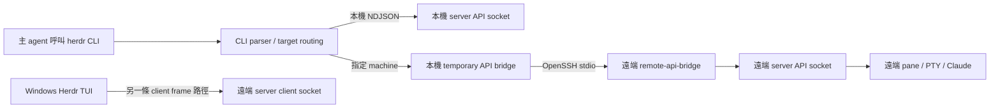
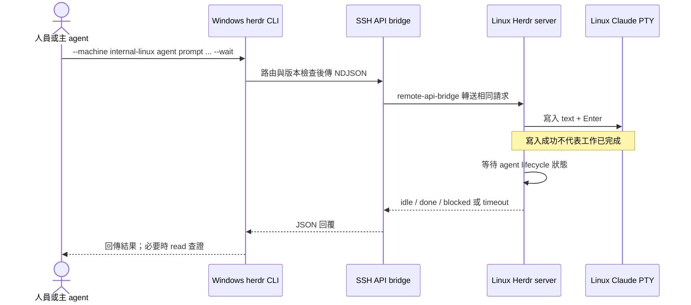
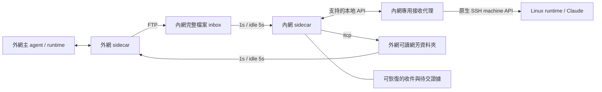
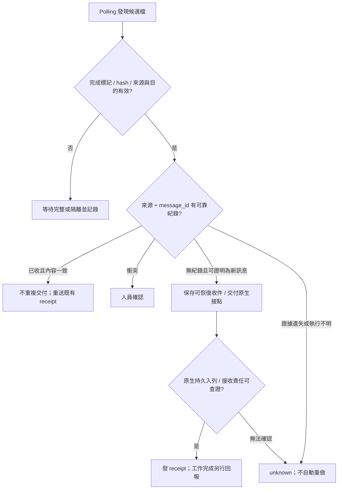
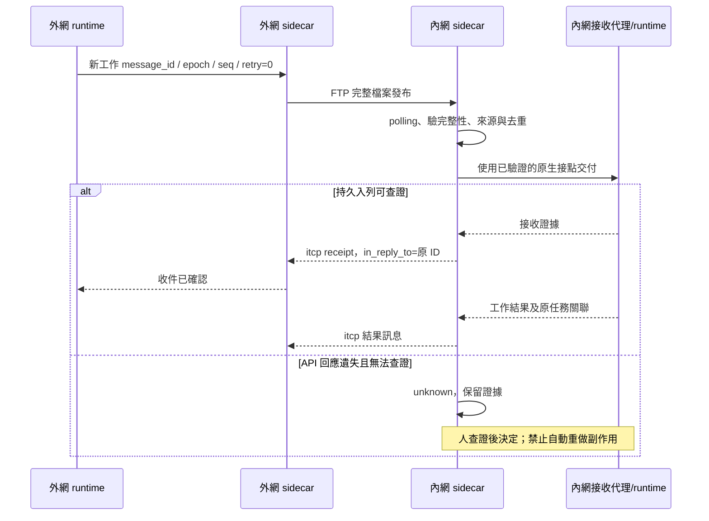
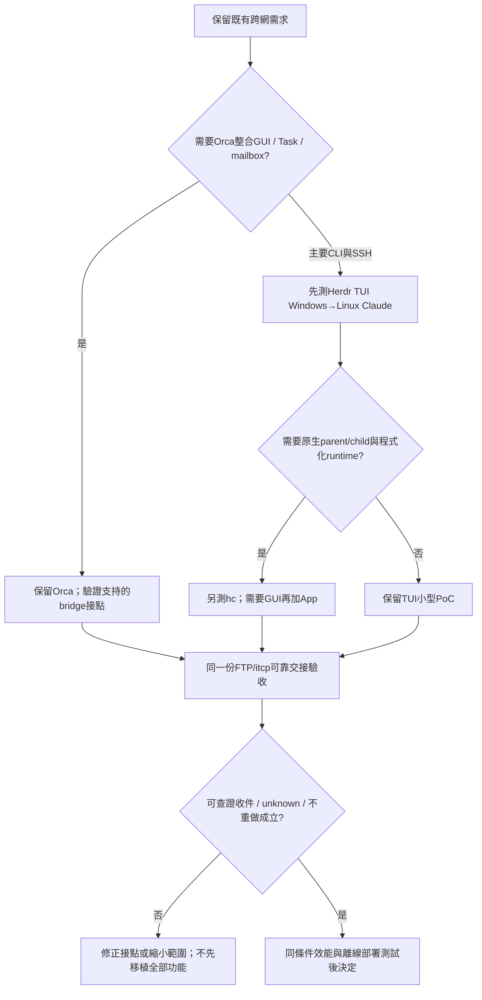

# 公司跨網 agent runtime 選型：Herdr、Herdr App/Core 與 Orca

研究日期：2026-11-01。本文以既有 Markdown、SVG 所記錄的需求為主軸，回答多主機、SSH Linux Claude、agent 指揮、FTP／itcp 適配、部署、協定、效能及維護差異。所有「建議」均為提案；本次沒有實測公司網路、執行產品 build 或量測同條件效能。

上傳查核補註：研究時讀取的本機主設計是3.0加review補強的副本；上傳時GitHub已有3.1主設計與驗收文件。本文是選型研究，不取代現行[主設計](orca-cross-network-mail-design.md)及[驗收規格](orca-bridge-acceptance.md)；實作時以遠端現行版本為準。

## 1. 從現有文件辨識的討論主題

依據 [handoff](handoff.md)、[主設計書](orca-cross-network-mail-design.md)、[Orca 原生架構](orca-native-architecture.md)、兩份歷史研究，以及 [架構 SVG](orca-architecture.svg)、[設定 SVG](orca-bridge-settings.svg)，目前要選的是：**能保留原生 agent 管理與人員操作，透過公司既有檔案通道協作，且在公司容易部署與維護的 runtime。**這是對文件的整理，新增產品偏好仍屬待決策。

| 已確定的需求 | 討論及驗收焦點 |
| --- | --- |
| 外→內 FTP；內→外 itcp；外網讀網芳 | 雙向非同步工作訊息，無直接跨網 SSH／WebSocket 前提 |
| 同一程式用設定區分兩端 | 收件、發送、路由分開配置，多個受託節點 |
| active 1 秒、idle 5 秒，可設定 | 輕量、不重疊掃描、對端失敗不阻塞其他節點 |
| seq 只記 log，按收到順序處理 | 不等缺號、不拿 native event sequence 當外層訊息序號 |
| 同 ID／seq 重送，retry 增加 | 去重、完整檔案發布、receipt 與工作完成分開 |
| 不額外保存 seq，重啟後同步 | 無證據時新 epoch；未知執行狀態由人決定，不能自動重做 |
| 一個主 agent 指揮多個 agent | 儘量使用產品原生協作與權限，避免重造 orchestration |
| 內網 Windows 有畫面；Linux 只 SSH | Windows 操作 Linux Claude；若用 browser 需另有允許的連線 |
| 公司開發與部署 | portable／離線依賴、Windows SDK、可維護的適配點 |
| 人可以繼續操作 | 工作目標、輸入與 ACK 所有權清楚，不與 bridge 競爭 |

歷史稿不是最終需求來源。例如永久 seq、固定不變的 retry bytes 和 Ed25519 不能因為出現在舊研究就視為已採納。

## 2. 先分清楚三個 Herdr 元件

**Herdr TUI、Herdr App 不是單純同一套程式的文字版與圖形版。App 使用獨立的 herdr-core，指令是 `hc`。**因此「Herdr CLI」有歧義，必須指明 `herdr ...` 還是 `hc ...`。

| 項目 | `herdr` TUI/CLI | `herdr-core`／`hc` | `herdr-app` |
| --- | --- | --- | --- |
| repo | herdrdev/herdr | herdrdev/herdr-core | herdrdev/herdr-app |
| 角色 | TUI、多 pane、CLI 自動化及自己的 server | 無畫面的 terminal／agent runtime，提供 CLI/API | 桌面畫面；使用 hc 執行工作 |
| UI | 終端內 sidebar、滑鼠、鍵盤、分割 | 不繪 UI，可 attach/read | 原生 GUI、space/tab/pane、agent sidebar、peek |
| runtime | Herdr server | core + terminal holders | 由 herdr-core 持有工作 |
| agent 協作 | start、prompt、read、wait；狀態 detection/integration | parent/child、send、wait children、attention notes | 呈現 core 的 agent／workers，另有操控畫面的 CLI |
| 狀態來源 | hooks、自回報、畫面／程序偵測等 | 程式透過 OSC 7501 回報；core 不猜畫面 | 顯示 core 的回報狀態 |
| 視窗關閉 | server/agent 可繼續跑 | 沒有視窗 | 關視窗後 core 繼續跑；關 pane/tab 會結束其工作 |
| 能否互換 API | 不應假定 | 不應假定 | App 的畫面命令不取代 hc 工作命令 |

App 的 mods 是可信任的 JavaScript 程式，官方明示不是 sandboxed extensions；發布版 telemetry 預設開啟，可在 Privacy 關閉。這些是 App 的特性，不能套用到 TUI。App 的 Linux GUI 需要桌面與 Vulkan；SSH-only Linux 應跑 core/runtime，不需要在 Linux 跑 GUI。

來源：[TUI README](https://github.com/herdrdev/herdr/blob/ee5bfb5041bb3e4a49d591c72308aae3c81ecdde/README.md)、[App README](https://github.com/herdrdev/herdr-app/blob/1581a587919dddd6f1efd5f78eb542c4b2b02cb5/README.md)、[Core README](https://github.com/herdrdev/herdr-core/blob/7a54c2975225a859b7e7d67302df5efc249fb9d0/README.md)。

### 版本及研究範圍

- 本地 `./herdr` 實際找到的位置是 `C:/Users/swche/orca/projects/orca_study/herdr`，origin canonical，HEAD `ee5bfb5041bb3e4a49d591c72308aae3c81ecdde`，2026-10-29，Cargo 版本 0.9.5。未修改 checkout。
- TUI 以該 commit 的程式碼與 `docs/versions/0.9.5/` 查核；不把 `docs/next` 當已發布能力。版本文件可能在發布後修訂，仍需對公司實際 binary 測試。
- App 固定 `1581a587919dddd6f1efd5f78eb542c4b2b02cb5`，Cargo 0.1.11；Core 固定 `7a54c2975225a859b7e7d67302df5efc249fb9d0`。初步以官方 README、API、machine 文件及 manifest 查核；後續另對Core的send/wait/notes原始碼與既有測試作專題查核，見 [Core messaging findings](herdr-core-messaging-findings.md)。App GUI仍未全量稽核。
- Orca 原始碼沿用 1.4.244、`b8ec5c8d170bcb9988e65de547a3a4e98b2885a9`。研究時 API latest release 為 1.4.245；未完成該版全量差異稽核。

## 3. 多機、Windows SSH Linux 與 agent 指揮

| 問題 | Herdr TUI／CLI | App + hc | Orca |
| --- | --- | --- | --- |
| 多台 client/server | 有；一個 TUI 連多個 saved SSH server | 有；local core 管 machine，合併遠端 terminal list/events | 有 Remote Server／SSH execution host |
| Windows→SSH Linux Claude | 官方支持，核心不用外掛 | machine/run/attach 架構支持；Claude 狀態需程序或 integration 回報 | 已有 SSH worktrees／remote runtime，需版本及 relay 驗證 |
| agent 指揮 agent | 呼叫 CLI/API 建 pane、start/prompt/read/wait | 原生 parent/child、send、wait children、templates | 原生 Run/Task/Dispatch、mailbox、gate |
| agent 跨機操作 | `--machine` 明確指定 saved profile | `--on` 及 `machine/terminal` 地址 | 依配對、execution host、Dispatch attachment |
| 自動全域 federation/mesh | 不應假定；每個 server 有自身 ID/name | 可合併 lists/events；不代表已提供離線 task federation | 有原生 federation，但 caller/連續序號等約束 |
| 離線 FTP/itcp | 未查到原生支援 | 未查到原生支援 | 未查到原生支援 |

Herdr TUI 範例，僅說明語法，未執行安裝或遠端操作：

```powershell
herdr machine add workbox --label internal-linux
herdr --machine internal-linux pane list
# 從上個輸出取得真實的可用 shell pane，再替換 <pane-id>
herdr --machine internal-linux agent start linux-claude --kind claude --pane <pane-id>
herdr --machine internal-linux agent prompt linux-claude "檢查專案，將結果寫入 report.md" --wait --timeout 120000
herdr --machine internal-linux agent read linux-claude --source recent-unwrapped --lines 120
```

`workbox` 必須是公司允許的 SSH target。Linux 需要先備妥 Herdr、Claude CLI、登入／模型存取及工具。setup 安裝 Herdr 不等於安裝／登入 Claude。Windows SSH key、agent、MFA 與 host key 需在公司測；Windows 未提供 TUI Unix client 的 ControlMaster 共用認證機制。

`--machine` 一次選一個遠端 session，CLI 不需要 TUI 開著；但也不會經另一個 TUI 轉送。agent 名稱和 pane ID 以 server 為範圍。Windows TUI 保存的 profile 不會自動出現在 Linux agent 的 home 裡。跨機指揮的呼叫端自己要有路由與 SSH 權限。

Core 則使用另一組命令，例如 `hc machine add user@host --name box`、`hc run --on box ...`，原生支援子 agent 關係與回報；不能將此能力說成 TUI 的 `herdr agent prompt` 本來就有。Core templates 是可配置的命令與角色，狀態不是靠偵測 Claude 畫面猜測。

依據：[TUI machines](https://github.com/herdrdev/herdr/blob/ee5bfb5041bb3e4a49d591c72308aae3c81ecdde/docs/versions/0.9.5/website/src/content/docs/connecting-machines.mdx)、[TUI Windows](https://github.com/herdrdev/herdr/blob/ee5bfb5041bb3e4a49d591c72308aae3c81ecdde/docs/versions/0.9.5/website/src/content/docs/windows-beta.mdx)、[Core machines](https://github.com/herdrdev/herdr-core/blob/7a54c2975225a859b7e7d67302df5efc249fb9d0/docs/machines.md)、[Orca 原生架構](orca-native-architecture.md)。

## 4. Stack 圖

```mermaid
flowchart TB
    subgraph TUI[herdr TUI 與 CLI]
        T1[終端機程式：Windows Terminal 等] --> T2[Rust TUI：ratatui / crossterm]
        T2 --> T3[Herdr server：Tokio / API / session]
        T3 --> T4[portable-pty / Windows ConPTY]
        T4 --> T5[Shell / Claude / Codex]
        T3 --> T6[Zig libghostty-vt：terminal state]
    end
    subgraph APP[herdr-app + herdr-core]
        A1[Rust GPUI 桌面 GUI] --> A2[hc API / herdr-core]
        A3[hc CLI / 自訂 API client] --> A2
        A2 --> A4[Terminal holders / OS PTY]
        A4 --> A5[程式 / agent / parent-child]
        A5 -->|OSC 7501 status| A2
    end
    subgraph ORCA[Orca]
        O1[Electron / React UI 或 browser client] --> O2[Orca runtime / orcad Node]
        O3[Orca CLI] --> O2
        O2 --> O4[原生 terminal 模組 / OS PTY]
        O4 --> O5[Shell / coding agents]
        O2 --> O6[Run / Task / Dispatch / mailbox / gate]
    end
```



這是邏輯 stack，不代表方塊一律同 process。App 另用 Zig Ghostty、GPUI 等相依；Core 和 TUI 不共用同一個 server 契約。Orca serve 也不應一概當成始終啟動完整桌面 window。

來源：[TUI Cargo](https://github.com/herdrdev/herdr/blob/ee5bfb5041bb3e4a49d591c72308aae3c81ecdde/Cargo.toml)、[App Cargo](https://github.com/herdrdev/herdr-app/blob/1581a587919dddd6f1efd5f78eb542c4b2b02cb5/Cargo.toml)、[Orca package](https://github.com/stablyai/orca/blob/b8ec5c8d170bcb9988e65de547a3a4e98b2885a9/package.json)。

## 5. Herdr CLI 用什麼 protocol？

**CLI 通常向 server 發命令，server 再控制 agent 的 terminal；沒有直接 CLI peer-to-peer 對談的前提。**以下三種路徑不可混用。

| 介面 | 格式 | 傳輸與架構 | 注意 |
| --- | --- | --- | --- |
| TUI repo 的 automation CLI | NDJSON，自有 `{id, method, params}` 請求/回覆 | Unix domain socket；Windows named pipe | 不應因外形相似就稱它為標準 JSON-RPC 2.0；id 只作 correlation |
| TUI repo 的畫面 client | u32 LE 長度 + bincode payload；stable hello/welcome 內含 JSON 字串 | local client socket，或 SSH stdio bridge | generation 1 協商 codecs/methods/capabilities；不等於 pure JSON HTTP |
| TUI repo 的 remote API | 同一份 NDJSON 請求/回覆 | `--machine` → local bridge → SSH stdio → `remote-api-bridge` → 遠端 API socket | mutation 不能因失聯任意重送；當前 CLI 有 protocol 版本檢查 |
| App 所用 Core API | 標準 JSON-RPC 2.0，一行一則；schema 為 OpenRPC | Unix socket／Windows named pipe；`hc connect` 可走 SSH stdio | App/Core 與 TUI API 不相容，不可共用 method 名稱假設 |
| Core terminal attach | hello 切換 framed mode；channel/kind/len/payload，channel 0 RPC，其他 channel stream | 相同本地／SSH byte stream，含 resize/focus/credit 等 | 必須連續雙向傳輸，不適合直接改成 polling 檔案 |

Core framed header 為 `channel u32 LE + kind u8 + len u32 LE`；payload 上限 16 MiB。TUI bincode outer frame 和這個格式不同。OSC 7501 則是程式向 core 回報狀態的 terminal control sequence，也不是跨機輸送協定。

### TUI/CLI Architecture



遠端 API bridge 和 TUI client bridge 的 socket 分開；圖中是不同邏輯控制面，不能把 API request 當畫面 frame 傳送。`herdr.sock`／`herdr-client.sock` 是 Unix 命名示意，Windows 使用 named pipe。

### Sequence：Windows 控制 Linux Claude



Herdr TUI `prompt --wait` 不追蹤個別 turn；agent 原本在工作時，前一輪完成可能滿足 wait。超時也可能已寫入 prompt。Core 有自己的 turn/狀態模型，不應直接套入此限制，但也不能據此承諾跨 FTP exactly-once。

依據：[本地程式碼詳細查核](herdr-source-findings.md)、[TUI socket API](https://github.com/herdrdev/herdr/blob/ee5bfb5041bb3e4a49d591c72308aae3c81ecdde/docs/versions/0.9.5/website/src/content/docs/socket-api.mdx)、[Core protocol](https://github.com/herdrdev/herdr-core/blob/7a54c2975225a859b7e7d67302df5efc249fb9d0/schema/README.md)。

## 6. 是否有 web serve？CLI 是否就夠？

兩個agent互相傳工作、回覆的實際stack、protocol與error handling另見 [Codex↔Claude通訊專題](agent-communication-comparison.md)。該專題補查Core的turn等待與重啟界線，以及Orca的mutation receipt/recovery；本表中的「有send」不等於同等收件或任務完成保證。

在所查 TUI command tree、socket server，以及 App/Core 官方文件中，**未確認有如 Orca `serve` 那樣可直接啟動的官方瀏覽器 UI**。TUI 的 server 是 terminal/runtime server；Core 的 server 是程序與 API runtime。兩者都不能因名稱叫 server 就用 Chrome 直接開畫面。Core 可自建 client，但「可寫 client」不等於已有交付的 web app；第三方插件亦須另行查核。

對目前需求，`herdr` TUI 已有多 pane、agent 狀態、SSH 與 CLI 控制，功能不只是簡單 shell。若接受終端畫面，可先用它驗證 Windows→Linux Claude，無須為此做 web UI。若更重視程式化 parent/child 協作，`hc` 值得另做 PoC；若要圖形操作再加 App。**不要把 App 當作對 TUI 的無痛升級，兩套資料／設定／agent 狀態接點都要分別驗證。**

| 選擇 | 適用 | 代價 |
| --- | --- | --- |
| `herdr` TUI | 終端操作、多台 SSH、既有 coding CLI | GUI editor/browser 整合較少；狀態與 turn 語意有限 |
| `hc` 無 App | 程式化工作、parent/child、read/attach | 人員圖形工作台需另外提供；狀態由程式回報 |
| App + hc | 原生 GUI、相同 core 的多機／agent 檢視 | 新的部署與 mod/runtime surface；仍不能假定有 Orca 全部功能 |
| Orca desktop/serve | 依賴既有 GUI、browser、Task/Dispatch/mailbox | Electron/Node/native dependencies、bridge 接點仍待驗證 |

## 7. 套用 FTP／itcp：缺口與改造成本

評估「小／中／大」是相對改動範圍，不是工時承諾。各產品都尚未找到能直接啟用的 FTP／itcp transport。

| 我們的需求 | TUI gap | App/Core gap | 建議改哪裡 |
| --- | --- | --- | --- |
| 同程式內外網角色與路由 | 無本案 transport 設定 | 同樣需要本案設定 | 共用 sidecar 設定，小到中 |
| FTP、itcp、網芳收件 | 自行新增 | 自行新增 | transport adapters，中 |
| polling 1s/5s，不重疊 | 另設 file scheduler | 另設 file scheduler | sidecar，小；不改 UI render loop |
| epoch/seq/retry | 原生序號用途不同 | event seq 重啟會重設，不能當外層 seq | sidecar envelope，小到中 |
| 半檔／ready/hash | 無本案檔案發布契約 | 同樣需要 | 檔案完整性與原子發布驗證，中 |
| 持久收件後 receipt | PTY ACK/event 不足 | 有 doc.get/set 原子版本文件，可研究作最小收件證據；未驗證工作交接交易 | 首要可靠性 gap，中到大 |
| 重啟去重／結果未知 | 沒有已查到持久工作郵件及 idempotency 契約 | doc 持久化不代表與 terminal input 原子提交 | sidecar＋原生可查狀態；無證據 unknown，中到大 |
| 主 agent 指揮多 worker | 在線 start/prompt/wait 已有 | parent/child/send/wait 已有 | 多沿原生；跨檔案關聯與回覆需補，中 |
| 原有 Orca Task/Dispatch/gate | 沒有相同模型 | parent/child 也不等於相同 Task/DAG/gate | 若要完全移植屬大改 |
| 人與 bridge 同時操作 | 同 pane 輸入易競爭 | 同 terminal 也需輸入責任 | 專用接收代理/目標，中 |
| 單一 inbox 消費者與復原 | 要另外鎖與記錄 | 同樣不能把 core lock 當 bridge lock | sidecar，中 |
| 多節點不互相阻塞 | 原生 SSH 有個別連線，檔案 bridge 尚無 | 原生 machines 與文件通道不同 | 對端排程、逾時、每輪上限，中 |
| 介面參數 SVG | TUI 設定畫面要另設計 | App mods 可評估，但不是現成 bridge 設定 | 先 JSON/TOML＋CLI；完整 GUI 中到大 |
| 原生 log/顯示 | API、notification、plugin log 可研究 | core records＋App mods 可研究 | 避免另造整套平台；確定接口後評估 |
| portable/離線開發 | 需工具與依賴 cache | App/Core 需各自準備 | 外網完整預備、斷網驗證，中 |

Core 的 `doc.set` 是帶版本的原子 opaque JSON 保存，單值上限 1 MiB，文件宣告跨 core restart/handover 保存；但這不等於「寫文件＋agent 收到工作」同一交易，也沒有因此獲得 exactly-once。損壞文件會移開並以空文件啟動，查不到去重證據時仍須 unknown。此候選接點比 TUI 的記憶體 event 更值得研究，但尚非已驗證解法。[Core Documents](https://github.com/herdrdev/herdr-core/blob/7a54c2975225a859b7e7d67302df5efc249fb9d0/schema/README.md#documents)

### Architecture：建議保留既有檔案信封，旁掛適配器



runtime 可分別驗證 Orca、Herdr TUI 或 Core；不能混用各自 API。SSH 只用在公司允許的 Windows↔Linux 範圍，跨內外網仍走 FTP／itcp。不要將即時 terminal attach 協定逐 frame 改成檔案，否則會把輸入、畫面、回壓、身份與時序一起搬進新系統。

### Flowchart：接收、去重與 unknown



### Sequence：跨網工作與 receipt



主設計要求可查證持久收件；若想改成「sidecar 已保存並承擔交付」就先回 receipt，須明確定義責任並修改主設計，不能因換產品默默改變語意。

## 8. 速度、記憶體與下載量

**尚無同條件實測，不能報 RAM MB 或快幾倍。**Rust TUI 不內嵌 Electron，合理推估空白 UI overhead 較低；要把外層 Windows Terminal／WezTerm 與 server 一起算。App 為 GPUI GUI，與 TUI 的數字不能混用。Orca desktop 與 serve+browser 也須分開測。

| 維度 | 可說的結論 | 限制 |
| --- | --- | --- |
| agent 回答速度 | 主要受模型、網路、CLI、工具與測試影響 | 換 Rust UI 不保證模型工作更快 |
| idle UI 記憶體 | TUI 架構可作較低 overhead 的候選 | 尚無 process-tree 對照量測 |
| 大量 pane 輸出 | TUI 有 render-scale、retained-render、API fairness benchmark | 自身回歸工具不是 Orca 對照成績 |
| SSH 頻寬 | TUI 非選中 machines 以 metadata 更新，且要求 SSH 壓縮 | 效益依網路、輸出與 CPU；未測 |
| FTP/itcp 延遲 | 兩者都受 polling 與傳輸工具影響 | 每個 polling 等待約 0～interval；不是工作完成 SLA |
| Windows 交付大小 | Herdr 0.9.5 ZIP 10,037,141 bytes；Orca 1.4.245 setup 207,321,160 bytes | ZIP vs installer、功能不同；不能換算 RAM |
| Linux 交付大小 | Herdr x86_64 binary 30,285,672 bytes；Orca AppImage 249,744,056 bytes | raw binary vs AppImage；只代表下載成本 |

Herdr App/Core 未下載對應產物量測，不以 TUI release 大小當 App 大小。來源：[TUI release](https://github.com/herdrdev/herdr/releases/tag/v0.9.5)、[Orca release](https://github.com/stablyai/orca/releases/tag/v1.4.245)、[TUI bench recipes](https://github.com/herdrdev/herdr/blob/ee5bfb5041bb3e4a49d591c72308aae3c81ecdde/justfile#L91)。

建議 benchmark：同一 Win11、相同終端尺寸、scrollback、agent 版本與工作目錄；冷/暖啟動各 5 次，idle 1/5/15 pane 各 60 秒，大量固定輸出、SSH attach/reconnect 各重複。紀錄 process tree private bytes/working set、CPU、threads、p50/p95 輸入延遲。Herdr 算外層 terminal；Orca serve 算 browser；模型耗時另列。不得用已開很多工作的 Orca 和空白 Herdr 比較。

## 9. 其他選型比較

| 面向 | Herdr TUI | App/Core | Orca | 對本案影響 |
| --- | --- | --- | --- | --- |
| 主定位 | 終端工作與 agent 管理 | 原生 GUI + 程式化 runtime | 整合 agent 開發工作台 | 決定是否需要 GUI/editor/browser |
| 原生多機 | SSH profiles | core machines + addresses | Remote Servers/SSH | 都要實測公司身份與版本 |
| 工作模型 | pane/agent lifecycle | terminal parent/child/status | Run/Task/Dispatch/mailbox/gate | 協作模型無法無痛互換 |
| durable mailbox | 未查到同等契約 | 有 send/notes 與 doc API，尚未證明本案收件/完成 ACK | 原生持久 mailbox 有 ACK | bridge 仍需可靠接點 |
| 持久去重 | 未確認 | 未確認跨 input 的交易/idempotency | 各 mutation 接點需逐一驗證 | 不可宣稱 exactly-once |
| 事件恢復 | 記憶體 ring，可能 events_lost | seq 每 core process 重設，missed 後 snapshot | 依原生 runtime 介面 | event seq 不取代檔案 seq |
| 斷 client | server/agent 繼續 | core/holder 繼續 | runtime/daemon 能力依模式 | 與主機重啟不同 |
| 主機重啟 | layout、支持的 agent resume；舊 process 不存活 | keep 恢復新 shell，不重跑原 task | 依任務與 agent 恢復能力 | 均需 unknown 查證 |
| 更新 handoff | Unix opt-in；Windows 不支援 | core 宣告更新保留 terminals；公司待測 | platform daemon/update 機制 | 更新與重啟分開驗收 |
| Git worktree | 原生 API | 本次未完整查核 worktree 等價功能 | 原生整合 | worktree 不是安全 sandbox |
| Editor/diff | terminal/外掛，非同等 IDE | mods 可擴充，未稽核完整 IDE 等價 | 原生整合 editor/diff/review | 想保留同款 GUI 會擴大範圍 |
| 內嵌 browser/computer | 未確認同等核心功能 | 未確認 Orca 同等功能 | 有、受權限與模式限制 | 不可當成加 transport 即可補齊 |
| Web UI | 未確認官方 serve | 未確認官方 browser client | 有 serve/browser | 本案可先不需要 |
| Windows 輸入 | terminal/ConPTY/IME限制 | GUI仍需原生驗收 | GUI/browser各自驗收 | 台灣中文輸入列必測 |
| Plugins/mods | Windows plugins preview/best effort | mods trusted code，非 sandbox | skills/plugins依功能版本 | 正式 bridge 先用小型 sidecar |
| 權限 | OS/SSH/elevation | OS/SSH/core endpoint policy | OS/runtime/agent確認 | bridge 不增隱藏升權 |
| 企業 RBAC | 未完成稽核 | 未完成稽核 | 未完成稽核 | 開源不等於企業多租戶保證 |
| 離線 runtime | 預備完整 binary與agent | App/Core各備包 | 安裝包與agent/模型存取 | 模型仍需公司可用服務 |
| 離線開發 | Rust crates+Zig+原生相依 | Rust/Zig/submodules等 | Node/pnpm/Electron/native artifacts | 需乾淨機斷網 build 才算驗證 |
| Linux→Windows | 有xwin/Zig cross lint | 未完整驗證交叉發布 | native modules限制 | cross lint不等於可發布exe |
| Windows SDK | MSVC目標仍需SDK/CRT | 不應假設免SDK | 原生編譯可能需SDK/Build Tools | Rust不代表只安裝cargo即可 |
| 正式Windows release | windows-2022 runner | 本次未全量檢查CI | Windows建置路徑 | 各自驗收正式包 |
| Windows簽章 | 文件列未支援簽章/SmartScreen avoidance | 需另查，不能套TUI結論 | 官方installer有簽章 | 自有fork不繼承官方簽章 |
| 授權 | Apache-2.0 | Apache-2.0 | MIT | 發布保留授權與相依notice |
| 遙測/外連 | 未做完整外連稽核 | App releases telemetry預設開，能關 | 未做完整外連稽核 | 公司需明確配置與測試 |
| 轉移成本 | Orca tasks/設定不能假定可匯入 | TUI→Core也不能假定可匯入 | 已有設計以Orca為基礎 | 保留回退與資料證據 |
| 維護成本 | 少改core較可控 | 對Core公開API接入較可控 | 少改federation較可控 | 外部sidecar優於改整套terminal wire |

TUI Windows cross setup 使用 xwin 下載 Microsoft SDK/CRT 並由 Zig 使用；官方 `windows-lint` 是 clippy/檢查，正式 release 在 Windows runner。不能據此承諾 Linux 可在完全沒有 SDK 的情況產生可用 Win11 package。[cross 工具](https://github.com/herdrdev/herdr/blob/ee5bfb5041bb3e4a49d591c72308aae3c81ecdde/scripts/windows_cross.py)、[release workflow](https://github.com/herdrdev/herdr/blob/ee5bfb5041bb3e4a49d591c72308aae3c81ecdde/.github/workflows/release.yml)。

## 10. 名聲、使用人數與 issue supporting

2026-11-01 約 18:17 Asia/Taipei 的 GitHub API 快照：

| 指標 | Herdr TUI | Orca | 意義 |
| --- | --- | --- | --- |
| Stars | 47,216 | 112,010 | 關注度，不是 active users |
| Forks | 3,775 | 7,086 | 複製/開發興趣，不是企業導入數 |
| Subscribers | 112 | 151 | Watch訂閱，不是用戶總數 |
| Open issues + PRs | 400 | 7,865 | REST欄位混合兩者，不能當純bug數 |
| latest stable release | v0.9.5，10/14 | v1.4.245，10/30 | 版本與發布頻率不同 |
| 該版Windows asset downloads | 46,332 | 77,541 | 重複/更新/bot均可能計入 |
| 實際活躍用戶 | 無可信公開數字 | 無可信公開數字 | 本研究不能給精確人數 |

App另外查到1,284 stars，不能加總為TUI使用人數。Core更是不同repo；關注度與功能成熟程度也不能直接劃等號。數字會變動，以快照時間為準。[Herdr API](https://api.github.com/repos/herdrdev/herdr)、[Orca API](https://api.github.com/repos/stablyai/orca)、[App API](https://api.github.com/repos/herdrdev/herdr-app)。

issue抽樣：各repo最新建立50筆issue/PR混合資料，排除PR，最多取10個；Herdr得到10個、Orca得到8個。這不是同年齡、同類型的隨機bug樣本，不適合計算公平的解決率。Herdr快速回覆主要來自`akbash-bot`；API把它列為User/COLLABORATOR，僅排除type=Bot會誤算真人速度。例如#5735為不支援版本分類，#5731為轉至App/Core repo；關閉不等於修bug。Orca這批很新的樣本查詢時沒有回覆，不能推論長期無支援。

兩者均有當日活躍push與公開問題流程；真人支援品質、SLA、企業服務未驗證。正式評估應以固定30/90天、Windows/SSH/Claude問題分層抽樣，分開bot首回、真人首回、修正合併、已發布、重開與未回覆。[Herdr #5735](https://github.com/herdrdev/herdr/issues/5735)、[Herdr #5731](https://github.com/herdrdev/herdr/issues/5731)、[Orca serve實際修正#30100](https://github.com/stablyai/orca/issues/30100)。

## 11. 建議的選型流程與停止擴大條件



建議三項必要PoC：

1. Windows原生client→已備妥Linux runtime→Claude，驗證中文、SSH認證、多機、斷線重連與agent指揮。
2. FTP/itcp完整發布、同ID重送、receipt遺失、交付前/後斷電、人工完成後舊檔重播、雙bridge實例；每案記錄預期狀態、證據來源與是否可自動重試。
3. 同機效能及離線開發包，包含所有agent/原生依賴；量測完再決定是否為節省資源換產品。

簡單CLI/SSH PoC不必大改；完整Orca協作語意與同款GUI移植會大改。無論選哪套，itcp語法、原子發布、可恢復交接與unknown查證都要實測，換成Rust不會自動消除這些缺口。

## 12. 證據及研究限制

本地詳細程式碼證據：[herdr-source-findings.md](herdr-source-findings.md)，含55個以上固定commit/行號來源及protocol補查；[Core messaging查核](herdr-core-messaging-findings.md)另列Core原始碼證據。GitHub API快照在`.study-evidence/herdrdev-herdr.json`、`.study-evidence/stablyai-orca.json`；重查程式為`collect-comparison-evidence.py`。沒有把TUI原始碼結論直接套到App/Core。

本次未執行Herdr、未建立遠端連線、未編譯、未量測RAM/CPU、未做完整資安或企業支援稽核。未修改產品程式碼，也未將提案當成已實作能力。
