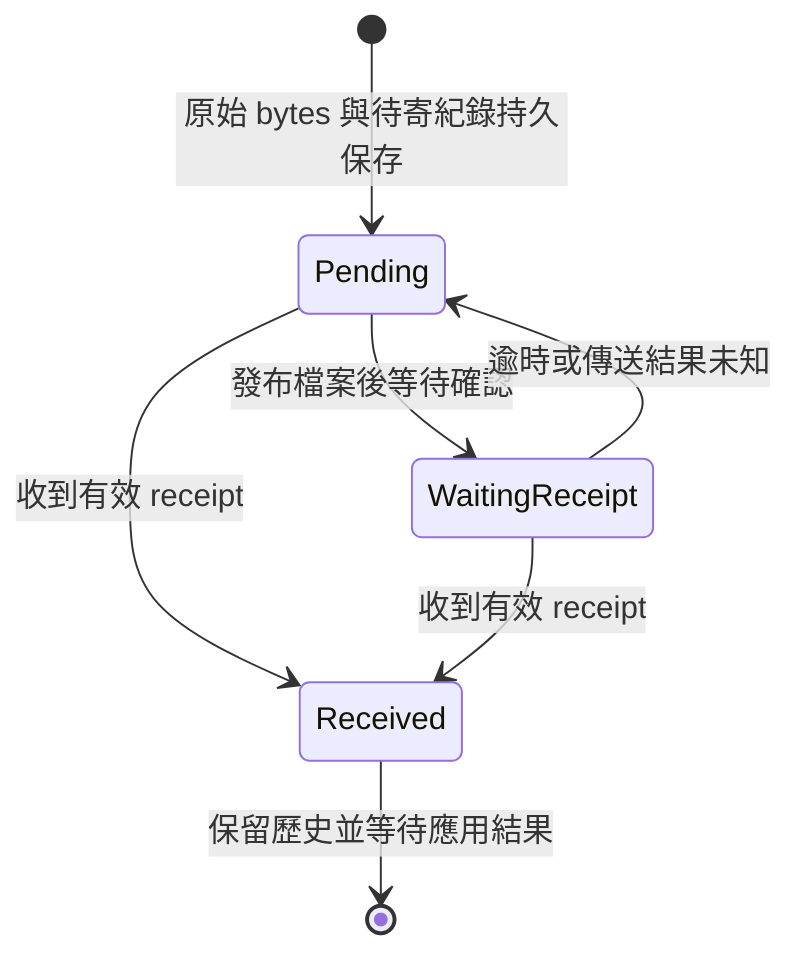
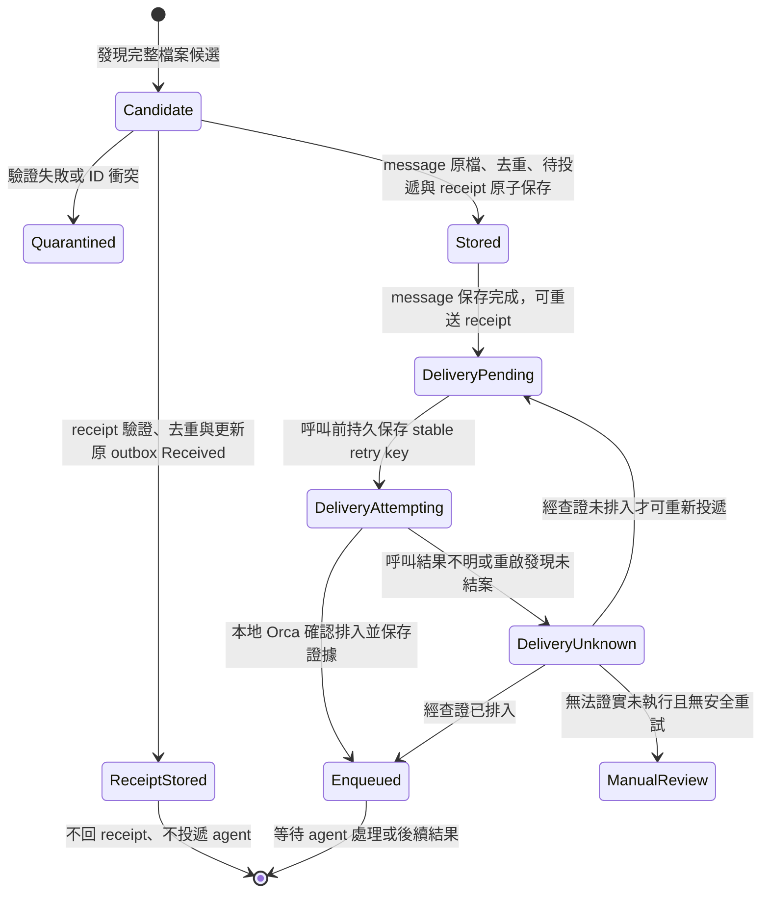

# Orca 跨網 bridge：可靠投遞與異常處理設計

> **歷史研究稿，已由 [Orca 內外網非同步通訊設計書](orca-cross-network-mail-design.md) 3.0 取代。** 本文件的簽章、儲存、重送 bytes、工作契約與 sequence 規則不代表目前使用者的決定；請勿據此實作。保留本稿供參考，最新方案與待驗證事項以主設計書為準。

版本：0.2 草案｜2026-10-30  
配套：[Orca 跨網協作設計書](orca-cross-network-mail-design.md)。本文件補充並優先於主設計書第 6 節；尚未實作或在公司環境實測。

## 1. 要達成什麼

外網與內網使用 FTP、`itcp` 和網路芳鄰非同步交換檔案。只要兩端的持久狀態與待傳檔案未永久損壞或遺失、通道及權限最終恢復，系統會持續嘗試投遞；不承諾最大送達時間。斷線、對方關機或逾時時，顯示等待或狀態未知，不宣稱對方已收到、工作已停止或失敗。

**確認分三層：**

| 階段 | 判定依據 | 尚不能推論 |
| --- | --- | --- |
| 傳送工具完成 | FTP／`itcp` 回報成功 | 對方 bridge 收到或保存 |
| bridge 收到 | 收到匹配的 `receipt`，對方已驗證並持久保存原訊息及待處理紀錄 | Orca 已讀、工作開始或完成 |
| 工作完成 | 收到並核對對端協調 agent 產生的明確結果，且本地代理依 Orca 規則處理 | 其他未回報任務亦已完成 |

主設計書定義 `request`、`progress` 和 `result` 的最小跨網契約。結果須通過來源認證，並與本機的原 request 的目標、operation、request ID 和 thread 一致；不可單憑 receipt、任意回覆或關鍵字判定完成。代理只在本機授權政策允許且合法的 Dispatch 身分有效時，根據有效結果向 Orca 報告；是否可信地啟動 agent、提交與恢復仍須實測，未通過時保持人工處理。

## 2. 訊息 ID、收據與 sequence number

- 每封應用 `message` 建立一次 UUID v4 `message_id`；所有重送保留原本 ID 與**完全相同的 UTF-8 檔案 bytes**。不同受託節點各自有獨立訊息。
- 收件端以已驗證的來源身分及 `message_id` 查詢持久化去重表。相同 ID 與相同 SHA-256 代表重複投遞，不再建立新的工作；相同 ID 但內容不同代表衝突，隔離、告警，不覆寫已收記錄。
- 首次收到有效的 `message` 時，收件端建立獨立 ID 的 `receipt`，其 `in_reply_to` 指向原 `message_id`；以 transaction 一起保存原檔、去重紀錄、待交 Orca 紀錄和 receipt。收到 `receipt` 依第 3.2 節處理，不再產生 receipt；原 message 重送時重新發布**同一份已保存的 receipt bytes**。
- 寄件端只有在 receipt 的協定版本、來源身分、`from`、`to`、`operation_id`、`in_reply_to` 和 `receipt_sha256` 都對得上本地待傳訊息及其原始 bytes 時，才記為對方 bridge 已收到。未知 ID、方向錯誤、內容 hash 不符或來源未通過驗證的 receipt 不得清除待傳狀態。兩端保存的訊息 ID 與原始資料是投遞紀錄的依據。

### 2.1 工作與 outbox 的原子關聯

主端在工作首次對外發布之前，先為每個目標工作建立持久且全域唯一的 `operation_id`；它不是 Orca Dispatch ID。一個 operation 對應一個目標與一次有意識的業務工作，重試、重啟或換代理都沿用；人工核准的全新工作才建立新 ID。穩定的來源 key 是主端持久化工作登記表中「任務識別 + 目標節點 + 工作代次」的唯一鍵；不能以會變動的 terminal、Dispatch 或新生 UUID 作為查找鍵。

提供原子的 `get_or_create(source_key, request)`：在同一 durable transaction 先查 source key，不存在時同時建立 operation ID、目標、Task 關聯、request message ID、精確 bytes、已簽名檔及 pending outbox；存在時返回原 ID 和原 bytes，不重新序列化或換 ID。相同 source key 的目標或請求內容不同時拒絕並告警。只有 transaction commit 後寄件程序才能看到或發布 outbox。提交結果不明時，呼叫方以同 source key 查詢，不能另建 operation。代理重啟必須先查原登記表；資料庫不可用、記錄無法核對或 source key 未持久化時停派並人工處理。DB 的唯一約束保護並行提交；實作與 agent 接口及 signature 落盤次序須經崩潰測試。

### 2.2 受託端結果與進度的原子提交

受託 agent 不能只靠記憶中的對話內容判斷是否已發過結果。受託端持久 operation 記錄與 outbox 必須在同一 transaction domain。終止結果使用固定 key `(authenticated_request_sender, operation_id, terminal_result)`，同一 operation 只能有一筆 terminal result。提交介面先以此 key 原子 `get_or_create`：不存在時同一 transaction 保存受託 agent 確認的結果狀態與內容、原 request ID／thread／目標節點關聯、message ID、JSON 精確 bytes、已簽名 sidecar 和待寄 outbox；存在時以 key 查回原 message ID、bytes、簽章，不另生成。相同 key 但提出不同狀態、內容或關聯的提交一律拒絕並告警，維持既有結果；兩個並行提交透過唯一約束只允許一筆生效。已 commit 但呼叫者未收到回應時，以相同 key 及相同結果查回既有紀錄。原資料不可查、無法證實代理提出的是同一結果，或工作副作用與結果不一致時停送並人工對帳，不以新的 message ID 再發結果。只有 transaction commit 後寄件程序才能看到 outbox；同 message ID 的重送固定使用原 bytes 與簽章。已對外發表錯誤結果時不得覆寫或發第二筆終止結果，改由管理員依公司更正／稽核程序處理；更正協定尚未定義，不得自動完成新工作。

進度是可選事件。若啟用進度，產生事件的本地受控流程必須先將穩定且唯一的 `progress_event_id` 及其 operation、內容永久保存；以 `(authenticated_request_sender, operation_id, progress_event_id)` 作為固定 key，原子保存事件內容、原 request 關聯、message ID、精確 bytes、簽章及待寄 outbox。提交逾時或重啟時只能依原事件 ID 查回並沿用；相同 key 內容不同拒絕並告警。若 agent 重啟後無法找回已保存的事件 ID 或無法證實新描述是否為原事件，**不自動補送該進度**，標記未知供人核對；不能重新生成 ID 並當作同一事件。可直接關閉進度而保留結果，不得因漏送 progress 判定工作失敗。事件與結果的保存及提交都不證明底層副作用恰好一次，底層操作仍需冪等或人工核對。

### 2.3 受託端 request 的 operation 唯一性

經簽章驗證後，收件 transaction 除了以 `(authenticated_sender, message_id)` 去重，還須以 `(authenticated_sender, operation_id)` 建立持久唯一約束，原子綁定第一個 request 的 `message_id`、原始 bytes 的 SHA-256、目標節點與工作待辦，並同時保存 receipt。只接受同來源、同 operation、同 request ID、同 bytes、同目標的重送，重發原 receipt 且不重做工作。若已存在的 operation 對應不同 request ID、不同 bytes 或不同目標，即使 message ID 本身是新的也判為衝突，隔離並告警；不得建立工作或為衝突發 receipt。驗證和唯一性檢查必須在持久保存並生成 receipt 之前完成，並與前述資料一起 commit，並行接收靠資料庫唯一約束處理。

經驗證但 request 尚未到達的 progress、result 不建立 request operation；先依第 2 節保存待關聯，不能據此執行工作或判定完成。receipt 一律查詢本地原 message outbox 並依第 3.2 節處理，未知或不匹配者隔離告警，不保存為等待 request 關聯的工作。operation 唯一記錄與結果記錄的保留、災難還原和重放保護遵守第 4 節，不能早於 request 去重記錄刪除。

### 2.4 主端終止結果的並行唯一性

主端驗證結果簽章、來源、目標，並成功關聯本地 request、operation、thread 後，在同一 durable transaction 以 `(authenticated_result_sender, operation_id)` 的唯一約束原子綁定首筆終止 result 的 message ID、原始 bytes、hash、狀態、待本地投遞紀錄與 receipt；commit 後才投遞或回 receipt。兩個不同 result 同時到達時，即使都通過格式驗證，也只能有一筆綁定成功，另一筆必須隔離、告警，不得入列或回 receipt。相同 message ID、相同 bytes 的重送僅重發原 receipt。若結果在 request 可關聯前已依第 2 節持久收到並回過 receipt，只能保存待關聯、不可入列；等 request 已關聯後套用此唯一 transaction，衝突時停止處理並告警，已送出的 bridge receipt 只能表示已保存，不能撤回或代表結果有效。

若第二筆衝突 result 在首筆已入列或主端代理已向 Orca 回報完成之後才到達，系統無法撤銷已發生的動作：停止該 operation 後續自動動作、保留兩筆原始資料與稽核證據、告警並人工對帳，不主張 Orca 狀態已回滾。只有受控管理決策能恢復；任意第三筆結果亦不得自動完成。

**v1 不要求 sequence number。** UUID 用於辨識和去重，`thread_id` 與 `in_reply_to` 用於關聯；它們不保證順序。sequence number 若未來需要，只能在每一個寄件端、收件端及方向的持久序列中使用，並定義重啟、備份還原、缺號與並行規則；不能以全域遞增號碼假設所有節點共用一個可靠計數器。就算有 sequence number，仍需要保存 receipt、去重與處理結果不明的狀態。

v1 不承諾 FIFO。對有依賴的操作，發送端應等前一步有明確應用結果後再發下一步；結果先於 request、receipt 先於本地查詢可見等情況，保存有效訊息、嘗試關聯並告警，不根據檔名或時間決定執行順序。若系統需要自動強制排序，須另訂持久序號與缺號協定，不能默認本設計已提供。

## 3. 收發狀態與恢復

### 3.1 寄件端

`Pending` 與 `WaitingReceipt` 都可能因重啟重新排程；任何狀態收到有效且匹配的 receipt 都可記為 `Received`。狀態資料和原始 bytes 必須落在可重啟後讀取的本地持久儲存；只存在記憶體不符合要求。關機期間不會重試，開機後 bridge 重新掃描待傳資料並恢復。使用原始資料重送時，不重新產生 ID 或重新序列化 JSON。

初始建議 5 分鐘重試、指數退避，最高間隔 1 小時，加隨機抖動。每筆訊息應設定下一次時間及告警門檻，開機後只執行一次到期嘗試，再按退避排程，避免同時大量重送。逾時只代表尚未確認；即使持續告警也不自動認定失敗。運維可以暫停，但不得靜默刪除待傳資料。輪詢及重試時間是提案，部署前依公司傳輸時間和限制設定。

### 3.2 收件端

多個掃描程序同時看到相同訊息時，靠資料庫唯一限制與 transaction 保護接收紀錄。驗證後依 `kind` 分流：

- **`message`：**除 message ID 去重外，request 套用第 2.3 節 operation 唯一約束，已關聯 result 套用第 2.4 節的唯一約束。接收紀錄、適用的 operation 綁定、要回傳的 receipt 與待投遞佇列在同一 transaction 提交；提交前不得發出 receipt 或投遞 Orca。若資料庫故障、磁碟已滿或無法持久保存，不發 receipt、不交 agent，告警後待修復。`Enqueued` 僅代表本地 Orca 已接受，仍不代表 agent 完成。
- **`receipt`：**驗證簽章、來源、目的、operation、`in_reply_to` 和被確認原始 bytes 的 hash，找到本地對應的 message outbox 後，在同一 transaction 持久保存 receipt 的去重紀錄及原始 bytes，並將匹配 outbox 的傳輸狀態原子更新為 `Received`。不產生另一個 receipt，也不建立 Orca 待投遞或交給 agent。相同 receipt ID 及 bytes 重播為冪等 no-op；不同 ID 但有效且指向已 `Received` 的同一 message 只記錄及稽核，不倒退狀態。未知或不匹配的 receipt 隔離告警，不改 outbox；同 receipt ID 不同 bytes 為衝突，隔離告警。未能持久保存或更新時不宣稱 Received，重啟後由原 message 重送觸發對端重發 receipt。

執行 Orca 前，先在 transaction 持久保存 `DeliveryAttempting`、穩定 request／retry key、固定目標、命令參數、owner 與呼叫代次，commit 後才呼叫；唯一約束及互斥保護同一項投遞。收回 Orca 成功證據後持久化為 `Enqueued`；確定遭拒且未入列才回 `DeliveryPending`。程序重啟發現殘留 `DeliveryAttempting` 時一律轉成 `DeliveryUnknown`，不能因未保存成功就假設未入列。版本明確支援且已實測重試時，使用**同一個** retry key 和相同參數重試；明確證實未入列才可進入 `DeliveryPending`，結果不明或無安全機制則保留 `DeliveryUnknown` 並人工核對。不得在原結果仍未知時新造 retry key，或因 lease 逾時讓第二個程序重複呼叫。此為設計要求，不聲稱所有 Orca 命令都能查詢或冪等重試。`check --ack` 是 Orca 本地整批確認，必須先持久處理整批，與跨網 receipt 不同。不要由 bridge 去消費非專用的共用 mailbox。

### 3.2.1 代理、Dispatch 與主機重啟

主端持久記錄 operation、來源 Task／Run、本地代理 Dispatch、所寄 request、receipt 與結果，以及核對證據。外網重啟後先凍結該 operation 的新派工，恢復 bridge 的收發，但結果只保存待處理；重新查詢原 Orca runtime 和 Dispatch。若能證實原 Dispatch 仍有效，按版本支援流程把已保存結果交原代理處理；若結果不明，標記 `unverifiable` 並等待或人工核查。不得僅憑中斷、逾時或失去畫面斷定已停止，也不得複製舊 Dispatch 身分來回報 `worker_done`。

原 Dispatch 確認停止或已有 Orca 可接受的 settlement，且確認不存在仍會執行的原代理後，coordinator 才能依當前版本的合法流程建立新的接手 Dispatch；先原子更新 operation 的主端接手紀錄和所有權，再讓新代理查既有 request／result 與副作用證據。接手只處理原 operation 的結果，不重新發起遠端工作；若遠端執行與副作用無法確認，保留未知、人工處理。舊代理未能證實停止、原 Orca 工作狀態或接手機制無法核對時禁止自動接手。跨程式資料庫交易無法原子封鎖 Orca，故不宣稱單靠 owner 更新就可 fencing 舊代理；須驗證 Orca 生命週期與外部副作用的冪等或人工確認。Linux SSH agent 結果透過受控、可持久恢復的內網 Windows 協調 agent／bridge 交接；中間任何一次交付結果不明同樣先核對，不直接讀取 Linux 路徑。

### 3.3 完整檔案與檔名

每次物理傳送使用新的 attempt UUID，檔名 `<message_id>.<attempt_id>.json`；重送的檔案內容不變。接收端以 JSON 的 `message_id` 去重，檢查檔名 ID 與內容一致。傳輸 attempt ID 只區分檔案，不代表新訊息，也不是順序號。receipt 重送同理。

每個 attempt 必須在目的目錄產生同 basename 的三個檔案：`<message_id>.<attempt_id>.json` 是 JSON 信封原始 bytes；`<message_id>.<attempt_id>.sig.json` 是第 4.1 節簽章 sidecar 的原始 bytes；`<message_id>.<attempt_id>.ready.json` 是完成標記。兩個 UUID 皆使用小寫 canonical UUID v4 字串。接收端只以 `ready.json` 為發現入口，從檔名推導另外兩個檔案的完整名稱，不接受任意路徑。

ready 是 UTF-8、無 BOM、無重複 key 的 JSON object，僅含 `protocol` 固定 `orca-file-bridge-ready`、`version` 整數 `1`、`message_id`、`attempt_id`、`message_length`、`message_sha256`、`signature_length`、`signature_sha256`。兩個長度是原始 bytes 非負整數且受各自上限限制，兩個 hash 是各自完整 bytes 的 SHA-256 小寫 64 位 hex；兩個 ID 與三個檔名完全一致。ready 上限 4096 bytes；signal 同一 attempt 僅允許一筆內容。ready hash 僅檢查一致性，不提供認證；信封簽章仍必須驗證。

發布順序：先完整傳送並可讀地發布 `.json`，再完整傳送並可讀地發布 `.sig.json`，最後產生含兩者長度及 hash 的 ready bytes，使用經端到端驗證的完整發布方法發布 `.ready.json`。建議先寫唯一的 ready 暫存檔，待資料及 sidecar 完整落地後，以確認對收件端原子可見的 rename 改為 ready 正式名。若 rename 不可用，可使用公司工具本身提供且端到端實測的 ready 完整發布機制；此機制不能以 ready 自己宣告自己完成。沒有任何合格的 ready 發布方式時停止收發、告警，不能只靠檔案大小穩定或解析成功猜測完成。資料及 sidecar 可以先以唯一正式名寫入，因為沒有完整發布的 ready 時不處理；每次重送使用新 attempt，禁止覆寫既有檔案。

接收端讀取完整 ready 後，核對 ID 和格式，再讀取相同 attempt 的資料與 sidecar，核對兩者長度／hash，接著驗證 sidecar 簽章、來源與路由；兩個檔案缺失或仍不完整時等待，逾時隔離並告警，不投遞、不發 receipt。receipt 是一則獨立簽署的信封，必須遵循相同三檔規則。ready、資料及 sidecar 中任一項不完整、長度不符、hash 不符或格式錯誤都不交給 agent；部分檔案清理仍須遵守在途傳輸保護。

接收端先讀到本地暫存並驗證完整性，再進 transaction；不能依一次資料夾列出結果、檔案出現或檔案大小暫時不變認定完成。通道殘留檔案的清理權限、可見時限與清理者需公司確認；資料庫保存後才能安全清理對應的輸入檔，但清理失敗不影響去重。半檔或異常檔清理需保留診斷資料並避免刪除仍在傳輸的檔案。

## 4. 可恢復條件與保留期

資料落盤包含 transaction commit 與所選儲存引擎提供的持久化保證；實作需驗證突然斷電、filesystem 和磁碟快取行為。單機磁碟永久毀損、備份回復到舊狀態、人工清空佇列或通道永久刪除檔案，無法僅靠 receipt 保證恢復。依公司要求設備份與還原程序，並明確定義 RPO；不可假設備份一定包含最新已確認訊息。

初始提案：未確認的原訊息、bytes 與對應狀態**不自動刪除**；收件端去重紀錄及 receipt 至少保存至有證據確認寄件端已停止重送後，再依雙方共同政策保留至少 90 天。因 receipt 不再收 receipt，接收端通常無法單憑本協定證明寄件端停止重送；若沒有額外的雙向清理協議或可稽核的人工確認，就不得把 90 天當成安全刪除保證。永久分區與有限儲存不能同時保證無限去重：達到保留容量上限時停止接收新工作、告警並依營運程序處理，不能靜默刪除。

狀態還原到較舊備份時，可能遺失已收紀錄或讓已執行工作再出現。先隔離該節點、暫停重送與執行，與對端保存的訊息、receipt、執行紀錄和工作副作用核對；無法確認的工作標未知並人工處理。不得只重建空白去重表後自動恢復工作。若要求可自動安全清理或災難復原，須另行設計已驗證的雙方水位／保留與對帳協議。

### 4.1 來源認證 profile：離線簽章

預設建議 `ed25519-detached-v1`，使用每節點獨立 Ed25519 金鑰；實作需用公司核准的密碼函式庫與金鑰管理，並經公司資安許可。bridge 的本地設定包含 profile、自己節點的私鑰安全儲存參照、每個允許來源的 key ID 到公鑰與唯一節點 ID 的映射。公鑰以受控程序離線佈建及核對指紋。FTP、`itcp` 或共享目錄的 ACL 應另外限制，但不取代本簽章驗證。沒有完整設定、私鑰、受信公鑰，或公司未核准此 profile 時，啟動時拒絕啟用跨網收發；不可降級成只驗證 `from`。

每個信封的**精確 JSON 原始 bytes** `B`，以 Ed25519 簽署 `ASCII("orca-file-bridge/v1") || 0x00 || uint64_be(len(B)) || B`，其中 `||` 為串接、長度是八位元組 big-endian。送件端在發布前保存 `B`、簽章與 key ID；每次重送使用同一份 `B`、簽章與 key ID。信封及簽章 sidecar 對應同一 `<message_id>.<attempt_id>`；sidecar 為 UTF-8 JSON，含 `profile` 固定 `ed25519-detached-v1`、`key_id` 與 `signature`，後者為 64 bytes 簽章的標準 Base64。演算法由本機 profile 決定，不接受檔案選擇替代演算法；key ID 必須在本地 allowlist 有唯一映射。sidecar 完整性以同一 attempt 的完成標記或經驗證原子發布方式判斷；兩者皆完整且在 1 MiB／設定的 sidecar 大小上限內才驗證。不能信任 sidecar 的名稱、key ID 或 JSON 中的 `from`，直到簽章成功並核對 key ID 對應身分等於 `from`、`to` 等於本機且來源獲授權；再進格式／去重 transaction。

receipt 也必須用寄件節點私鑰簽署；接收時還要核對所確認原始 bytes 的 `receipt_sha256`。單一 ID／hash 不能防止惡意重放，仍依持久去重及保留規則抵擋已收訊息重放。雙方金鑰應依公司策略輪替：新 key ID 和公鑰須先受控佈建，舊 key 在原待傳訊息／receipt 尚需重試期間保留驗證能力；私鑰洩漏、撤銷或輪替造成舊簽章不再可信時，暫停相關 operation 並人工對帳，不能變更原 bytes 或未經授權重新簽署後宣稱同一筆已收。簽章只證明具有私鑰的節點發送精確 bytes，不保障內容安全、保密或資料外送合規。

## 5. 異常案例與預期行為

下表涵蓋目前辨識到的主要情境，不宣稱列盡所有故障；測試時應根據公司工具回傳碼、傳輸鏈與作業政策擴充。

| 情境 | 預期處理 |
| --- | --- |
| 外網 Windows 關機數小時或數天 | 外網 bridge 不輪詢、不重試。內網待寄結果持續保存及依退避重送；外網開機後恢復掃描、驗證、去重與確認。前提是中間檔案或寄件佇列仍保存，且外網程式設有允許的開機啟動機制。 |
| 內網 Windows 關機 | 外網持續保留 request 並重試；已傳到 FTP 的檔案若遭清除，也可由外網重送。內網重啟後以持久 ID 去重。 |
| 兩邊同時關機 | 兩邊待傳與已收記錄需已落盤；恢復後重新掃描、依排程重試。工作是否曾在 Linux 執行須另行核對。 |
| Linux SSH 中斷、Windows 仍運作 | 標記遠端狀態未知；Windows bridge 可繼續接收並保存，但不重複啟動同一遠端工作。SSH 恢復後核對 Orca 和 agent 狀態。 |
| FTP、`itcp`、網路芳鄰暫時不可用 | 保存佇列與錯誤、退避重試及告警；任何單向通道失敗都不影響另一通道既有資料的持久保存。 |
| 工具回報失敗／逾時，但實際已落地 | 視為結果未知，使用相同訊息 bytes 和 ID、不同 attempt 重新傳；對端去重並回 receipt。 |
| 檔案遺失、被中間系統清除或落地延遲 | 未收到 receipt 前不刪除來源原件，定時重送；收到 receipt 後仍保留稽核與恢復紀錄。永久遺失且寄件狀態也遺失時需人工復原。 |
| 上傳中斷、半檔、ready 先到、sidecar 缺失或任一 hash 不符 | 不投遞、不確認；暫待同 attempt 的兩檔完整，逾時隔離與告警。ready 自身須依已驗證原子發布機制完整可見。寄件端未收到 receipt 時另以新 attempt 重送。 |
| 同一檔被列出兩次、不同 attempt 重送 | 同 ID、同 bytes 視為一次；保存或重發原 receipt，不重複產生待投遞工作。 |
| 同 ID 不同 bytes | 隔離衝突檔、告警、保留原紀錄；不覆蓋、不再交給 agent。 |
| 同一來源和 operation，但 request ID 或 bytes 不同 | 即使是新的 message ID，也與已綁定 request 衝突；隔離、告警，不發 receipt、不建立工作。 |
| result 已保存但提交回應遺失 | 受託端以固定 terminal-result key 取得原 result ID、bytes 與簽章；不同結果內容視為衝突，不發第二筆 result。 |
| progress 提交後呼叫者重啟或遺失事件身分 | 若持久事件 ID 可查則重用；無法確定時不自動重新產生事件，記錄未知並人工核對。 |
| receipt 遺失或重複 | 遺失時寄件端重送原訊息，收件端重新送出已保存的 receipt；重複 receipt 是冪等更新。receipt 本身不再確認。 |
| receipt 比本地傳送回報早到 | 若來源、目標和 ID 均匹配，直接標已收；後續遲到的傳送回報不得把狀態倒退。 |
| 偽造、錯誤來源或未知 ID 的 receipt | 不停止重送；隔離及告警。須有公司核准的來源認證，單靠 `from` 與 hash 不足以辨識對端。 |
| 訊息順序顛倒、重複結果或關聯 ID 未知 | 持久保存有效但尚未關聯的訊息並重試關聯；對符合規則的 message 回 receipt。不以時間推論順序；相互衝突的終止結果人工審查。 |
| Orca 關閉／mailbox 暫不可用 | bridge 保存並重試待本地投遞；已發 receipt 仍只代表 bridge 已收。禁止因 Orca 不在就丟棄訊息。 |
| 本地 Orca 已入列後 bridge 在回應前當機 | 進入結果未知狀態。先依版本的受支援重試或查詢機制核對，無法證實時人工處理，不盲目重派。 |
| agent 已有外部副作用但結果未保存 | 狀態未知。由工作本身使用持久冪等鍵、可查證交易紀錄或人工核對；不可因沒收到結果就自動再次執行。 |
| agent 卡住、停止或不支援模型連線 | 紀錄工作等待或已證實的失敗並告警；逾時本身不證明停止，不冒充 `worker_done`。恢復或取消需走各端 Orca 合法操作。 |
| 非法 JSON、未知版本、過大、無效 UTF-8、錯誤方向 | 不交 agent、不發 receipt；隔離與告警。寄件端持續未確認，維運應從告警排查，不能把拒收假報成成功。 |
| 憑證過期、權限被移除、itcp exit code 未知 | 保存資料並告警；依可辨識的暫時錯誤退避，永久配置錯誤等待修復。未知退出碼不可當成功。 |
| 磁碟空間不足、資料庫損壞、無法寫入 | 不回 receipt、不交付新工作；保留現有檔案並告警。恢復後確認 transaction 一致性及佇列。 |
| 主機時間跳動 | ID、去重與完成判斷不使用系統時間排序；執行中的重試以單調時鐘計時，重啟後使用持久排程重新評估並限制速率。 |
| 多個 bridge 實例、重複啟動或多個節點讀同一資料夾 | 同節點使用獨佔租約／鎖與持久唯一約束；不同節點使用各自目錄。鎖失效或狀態不確定時停止副作用並告警，不只依靠程序存在判斷。 |
| 一個主端、多個受託端 | 每目標各有獨立 message ID、receipt、路由及任務狀態；一個 worker 回覆不能確認另一個 worker。各路由獨立退避，避免故障節點拖住其他節點。 |
| 檔案量暴增、磁碟滿或傳輸塞車 | 限制每路由佇列、同時傳送數與速率，顯示積壓；無法保存新工作時拒絕接收、告警，不丟棄已確認保存的工作。 |
| 版本不相容或更新中 | 收件端對不支援版本隔離且不發 receipt；部署採雙方先支援再切換，保留舊版本待傳資料及回退方案。 |
| 節點還原舊備份或重用 ID | 暫停並對帳，不自動執行；節點 ID 不重用，必要時以新身份重新配對並記錄舊待辦。 |
| 非法內容或 prompt injection | 按公司規定檢查資料、身分及許可；訊息不可選任意本地路徑、命令或 Orca handle。即使來源認證有效，agent 權限仍受限制。 |

## 6. 實作驗收：故障注入

1. 兩方向各測正常 request → receipt → 明確結果 → receipt；核對每個節點與訊息 ID。測一次 receipt 先於工具回報的競態。
2. 在傳輸前、傳輸中、接收 transaction 前後、receipt 發送前後、本地 Orca send 前後、工作副作用前後逐點終止程序或斷電；重啟後核對佇列、去重與人工介入狀態。每一個故障點都要確認無遺失的已確認工作、無未受控的重複副作用。
3. 關閉外網 Windows 一段超過重試週期的時間，內網產生結果；再開機，確認恢復、重送與去重。反向測試內網關機、兩邊同時關機與 SSH 中斷。
4. 注入半檔、ready 提前、工具回報與實際結果不一致、遺失 receipt、相同 ID 不同 bytes、偽造 receipt、亂序、重複列目錄、版本不符和多個 worker；確認告警、隔離及各路由互不干擾。
5. 測試磁碟滿、拒絕寫入、資料庫損壞、斷電與舊備份還原。確認未能持久化時不發 receipt，還原後先暫停對帳。檢驗公司實際 FTP／`itcp` 完成與清理語意。
6. 實測 Orca 的 mailbox 本地投遞、結果未知時的可重試能力、專用 Run 的整批 ACK 與代理的合法 `worker_done`；沒有驗證前，對有副作用的自動工作保持人工核對。
7. 在 `get_or_create` transaction 前、commit 後及回應前關機，並從重啟或新代理以相同 source key 查詢，驗證相同 operation、request ID、bytes 和簽章；相同 key 不同內容須拒絕。兩個代理並行提交不得建立兩筆工作。
8. 本地 Orca 呼叫前、實際入列後但回應落盤前各斷電；重啟的 `DeliveryAttempting` 必須轉成未知。模擬原 Dispatch 尚在執行、狀態不可查、已證實退出及可合法接手，確認不能偽造身分或重發遠端工作。
9. 對 request、result 和 receipt 驗證正確簽章；測試缺少 sidecar、未授權 key ID、簽章錯誤、變造內容、跨節點冒充、錯誤 receipt hash、舊 key 輪替及已知已收訊息重放。認證失敗時不得產生 receipt 或本地投遞。
10. 測試結果來源、operation、request ID、thread 不匹配或第二筆不同 result；確認隔離、告警且不得自動完成原 Task。確認 operation ID 不是新 Dispatch ID，接手時不重新派送原工作。
11. 在受託端 result 和 progress 的 transaction commit 前、commit 後但回應前斷電；原 key 重試須得到完全相同的 ID、bytes、簽章，並行提交不得生成第二筆；同 key 變更內容須拒絕。事件 ID 遺失時不得自動補發。驗證代理重啟、結果狀態衝突及原記錄無法查詢的人工處理。
12. 以已認證來源，對同一 operation 並行送出不同 request ID、同 ID 不同 bytes、不同目標，以及完全相同重送；僅第一筆合法 request 建立工作並產生原 receipt，完全相同重送僅重發原 receipt，衝突不可確認或重做。測試兩個不同來源使用相同 operation ID 時依各自認證身分隔離，並確認目的端驗證與限制仍生效。
13. 測試三檔命名、兩個長度與 hash 各自錯誤、sidecar 缺失、部分寫入、ready 最先可見及不同 attempt 混用；在實際 FTP、`itcp` 及落地路徑驗證 ready 完整發布與可見性。無法證明 ready 完整交付時必須停止收發。
14. 同一已認證來源與 operation 並行投遞兩個不同 result，確保 transaction 只有首筆入列與 receipt；也測試原結果先已完成、衝突結果後到的情況，確認不宣稱回滾，停止後續自動動作並告警人工對帳。
15. 收到有效 receipt 時，注入重啟與 transaction 失敗，確認 receipt 去重保存及 outbox `Received` 同時提交或均未提交；無論正常、重播或不同 receipt ID 的重複確認，都不產生 receipt，也不投遞 agent。未知或不匹配 receipt 隔離告警、不更改 outbox；同 receipt ID 不同 bytes 視為衝突。

## 7. 尚需公司決定

公司要提供 `itcp` 的實際命令、返回碼、落地及 rename 語意；FTP／網路芳鄰的權限、過期清理規則與可用空間；每條路由資料分級、身分驗證及外送審核；可接受的斷線時間、備份 RPO、保留容量、告警管道與維運人員。這些條件決定重試與保留數值，也決定此方案能否提供上述恢復保證。
