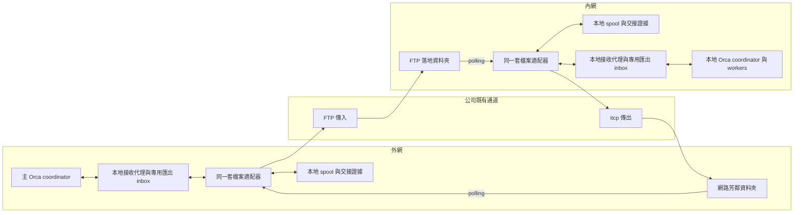
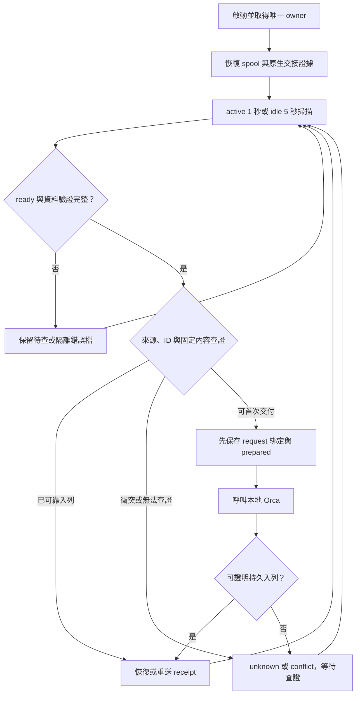
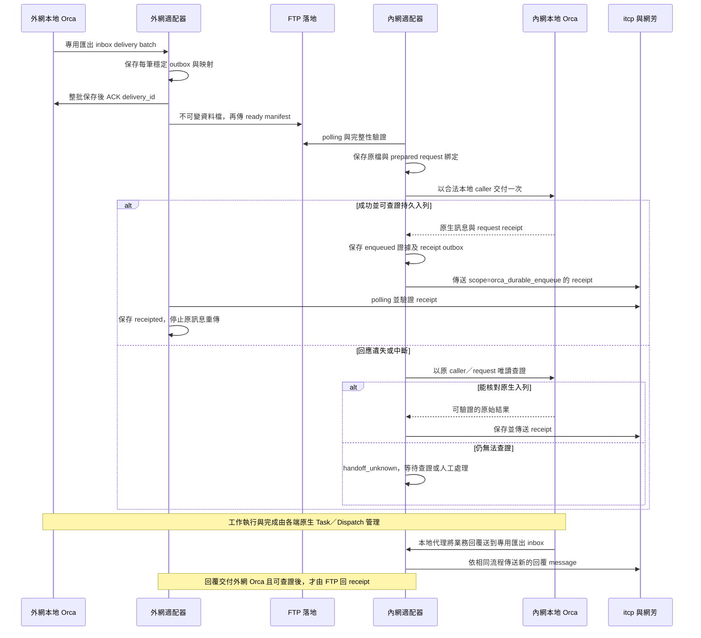

# Orca 內外網非同步通訊設計書

版本：3.1 草案｜2026-10-30  
狀態：已依 review 補強的設計；尚未實作或在公司環境實測。驗收規格見 [review 對照與故障驗收](orca-bridge-acceptance.md)，交接見 [handoff](handoff.md)。

## 1. 目的、原則與版本範圍

外網 Orca 與內網 Orca 使用公司既有通道交換 JSON 檔案：外網到內網以 FTP 傳入；內網到外網由 `itcp` 傳至指定資料夾，外網 Windows 透過網路芳鄰讀取。`itcp` 的實際語法、path、回傳碼及完成語意仍待公司環境確認。

盡可能沿用 Orca 原本的 agent、coordinator、worker、Run、Task、Dispatch、mailbox、工作狀態、權限、人工操作與顯示。新增部分是檔案 transport、polling、外層 `seq`／`retry` 以及可靠交接所需的最小資訊。人員可繼續操作；修改程式碼、部署與操作正式環境的權限及確認，沿用 Orca 與公司既有機制。

本設計是公司適配提案，不是 Orca 已支援的設定或官方 mailbox wire protocol。先前研究基準為 Orca 1.4.244、commit `b8ec5c8d170bcb9988e65de547a3a4e98b2885a9`；本輪補強依 GitHub 固定版來源，未重新檢查本機或公司主機。原生架構與 Mermaid 圖見 [Orca 原生架構](orca-native-architecture.md)。

3.1 整合先前 review 補強並明定：**receipt 在可查證的 Orca 持久入列之後產生；每個 inbox 有唯一消費者；跨網第一階段透過兩端本地接收代理。** 不另建持久 seq counter、工作排程系統、權限系統或產品 log 系統；無法查證的交接維持 unknown，由人處理。檔案或紀錄永久遺失時不保證最終送達，也不承諾副作用 exactly-once。

## 2. 架構、使用者場景與原生接點

### 2.1 架構與 Linux 場景

第一階段驗證一台外網 Windows、一台內網 Windows 與一台內網 Linux，保留一個主 Orca 協調多個 Orca 的目標。兩端 runtime 各自擁有自己的 Run／Dispatch 與合法身分。



代理、專用 inbox 是邏輯責任；實際以公司版本允許的 Run／Dispatch／terminal 配置，不杜撰原生地址或公開 API。第一階段不把檔案信封直接送進 `federationImport`，也不偽造遠端 `worker_done`。完整 federation transport 適配仍是後續研究，不在第一階段承諾範圍。

Linux 優先驗證 headless `orca serve` 加 Windows browser client；僅能 SSH 時，須確認公司允許的 SSH port forwarding、配對、agent／模型與 UI 功能。不可行時再驗證內網 Windows Orca 桌面版經 SSH 操作 Linux。適配器部署在 Windows 或 Linux 由 FTP 落地、itcp 執行位置與存取權限決定，不假設兩台主機共用本機路徑。參考 [Remote Server](https://www.onorca.dev/docs/remote-servers)、[SSH worktrees](https://www.onorca.dev/docs/ssh)，以公司版本實測為準。

### 2.2 功能、呼叫介面與限制

| 功能 | 第一階段接點 | 身分／地址映射 | 限制與必驗項目 |
| --- | --- | --- | --- |
| 外部訊息交給 Orca | 本地 `orchestration.send`，先限一般訊息 | 已設定 peer 對應合法本地接收代理；實際使用 `run:<id>`／`dispatch:<id>` 等支援地址 | 以本地 caller 授權；外部 from 不變成本地特權身分。固定信封與原生訊息的關聯須可恢復 |
| 本地回覆對外發送 | 專用匯出 inbox 的 `check`／`check --ack` | 一個有效 inbox 綁一個 bridge 消費者；業務代理主動投遞到此 inbox | 整批 row 保存成穩定 outbox 後才 ACK；不掃 coordinator 整個業務 inbox |
| 查證 mutation | `orchestration.requestShow`；已驗證時使用同 request replay | 保存原 caller identity、runtime、request ID、method、參數及入列訊息 ID | completed／pending／absent 必須分開處理；不能換 caller 後解讀 absent 為未執行 |
| 主端協調多節點 | 設定路由＋各端本地原生 Run／Task／workers | 每個 peer 的 inbox、來源綁定與原生工作關聯獨立 | 不是把多個 runtime 合成一個 Run；本地代理須沿用 Task 相依性與權限 |
| 問題／回覆／工作結果 | 先作一般訊息，經本地代理關聯原生 Task／thread | 遠端 ID 保持作關聯資訊；本地 Dispatch 由本地 runtime 決定 | `ask`／`reply` 的跨網映射需單獨驗證；遠端結果不是本地合法 `worker_done` 的替代品 |
| 原生 federation | 第一階段不直接接入；另列研究 | 維持原生 caller fingerprint、attachment、Dispatch 與連續 relay sequence | 原生 import 遇缺號拒收，不能與只觀察的外層 seq 混用 |
| Log／GUI | 優先原生 log、mailbox status 或公開查詢 | 只使用實際版本證實可用的接口 | 尚未確認外部適配器寫原生 log／GUI 的公開標準 API；不得宣稱已有 |

固定版 [send](https://github.com/stablyai/orca/blob/b8ec5c8d170bcb9988e65de547a3a4e98b2885a9/src/main/runtime/rpc/methods/orchestration/messaging/send-methods.ts)、[requestShow](https://github.com/stablyai/orca/blob/b8ec5c8d170bcb9988e65de547a3a4e98b2885a9/src/main/runtime/rpc/methods/orchestration/runs/mutation-request-show.ts)、[federation relay](https://github.com/stablyai/orca/blob/b8ec5c8d170bcb9988e65de547a3a4e98b2885a9/src/main/runtime/rpc/methods/orchestration/federation/federation-relay.ts)。這些是原始碼接點，不表示每個內部方法都是穩定的公開擴充 API。公司 Agent 須記錄實際可呼叫的 CLI／RPC、參數與權限。

## 3. 同一套程式與設定

收件及送件分開設定，不能只選一個 FTP 或 itcp。每個 peer 有固定來源綁定、目的路由、inbox owner 與本地 Orca 地址；JSON 不得選擇任意程式、shell 命令或檔案目的路徑。

| 節點 | 收件 | 送件 |
| --- | --- | --- |
| 外網 | polling 網路芳鄰資料夾 | FTP |
| 內網 | polling FTP 落地資料夾 | itcp |

以下是提議設定，不是 Orca 既有設定。數值除使用者指定的 1／5 秒外，均為原型起始值，應依公司實測調整：

```json
{
  "node_id": "external",
  "spool_path": "LOCAL_BRIDGE_STATE_PATH",
  "inbound": { "kind": "directory", "path": "COMPANY_SHARE_PATH" },
  "outbound": { "kind": "ftp", "destination": "COMPANY_FTP_DESTINATION" },
  "polling": { "active_seconds": 1, "idle_seconds": 5, "idle_after_seconds": 30 },
  "limits": { "scan_batch": 50, "max_file_bytes": 10485760, "inflight_per_peer": 1 },
  "timeouts": { "read_seconds": 30, "send_seconds": 120 },
  "retry": { "interval_seconds": 60 }
}
```

內網改用 `inbound.path=COMPANY_FTP_DROP_PATH`、`outbound.kind=itcp` 與待確認的目的地。多個 peer 依相同設定結構各自建立 route；第一階段不實作跨 peer 自動轉寄，避免路由迴圈。需要主端轉交時，由主端本地代理建立有明確關聯的新訊息，不能把收到的檔案任意重命名後轉送。

憑證、真實內網路徑、主機資料與公司機密不提交 public repo。來源確認優先沿用公司通道帳號／資料夾 ACL 與固定 peer 映射；檔內的 `from` 或 SHA-256 都不是身分認證。若共用資料夾無法分辨可信寄件者，該路由不能自動交付有副作用的工作，須先補足公司允許的來源綁定。

## 4. Polling、順序與單一執行者

活動時約每 1 秒掃描、idle 約每 5 秒掃描，均可設定；初始 idle 門檻為連續 30 秒沒有新活動。每個目錄同時只有一個掃描，耗時超過間隔不疊加。發現新完整檔、恢復可處理工作時回 active；持續錯誤節流，目錄不可用時依 idle 間隔重查。

**收到順序**定義為本端首次確認完整並納入交付佇列的順序，不是 sender 時間、mtime、檔案列舉順序或 seq。同一輪的完整候選檔以不可變 ready 檔名的 ASCII 字典順序決定平手；只含 ASCII 的檔名格式見 §7。每輪處理上限外的候選以公平續掃處理，不能每次重新掃最前面的錯誤檔而餓死後面的檔案。[Node.js 目錄讀取文件](https://nodejs.org/api/fs.html#dirread) 說明目錄項目沒有特定回傳順序，不能拿底層列舉順序當通訊保證。

同一 peer 的一般訊息循序開始原生交付；前一筆交接 unknown 時暫停該 peer 後續一般訊息交付，仍繼續掃描、處理 receipt／查證，其他 peer 獨立進行。這是避免交接結果未明時破壞交付順序，不是等待 seq 補號。工作可能由 Orca 並行執行，**入列／交付順序不等於工作完成順序**；需要先後完成的工作由原生 Task 相依性管理。

每個 inbox 只允許一個指定 host owner。單一主機使用 OS 排他 process lock，第二個 bridge 實例無法取鎖就退出；跨主機不提供 active-active，也不假設 SMB lock 可作分散式仲裁。交接 owner 前須確認舊實例已停止；僅有 timeout 不足以接管。未取得 owner 的實例不能 send、ACK 或執行 cleanup。

網芳 read 與傳輸 process 必須有 deadline。逾時的 OS I/O 或 process 可能仍在進行，應使用可隔離／終止的既有 process 包裝方式；舊執行尚未退出時，不在同一 lane 啟動另一個 sender。限制每 peer 及整體工作數，禁止無限累積卡住的 promise／process。receipt 待送不阻塞收件掃描或其他 peer。



## 5. 信封、sequence_epoch、seq 與 retry

下列 wire version 1 仍是未部署的草案；3.1 補齊必要欄位，不代表已發布相容性保證。第一個原型必須驗證必填欄位；不能把缺 `sequence_epoch` 的舊草案例子靜默當成完整新協定。

```json
{
  "protocol": "orca-file-bridge",
  "version": 1,
  "from": "external",
  "to": "internal",
  "sequence_epoch": "eeb1dc5e-0284-44cf-8026-7dadf2663b82",
  "seq": 12,
  "retry": 0,
  "kind": "message",
  "message_id": "4f0da877-7d52-43d1-9ae4-3acaa878e915",
  "orca_message": {
    "type": "status",
    "subject": "檢查測試結果",
    "body": "請處理測試結果。",
    "thread_id": "4f0da877-7d52-43d1-9ae4-3acaa878e915"
  }
}
```

`orca_message` 是適配層內容，實際轉成本地 API 欄位及支援類型須依 §2.2 驗證，不能把外部 payload 直接當成受信任的原生生命週期事件。

| 欄位 | 規則 |
| --- | --- |
| from／to | 已設定來源及目的節點。去重 key 為可信來源身分、目的節點及 message_id，不能只相信檔內 from |
| message_id | 新訊息建立一次的穩定 ID；優先以可恢復的原生訊息 ID 建立映射。相同工作 retry 不換 ID |
| sequence_epoch | 每個有向節點對的序號區段 UUID；同訊息所有 retry 保留原值 |
| seq | 每個方向、每區段的新訊息及 receipt 遞增；正整數。只記錄跳號、倒序及重複，不等待補號或重排 |
| retry | 初次為 0；每次新的傳輸嘗試前加一。message_id、epoch、seq 及固定內容保持不變；失敗嘗試也計數 |
| kind | message 或 receipt；receipt 不再產生 receipt |
| orca_message | 一般訊息內容及 thread／工作關聯；不直接授予本地 caller／Dispatch 權限 |

固定內容 digest = SHA-256(RFC 8785 canonical JSON(信封移除頂層 retry))。採用既有且已驗證的 JCS 實作，不自己發明排序；字串不另行正規化，陣列順序保留，拒絕重複 key、非法 JSON、超範圍整數與不支援欄位。seq／retry 限安全整數；固定內容中的 epoch、seq、from／to、kind、message_id 及 body 都不可在重送時變更。改 retry 或 JSON 排版不是新工作；相同去重 key 的固定 digest 不同為 conflict。[RFC 8785](https://www.rfc-editor.org/rfc/rfc8785)

seq 不另存持久 counter。3.1 的輕量同步提案以區段識別為主：sender 重啟後先核對可恢復資料；沒有完整、可證明的已分配基準時，為新建立的訊息產生新 epoch、從 1 開始，首封信攜帶區段資訊，對端記錄同步重置，不等待同步成功才收件。舊 outbox retry 沿用舊 epoch／seq，不重編號；既有信封保留原欄位不等於另建 seq 資料庫。只有雙端及原生紀錄足以證明包含未送達訊息的已分配上限時，才可研究沿用舊區段；不能以對端最後收到的 seq 推算所有已發送序號。這項延續能力須在公司實測，原型預設使用新區段。舊 epoch 延遲到達只作觀察，不覆蓋新區段狀態、不改去重結果。沒有交付證據時仍是 unknown，不因新 epoch 自動重新執行。

## 6. Orca 交接、receipt 與 ACK 所有權

### 6.1 確認點與可查證狀態

FTP／itcp 回報成功只表示傳輸工具的結果。**成功 receipt 的唯一語意是：該固定內容已透過合法本地接口持久入列 Orca，並有可恢復的證據可查。** 它不表示 agent 已讀、工作開始、業務成功或副作用只執行一次。3.0「完整收件即可先 receipt」的流程由本節取代。

固定版 messaging 文件明定 `send` 成功證明 durable enqueue；requestShow 依 caller fingerprint 查 durable receipt，狀態為 completed／pending／absent，其中 absent 也可能是 receipt 已清理。普通訊息與 worker_done 的內部交易路徑不能視為相同：固定版 point-to-point 原始碼對 worker_done 有特別的原子提交路徑，不足以證明任意普通訊息的 crash replay 都安全。公司 Agent 必須測選用的 method／訊息類型，不可把一般說明當成 blanket exactly-once 保證。[messaging 規則](https://github.com/stablyai/orca/blob/b8ec5c8d170bcb9988e65de547a3a4e98b2885a9/skill-guides/orchestration/references/messaging-and-gates.md)、[request 狀態](https://github.com/stablyai/orca/blob/b8ec5c8d170bcb9988e65de547a3a4e98b2885a9/src/shared/orchestration-mutation-request.ts)、[point-to-point 實作](https://github.com/stablyai/orca/blob/b8ec5c8d170bcb9988e65de547a3a4e98b2885a9/src/main/runtime/rpc/methods/orchestration/messaging/send-point-to-point.ts)。

| 交接狀態 | 證據與位置 | 可採取行為 |
| --- | --- | --- |
| incomplete | 中間目錄資料不齊或 manifest／hash 不符 | 不交付、不回成功 receipt；重讀或隔離 |
| validated | 本地 inbox spool 有驗證完整的原信封與來源綁定，尚無 prepared | 可以建立首次交接；磁碟寫入失敗則不往下 |
| prepared | 呼叫前持久保存去重 key、固定 digest、原生 caller／runtime、request ID、method、完整固定參數與目標地址 | 首次呼叫一次；重啟看見此狀態時視為可能已呼叫，先查證 |
| handoff_unknown | 呼叫超時、回應丟失，或重啟後無法證明原生結果 | 只查詢原 request／mailbox／Task；不另建 request、不直接重跑工作 |
| enqueued | 成功回應或同 caller 的 completed receipt，且 method、目標、內容與原生訊息關聯皆可核對；本地保存查證結果 | 可建立／傳送 receipt；重複檔不再入列 |
| receipt_pending | 已有 enqueued 證據及完整 receipt outbox，反向通道尚未送達 | 保留待送並重試傳輸，不重新交付訊息 |
| receipted（寄件端） | 收到符合來源、方向、原 message_id 與 digest 的 receipt，並保存確認 | 停止此訊息的自動傳輸重試；業務工作仍依 Orca 狀態追蹤 |
| conflict／manual_closed | 固定內容衝突，或人員查證後依原生工作狀態結案 | 保留依據；不自動重做。人工完成不等於可偽造入列 receipt |

優先使用 Orca 原生持久資料保存關聯與查證結果。公開接口不足時，允許最小本地檔案 spool 保存信封及交接 manifest，不引入新 DB、獨立工作 scheduler 或 seq counter。建議目錄為 `outbox/`、`inbox/`、`receipts/`、`quarantine/`；每筆 manifest 只放上述交接證據與狀態。寫入須先暫存、完成 flush／可用的 sync，再本地原子發布；所選 OS／檔案系統的 durability 必須實測。不能直接修改 Orca DB。

**呼叫前必須能固定並保存原生 request 身分。** 若現行 CLI／RPC 不能事先取得或指定、或無法以同一 caller 查回，就記錄接點限制，先做無副作用原型；不可宣稱可以無人自動恢復。prepared 與 send 的中斷空窗透過查證解決，不透過換 ID 解決。

requestShow completed 須核對 method 與成功入列結果；pending 先確認原 process 是否仍活著，不能與原呼叫並行重試。只有該版本、該方法的同 request replay 已通過故障測試才允許自動 replay；否則 unknown。absent、caller 改變、receipt 被 prune、runtime／spool 還原或來源紀錄不足都不能證明未執行；唯讀查證不足即由人決定。

### 6.2 Receipt 與重送

以下 receipt 中 digest 是佔位示意，實作時必須填入原 message 固定內容的 64 位十六進位 SHA-256：

```json
{
  "protocol": "orca-file-bridge",
  "version": 1,
  "from": "internal",
  "to": "external",
  "sequence_epoch": "b15a526c-f93d-4baa-9a0b-bd49de88c602",
  "seq": 7,
  "retry": 0,
  "kind": "receipt",
  "message_id": "7d9534d8-3452-472a-ad23-0cbd4a9eae1e",
  "in_reply_to": "4f0da877-7d52-43d1-9ae4-3acaa878e915",
  "in_reply_to_content_sha256": "CALCULATED_64_HEX_SHA256",
  "scope": "orca_durable_enqueue"
}
```

只有合法匹配的 receipt 才停止原 outbox 的重試。receipt 自己有 ID／epoch／seq，重送也加 retry；同一已建立 receipt 優先恢復重用。receipt 遺失時，原訊息重傳只觸發重新查證及回送 receipt。receipt 不需要另一封 receipt，避免確認迴圈；receipt 傳輸明確失敗或未知可重試，傳輸已成功後保留可重播資料，必要時由原訊息再次觸發。

重試間隔與 polling 分開設定；一秒 polling 不等於一秒重新派工。每次送出前先保存新的 retry 值與 attempt 名稱；中斷後無法確認上次是否已開始時，下一次分配更高 retry，允許計數有空洞。舊 attempt 晚到或低 retry 到達仍按穩定 ID 去重，不視為新訊息。缺少可信原信封、來源綁定或已超出可證實的去重保留範圍時，停自動重送並標 unknown。

### 6.3 Inbox 消費與 ACK 責任

原生 coordinator 的並行 consuming check 會共用待確認 batch，沒有為不同讀者保留各自進度；peek／all 為唯讀監看。[固定版規則](https://github.com/stablyai/orca/blob/b8ec5c8d170bcb9988e65de547a3a4e98b2885a9/skill-guides/orchestration/references/messaging-and-gates.md)

| Inbox／資料 | 唯一消費者 | 確認條件 |
| --- | --- | --- |
| coordinator／業務代理的原生 inbox | 原本的 coordinator／業務代理 | 按原生流程處理整批才 ACK；bridge 不介入 |
| 專用匯出 inbox | 對應 bridge owner | batch 每一 row 都已保存為可恢復 outbox 及穩定映射，才 ACK 該 delivery_id |
| 外部 drop folder | 指定 bridge owner | 完整驗證、交付可查證後回跨網 receipt；與原生 batch ACK 不同 |
| 本地接收代理的原生 inbox | 該代理的原生消費流程 | 依 Orca 原有規則；bridge 的 send 成功不是替代理 ACK |

匯出時以「本地原生訊息 ID＋目的 peer」作穩定映射；相同 batch 重播不可產生新 message_id。保存 batch 到一半就中斷時，已保存 row 沿用原檔，補完其餘後才 ACK。ACK 回應遺失也不清空 outbox。人員可照常操作原業務 inbox；監看專用匯出 inbox 時用 peek／all，不另設 competing consumer。外網暫時離線時，本地可靠 outbox 接手後即可完成原生 batch ACK，不必令 coordinator 等待跨網 receipt。

### 6.4 正常與中斷時序



## 7. 完整檔案發布與傳輸逾時

第一階段採 **資料檔＋ready manifest**，兩者都由現有 FTP／itcp 傳送。每次 attempt 使用 ASCII 名稱 `<message_id>.r<retry>.<attempt_uuid>.json` 與同 basename 的 `.ready.json`，不可覆寫已發布檔。即使 retry 計數在故障後出現空洞，attempt UUID 仍區分傳輸；epoch 留在信封中，不當成新工作的識別。

sender 先在本地保存完整資料檔，再傳資料檔，最後傳 ready manifest。manifest 固定欄位為協定版本、資料檔 basename、message_id、retry、byte_length、該次完整資料檔的 SHA-256。這個檔案 hash 包含 retry，與 §5 排除 retry 的固定內容 digest 用途不同。優先驗證暫存檔＋原子改名的發布方式；公司通道無法提供 remote rename 時，必須實測下述完整 manifest＋資料 hash 的等效完成條件，通過後才可使用，不能假設遠端改名一定可用。

receiver 只處理可完整解析的 ready，拒絕路徑分隔符、`..`、超大檔及不支援版本；讀入指定資料的同一份 bytes，驗證實際長度、SHA-256、JSON 及 envelope／檔名／manifest 一致，然後保存本地不可變副本。避免驗證後重新開另一份 remote file 造成內容變更。symlink／reparse point 及跨根目錄解析要依 OS 拒絕或限制在已設定目錄；不能從訊息指定任意路徑。

ready 先到、半檔、size 暫時不變或檔名看起來正常，都不構成完成。暫時缺檔可留待下輪；固定內容衝突、同名不同 bytes 或確定非法格式要隔離並節流記錄，不能永遠堵住後續合法檔。ready 本身未完整解析或資料校驗不通過時，絕不交付。

公司 Agent 必須確認 itcp 能否分別傳送兩個檔案及保留名稱。若不能，記錄 blocked，另設計有等效完整性證據的容器格式；未驗證前不可自動降級成「檔案大小連續兩次一樣就算完成」。SHA-256 只處理完整性與關聯，不能替代來源授權。

傳輸 timeout 只代表結果未知，不代表沒傳到或舊 process 已停止。確認舊 sender 已退出後才開始同 lane 新 attempt；不能停止時該 lane 等待人工，其他 peer 繼續。receipt 走獨立待送佇列，通道失效不阻塞掃描及查證。

## 8. 重啟、保留、清理與人工恢復

### 8.1 保留規則

| 資料 | 保留／清理條件 |
| --- | --- |
| 未確認 outbox | 保留原固定內容、attempt 與原生 row 映射，直到匹配 receipt 已持久確認或人工結案；不得只因傳輸成功／檔案年齡刪除 |
| inbound 與 prepared／unknown 證據 | 必須保留到交接可查證或人工結案；磁碟滿先停止新交付，不刪未知紀錄換空間 |
| enqueued 去重證據與 receipt | 保留至少覆蓋所有可能重送、對端離線、中間資料夾殘留及備份重播的時間範圍 |
| 原生 mutation receipt／message／Task | 實測其保留與 prune 行為；若短於允許重播期間，保留可驗證的最小交接證據或縮小自動恢復範圍 |
| 已結案原始檔 | 只有在可證明仍有足夠去重／工作證據且符合公司政策時清理；無法證明安全期限則原型不自動 GC，顯示容量限制 |

未量測前不杜撰「保留 N 天就安全」。最小去重證據是既有原生紀錄或交接 manifest，不是另建 seq DB。若產品需要自動 cleanup，先取得公司實際最長離線與各資料夾清理規則，驗證 T08 後再開啟。不能同時刪除所有去重證據，卻仍承諾任意舊檔可安全重播。

### 8.2 重啟與 unknown 操作流程

啟動先取得唯一 owner、確認配置及原生 caller／runtime，恢復 outbox、inbox 與 prepared／enqueued 證據。序號依 §5 同步；無可靠基準時使用新 epoch，舊訊息沿用舊信封。不要用檔案不存在、outbox 已搬走或 seq 跳號判定業務完成。

若資料夾、spool、原生 DB／receipt 有遺失、清理或備份回退，進入恢復模式；當前可見但沒有紀錄的檔案不能全部當新工作。先與對端 outbox 及原生訊息／Task 對照，查不到則 unknown。一般正常運作期間的新 message 才能依有效的保留政策判定首次交付。

unknown 依序查：原 caller 的 requestShow → 綁定的原生訊息／Task／Dispatch → 對端原訊息及 receipt／人工操作紀錄。可以查證已入列就補 receipt；已完成／取消就保留原生結果、不重新啟動。人員已完成工作但沒有入列證據時，使用原生狀態與人工結案回報，不偽造 durable-enqueue receipt。

仍無法判定時，向人員呈現原 message_id、目標、request ID、已查證據及可能副作用。由人決定等待、確認已處理、取消，或有意識地重新執行；決定及原工作關聯記在可用原生介面／交接 manifest。人工明確要求的新工作才可建立新 message_id；不能為了消除 timeout 或 absent 而自動換 ID。對相同業務工作使用不同 ID 的重複請求，仍需本地代理核對原生 Task；傳輸去重不負責判斷語意相同的任意新命令。

### 8.3 主要 edge cases

| 情境 | 處理 |
| --- | --- |
| 外網／內網／雙端關機 | 停 polling；恢復原檔及證據後查核，不假定對方沒做；新 epoch 不清除去重 |
| Orca 未運作、request pending／absent、caller 改變 | 不回成功 receipt；可查證前為 unknown，不另派同工作 |
| receipt 遺失或重複、訊息重送 | 已 enqueued 不重複入列，回原 receipt；receipt 不互相確認 |
| seq 1、3、2 或舊 epoch 晚到 | 只記錄，按首次完整接收的順序交付，不等待補號 |
| 相同 ID 不同固定內容、錯版本／目的地／來源 | conflict／quarantine，不交付、不清除無關 outbox |
| batch 部分保存、人工監看、兩個 bridge | 未保存整批不 ACK；監看唯讀；唯一 owner 防止並行消費 |
| 網芳／itcp 卡住、單一 peer 長期離線 | deadline、獨立 lane、保留待送；其他 peer 繼續；不得無限開 process |
| 人工已完成／取消、舊命令重現 | 查原生工作及交接紀錄；不重新執行；缺紀錄則人工查證 |
| SSH 中斷或 agent 失聯 | 先查原生工作，不把失聯當成停止 |
| 磁碟滿／權限不足／中間檔清理／紀錄過期 | 停止無證據的交付／ACK，顯示錯誤；資料遺失不宣稱可自動恢復 |

## 9. 顯示、公司實測與完成條件

優先用 Orca 原生 log、畫面或公開接口顯示 peer、message_id、epoch、seq、retry、交接狀態、原生 request／訊息關聯與可理解的錯誤。mailbox status 不一定是 log API 或可靠喚醒；未確認的接口先記限制。敏感本文、憑證與私有路徑不自動寫公開研究紀錄。

公司 Agent 的必做項目：

1. 核對公司 Orca commit、合法 sender／inbox、send／requestShow／replay、普通訊息與 worker_done 的差異、receipt 保留與 recovery 能力。固定版本來源只是起點，不直接修改 Orca DB。
2. 確認 itcp 語法、兩檔發布、FTP／網芳權限、完整性、返回碼、timeout／process 終止及中間目錄清理規則。未確定資訊仍保留 TBD。
3. 建立無正式副作用的最小原型；優先既有 API，接點不足才評估薄適配或必要原生修改。各 peer 的映射、唯一 owner、spool durability 與來源綁定都要有證據。
4. 依 [驗收清單](orca-bridge-acceptance.md) 執行全部 C／O／T 案例，特別是收件／入列／receipt 各邊界強制中斷、人工與 bridge 同時讀、兩實例、人工結案後舊檔重播。記錄實際結果與是否允許自動重試。
5. 驗證 Linux serve＋browser 及 Windows SSH 備案、多節點公平性、1／5 秒 polling 與原生權限。每項分 passed／failed／blocked／not_run，不能把文件完成當公司環境驗收完成。

## 10. 來源、歷史與本次 review 範圍

- 原生功能及固定來源彙整：[orca-native-architecture.md](orca-native-architecture.md)。固定基準為 1.4.244／`b8ec5c8d170bcb9988e65de547a3a4e98b2885a9`。
- [Orca orchestration 文件](https://github.com/stablyai/orca/blob/b8ec5c8d170bcb9988e65de547a3a4e98b2885a9/docs/site/content/docs/cli/orchestration.mdx)、[messaging 規則](https://github.com/stablyai/orca/blob/b8ec5c8d170bcb9988e65de547a3a4e98b2885a9/skill-guides/orchestration/references/messaging-and-gates.md)、[requestShow](https://github.com/stablyai/orca/blob/b8ec5c8d170bcb9988e65de547a3a4e98b2885a9/src/main/runtime/rpc/methods/orchestration/runs/mutation-request-show.ts)、[request 狀態](https://github.com/stablyai/orca/blob/b8ec5c8d170bcb9988e65de547a3a4e98b2885a9/src/shared/orchestration-mutation-request.ts)。
- [send 實作](https://github.com/stablyai/orca/blob/b8ec5c8d170bcb9988e65de547a3a4e98b2885a9/src/main/runtime/rpc/methods/orchestration/messaging/send-methods.ts)、[point-to-point](https://github.com/stablyai/orca/blob/b8ec5c8d170bcb9988e65de547a3a4e98b2885a9/src/main/runtime/rpc/methods/orchestration/messaging/send-point-to-point.ts)、[federation relay](https://github.com/stablyai/orca/blob/b8ec5c8d170bcb9988e65de547a3a4e98b2885a9/src/main/runtime/rpc/methods/orchestration/federation/federation-relay.ts)。
- [可靠投遞歷史研究](orca-bridge-reliability-design.md) 與 [早期橋接研究](orca-network-bridge-research.md) 僅供取捨參考。永久保存 seq、固定重送 bytes、強制 Ed25519 及歷史工作契約不是目前定案；不得以歷史稿覆蓋本文件。

本次完成的是 review 意見的規格補強與原始碼核對；沒有宣稱新一輪獨立 subagent review 已零意見。所有實作能力與公司環境測試仍待交接 Agent 驗證。
