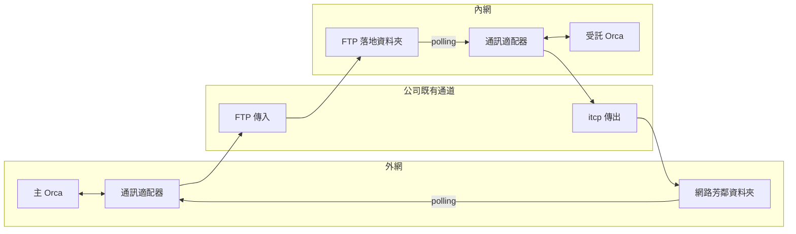
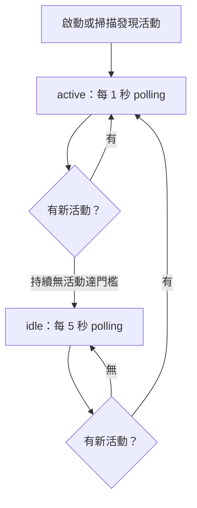
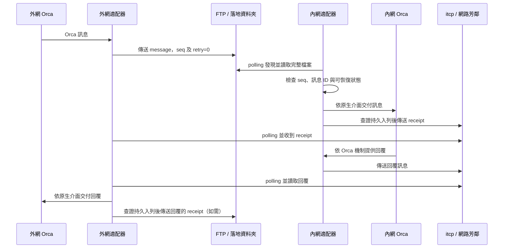

# Orca 內外網非同步通訊設計書

版本：3.0 草案｜2026-10-30  
狀態：設計與待驗證事項；尚未實作或在公司環境實測。

## 1. 目的與原則

讓外網 Orca 和內網 Orca 在公司既有通道上非同步交換訊息。盡可能沿用 Orca 原本的 agent、coordinator、worker、mailbox、工作狀態、權限、人工操作和顯示方式；新增的部分以跨網檔案適配、polling、`seq` 和 `retry` 為限。人員仍可依 Orca 原本方式繼續操作，是否修改程式碼、部署或操作正式環境，沿用 Orca 的既有權限與確認機制及公司政策。

外網到內網以 FTP 傳檔；內網到外網以 `itcp` 傳檔，外網 Windows 由網路芳鄰讀取。確切 `itcp` 格式、路徑、回傳碼和實際網路條件待到公司環境檢查，不假設目前已知。

本機 Orca 1.4.244 的公開 CLI 與說明沒有顯示可直接將 FTP／`itcp` 設為跨 runtime transport，也沒有查到這些通道的跨網 `seq` 或重試計數。Orca 的 FIFO mailbox 與 `--retry-request` 是本地 orchestration／請求機制，不能直接視為跨網檔案序號或傳檔重試次數。[Orca orchestration](https://github.com/stablyai/orca/blob/main/docs/site/content/docs/cli/orchestration.mdx)

補充原始碼查核：Orca 1.4.244 的 federation 內部已有 sequence 與 ACK，且 import 會拒絕不連續序號。這與本設計希望「`seq` 只記 log、照收到順序處理」不同。若要直接沿用原生 federation，須另外處理此差異；尚未確認如何透過 FTP／`itcp` 保留它的原生語意。[固定版原始碼](https://github.com/stablyai/orca/blob/b8ec5c8d170bcb9988e65de547a3a4e98b2885a9/src/main/runtime/rpc/methods/orchestration/federation/federation-relay.ts#L102-L133)。原生功能及架構另見 [Orca 原生架構說明](orca-native-architecture.md)。

本設計**不是 Orca 已支援的設定或公開 wire protocol**。適配採外掛或修改 Orca 哪一種，待檢查當時版本的原始碼、公開介面及公司環境後決定；不能預先宣稱原生 federation、所有 worker 生命週期與 GUI 已在檔案通道可用。兩端各自的 runtime、Run、Dispatch 身分和權限不能僅靠 JSON 變成同一個 Run；不得偽造遠端 `worker_done` 或 Dispatch 身分。

## 2. 場景與架構

第一階段以一台外網 Windows、一台內網 Windows 和一台內網 Linux 為驗證範圍，保留一個主 Orca 協調多個 Orca 的目標。外網 Windows 可關機，人員可繼續依 Orca 原方式操作。順序以實際收到的順序交付；`seq` 僅供檢查和顯示，不阻擋訊息。



多個受託節點分別設定路由及收件資料夾。圖中 Orca 與適配器的實際介面尚待驗證；Orca 原生群組、Dispatch 和完成權限的適配不能假設可跨這兩條檔案通道直接重用。

### 2.1 內網 Linux 的操作方式

優先在公司環境驗證 Linux 執行無畫面 `orca serve`，使用者由 Windows 瀏覽器連接；確認 browser client 的配對、可用功能與公司允許的連線路徑。Linux 若僅能 SSH，可能需要公司允許的 SSH port forwarding；未實測前不可認定瀏覽器能連上。若此方式不可行，再驗證 Windows Orca 桌面版透過 SSH 操作 Linux。[Orca Remote Server](https://www.onorca.dev/docs/remote-servers)、[SSH worktrees](https://www.onorca.dev/docs/ssh)

Linux 執行 agent 需有公司允許的 Orca、agent、模型服務、權限和所需工具。適配器究竟部署在內網 Windows 或 Linux，須依 FTP 收件資料夾、`itcp` 執行位置及存取權限實測決定，不預設兩台機器共用本機路徑。

## 3. 適配器與設定

同一套程式以不同設定選擇本端節點、收件位置、發送通道及對端。收件與送件必須分開設定；不能只選一個 FTP 或 `itcp`。

| 節點 | 收件 | 發送 |
| --- | --- | --- |
| 外網 | polling 網路芳鄰資料夾 | FTP |
| 內網 | polling FTP 落地資料夾 | `itcp` |

提議設定範例，並非 Orca 既有設定；檔案路徑、連線參數、憑證及 `itcp` 命令到公司環境確認。外網：

```json
{
  "node_id": "external",
  "inbound": { "kind": "directory", "path": "COMPANY_SHARE_PATH" },
  "outbound": { "kind": "ftp", "destination": "COMPANY_FTP_DESTINATION" },
  "polling": { "active_seconds": 1, "idle_seconds": 5 }
}
```

內網：

```json
{
  "node_id": "internal",
  "inbound": { "kind": "directory", "path": "COMPANY_FTP_DROP_PATH" },
  "outbound": { "kind": "itcp", "destination": "TO_BE_CONFIRMED" },
  "polling": { "active_seconds": 1, "idle_seconds": 5 }
}
```

相同程式支援多個對端的設定路由；以上範例只示意單一對端，並不定義未確認的 `itcp` 參數。憑證及存取設定遵守公司規範，勿放在訊息本文。訊息不得決定程式路徑或任意命令。

## 4. Polling

- **有活動時**預設每 1 秒掃描一次，可設定。
- **idle 時**預設每 5 秒掃描一次，可設定。
- 掃描發現新檔或待處理工作時回到 active；持續無新活動後進入 idle。建議初始「連續 30 秒沒有新活動」為可設定值，待實測調整；不代表 Orca 內建此判斷。
- 每個資料夾同時只執行一次掃描；掃描耗時超過間隔時不疊加。網路芳鄰或 FTP 落地目錄不可用時以 idle 間隔重試，並依可用的 Orca 原生 log／顯示介面記錄。權限錯誤等持續失敗不應每秒洗版。
- 程式只讀完成且屬於本節點的候選檔，不假設資料夾列出結果即表示檔案已傳完。若適配器或電腦關閉，無法 polling；重新啟動後掃描目前可見檔案並恢復 Orca 可查到的工作狀態。



## 5. 訊息與 `seq`、`retry`

跨網檔案信封是**適配層草案**，不是 Orca 官方 mailbox JSON。應優先承載 Orca 現有訊息欄位及身分，並在兩端使用 Orca 當前公開接口映射；以下範例的 `orca_message` 是概念示意，實際結構以版本檢查和原型為準。

```json
{
  "protocol": "orca-file-bridge",
  "version": 1,
  "from": "external",
  "to": "internal",
  "sequence_epoch": "cdbf55ea-9301-41de-9de5-fc3197087d18",
  "seq": 12,
  "retry": 0,
  "kind": "message",
  "message_id": "4f0da877-7d52-43d1-9ae4-3acaa878e915",
  "orca_message": {
    "subject": "檢查測試結果",
    "body": "請處理測試結果。",
    "thread_id": "4f0da877-7d52-43d1-9ae4-3acaa878e915"
  }
}
```

| 欄位 | 規則 |
| --- | --- |
| `from`, `to` | 已設定的寄件與收件節點。每組有向節點對各自維護一組序號。 |
| `message_id` | 穩定的訊息識別；若可直接使用 Orca 可公開且可恢復的 ID，優先沿用，否則由適配器產生。這是去重的識別，須在實測時確認其生命週期。 |
| `seq` | 每個方向每封**新**訊息遞增；一般訊息和 receipt 都編號。只檢查跳號、重複或倒序並記錄，不等待補號、不變更實際收到的處理順序。 |
| `retry` | 第一次傳送為 `0`，每次重送加一。同一封訊息重送時 `message_id` 和 `seq` 不變。 |
| `kind` | `message` 為一般訊息；`receipt` 為適配層的收件確認。優先驗證 Orca 是否已有可直接沿用的確認介面。 |
| `orca_message` | 承載要交給 Orca 的內容；欄位及可支援的 Orca 類型需按實際版本驗證。不能將外部訊息偽造為有權限的 Dispatch 完成訊號。 |

重送時 JSON 的 `retry` 會改變。去重比較應以穩定 `message_id` 與**除 `retry` 以外的固定訊息內容**判斷；單純 retry 變化不算衝突。如果固定內容不同，記錄衝突並交人確認，不自動當成同一工作。實作時須明確定義固定內容的比較方式，避免因 JSON 排版或 key 順序產生誤判；到公司環境確認是否可直接沿用 Orca 的 ID 和內容。

`seq` 不額外保存至適配器自建持久狀態，依使用者決定在重啟時與對端同步。同步來源與 Orca 是否保有足夠紀錄需實測；若兩端可確認同一個基準，從該基準後繼續。若雙方都沒有可核對的紀錄，不能推算舊序號或保證無缺號；建立新的序號區段並標記同步重置，區段的識別與交換方式待 Orca 接口查核後定稿。序號只供觀察，**不以它判定訊息已收或阻擋工作**。

## 6. 收件確認、重送和 Orca 交接

如果 Orca 現有接口能安全提供跨檔案通道所需的確認與去重，優先沿用；否則適配器需要最小 `receipt` 機制。傳輸工具回報成功只表示工具報告已傳送，不能推論對方 Orca 已讀或工作完成。

確認信封範例；`in_reply_to` 指向收到的訊息 ID，receipt 有自己方向的 `seq` 與 `message_id`：

```json
{
  "protocol": "orca-file-bridge",
  "version": 1,
  "from": "internal",
  "to": "external",
  "sequence_epoch": "c1cfb790-5f3f-4bf8-8ead-709efc62c849",
  "seq": 7,
  "retry": 0,
  "kind": "receipt",
  "message_id": "7d9534d8-3452-472a-ad23-0cbd4a9eae1e",
  "in_reply_to": "4f0da877-7d52-43d1-9ae4-3acaa878e915"
}
```

1. 發送端建立訊息，透過 FTP 或 `itcp` 傳出；若使用 receipt，接收端在確認完整收件且可恢復後回覆 receipt。receipt 不再回 receipt，避免無限迴圈。
2. 未收到 receipt 時可重送相同 `message_id` 和 `seq`，並遞增 `retry`；重送間隔需可設定，與 1 秒／5 秒 polling 間隔分開。預設值待實測公司傳輸時間後定案，避免頻繁重送。
3. 接收端對已確認收過的同一 `message_id` 不重複交給 Orca；若原 receipt 遺失，重送 receipt。receipt 必須對得上原訊息及預期對端。無法確認來源或關聯時不標記成功。
4. 工作完成依 Orca 原本機制或已驗證的本地流程回報；receipt 只代表適配層收件，不代表 agent 已執行。若 Orca 交接曾發生、結果卻因中斷而不明，顯示未知並由人員決定，不自動重做可能有副作用的工作。

不另保存 `seq` 不代表能保證關機後可靠去重。Orca 原有資料或實際傳輸資料若能保留並查詢 `message_id`、收件及待傳狀態，可優先利用；若沒有可恢復的紀錄，就無法確定是否收過或該從哪裡繼續。這時按使用者決定標記**狀態未知、由人決定是否重送**，不能宣稱自動可靠或保證只執行一次。持久化位置與最小必要資料要等 Orca 原生能力和公司環境驗證後再決定，不能偷偷增加獨立 `seq` 保存。



圖中 receipt 與 Orca 的工作完成是不同事件；實際先後可因網路及 polling 而不同。重複訊息仍需按照可查證的紀錄處理，`seq` 異常只記錄、不重新排序。

### 6.1 Review 補強：交接、恢復與驗收

本節為設計與待驗證事項，不代表 Orca 已提供所需能力。優先驗證 Orca 的持久入列和 mutation receipt／replay 是否支援公開查詢與安全重試。無法查證是否已交付或執行時標記 unknown，由人查證並決定，不自動重做。

| 階段 | 查證及責任 |
| --- | --- |
| 發現檔案 | 完成標記、長度與 hash 均通過才納入處理；不完整時不交付、不回成功 receipt。 |
| 完整收件 | 按來源及 message_id 查原生紀錄；沒有可恢復證據時不能宣稱可靠收件。 |
| 交付 Orca | 使用穩定請求 ID 和經驗證的本地介面；回應遺失時查原生 mutation receipt／工作狀態，查不到即 unknown。 |
| 持久入列已查證 | 才發送跨網 receipt；發送失敗保留待送狀態、重送相同 receipt。receipt 不代表工作完成。 |
| 工作完成／取消 | 核對 Orca 原生狀態；人工已處理後重播舊檔，證據不足時 unknown，不重新執行。 |

原生查詢、資料保存與安全重試能力須實測；如需最小持久收件與待送紀錄，先確定內容與保留期，不能只靠記憶體宣稱可恢復。去重鍵為經確認的來源及 message_id；同鍵固定內容不同視為衝突。`sequence_epoch` 為每個來源與目的方向的區段 UUID：重送保留 epoch、message_id、seq 並增加 retry；無法同步時建立新 epoch，舊訊息保留舊 epoch。不因新區段重新執行，也不新增 seq 資料庫。

**Mailbox 責任：**先驗證 bridge 專用收件地址與單一消費者，由 bridge 負責該 inbox 的 check／ACK；人員監看使用經驗證不消費的 peek／all。bridge 不與人工或 coordinator 競爭同一 batch；以上介面若不可用，先釐清原生行為，不能假設各讀者有獨立 ACK。

| 功能 | 預定介面及地址映射 | 限制 |
| --- | --- | --- |
| 本地交接 | 兩端本地接收代理透過支援的 mailbox／orchestration，設定節點與專用地址 | 身分、權限、去重和持久查詢待驗證；不得偽造 Dispatch 或 worker_done。 |
| 跨網傳送 | FTP、itcp、網芳資料夾適配器；from／to 映射已設定節點 | 外層 seq 只記錄，不等於 federation 序號。 |
| federation | 另研究 relay、caller 與 Dispatch attachment | 原生 import 要求連續序號，不能直接套用可跳號的外層 seq；完整跨網控制尚未證實。 |

**完整檔案：**每次傳輸使用獨立 attempt ID，發布 `<message_id>.<attempt_id>.json`，再發布同名 `.ready.json`，包含資料長度與 SHA-256；兩者一致才處理。完成標記本身須透過經實測的暫存後原子改名發布；FTP、itcp、網芳不支援時先驗證其他可靠方案，未證實前不啟用自動處理。hash 只檢查完整性；檔案可見或大小暫時不變不代表完成。

**順序與資源：**收到順序指首次確認完整並納入處理的順序；同輪發現多個完整檔案時按完整檔名的字元順序決定，不依 seq 排序。交付順序不保證工作完成順序；有相依性時使用原生 Task。網芳讀取及 itcp 逾時、每輪處理上限可設定；對端獨立處理，失敗或待送 receipt 不阻塞其他節點。逾時代表結果未知。每個 inbox 使用單一消費者和經實測的排他鎖，第二個實例或失鎖者停止消費。

**保留與清理：**待送檔保留到可查證匹配 receipt；已收紀錄與 receipt 至少保留到重送窗口結束、確認對端不再重送且原生狀態可查證。實際期限與人工清理流程待公司實測；去重證據消失時不得把舊命令當成新工作。

| 故障注入驗收 | 預期、查證來源與重試 |
| --- | --- |
| 收件前、交付前、入列後回應前、receipt 發送前後分別斷電 | 比對完整檔案、原生入列及待送紀錄；只有證明安全的階段可自動重試，無法查明即 unknown。 |
| bridge 與人員同時讀取 | 以 mailbox 狀態驗證專用 inbox 的 ACK 責任與 peek 不消費；未證實時停止競爭式讀取。 |
| 兩個 bridge 同時啟動 | 驗證鎖及 mailbox 狀態；僅持鎖者消費，失鎖者不得重試交付。 |
| 人工完成／取消後重播舊檔 | 查原生狀態與去重證據，不重複執行；查不到即 unknown，不自動重做。 |

## 7. 異常及處理

| 情境 | 預期行為 |
| --- | --- |
| 外網電腦關機 | 停止 polling；內網依可恢復的待傳紀錄保留結果。外網開機後重新掃描、同步 `seq`；不能查證是否收過時標未知、由人決定。 |
| 內網或兩邊關機 | 停止運作，重啟後先同步並查核 Orca 與傳輸資料；無可核對的狀態不自行重做有副作用的工作。 |
| 網路不穩、FTP 或 `itcp` 結果不明 | 不假定已收到；按可設定的重送策略處理，穩定 ID 和 `seq`，`retry` 遞增。確實不能判定時標未知。 |
| 半檔、網芳尚未完整可讀 | 不交給 Orca、不回成功 receipt。完成判定依公司 FTP／`itcp` 行為實測，可評估完成標記或安全改名，不假設兩者可用。 |
| receipt 遺失、訊息重複 | 若可查到已收紀錄，保留同一工作並重送 receipt；不可查證時交由人確認。receipt 不再互相確認。 |
| `seq` 跳號、倒序或重複 | 使用 Orca 原生 log／顯示或經驗證的標準 API 記錄；不阻擋、不調整訊息收到的順序。去重依 `message_id`，不是 `seq`。 |
| 相同 `message_id`、不同固定內容 | 記錄並交人確認，不把內容衝突當成 retry 的正常變化。 |
| Orca 未運作或交付結果不明 | 盡量用 Orca 原生恢復和可查詢的訊息紀錄；無法確認是否執行時標未知，由人決定，不偽造 `worker_done`。 |
| SSH 斷線或 Linux agent 失聯 | 不等於工作已停止；依 Orca 原生方式查核，不能只因逾時就啟動可能重複的工作。 |
| 資料夾不可讀、權限或空間不足 | 顯示或記錄錯誤，等待修復，不假報收到。 |
| 不明來源、非法格式或錯誤目的地 | 不交付給 Orca；依公司既有安全和存取控制規定記錄及處理。安全設計保持簡單，具體來源確認方式待公司環境查核。 |
| 多個節點同時工作 | 每個有向節點對各自 `seq`；目的路由和訊息 ID 分開，單一節點的 receipt 不代表其他節點已收到。 |

不可用的通道若永久未恢復、檔案被清除或工作紀錄遺失，無法保證最終送達。人員繼續操作、權限與正式環境行為沿用 Orca 機制，不以適配器自行增加一套工作權限規則。

## 8. Log 與顯示

優先使用 Orca 原本的 log、畫面或公開標準 API；目前只確認 Orca 有本身的應用程式 log，**尚未找到外部適配器可寫入 Orca log／GUI 的公開標準 API**。可研究以 Orca 本地 mailbox `status` 顯示狀態，但不可假設它等同 log API 或會自動喚醒 agent。到公司環境檢查版本、使用方式與可讀性；若沒有合適的原生接口，先回報限制再決定最輕量的替代方式，不預設建立新的 log 系統。

建議顯示訊息 ID、寄件與收件節點、`seq`、`retry`、收件狀態及可辨識的錯誤；敏感內容和憑證不應自動顯示。畫面／log 能否保留供 `seq` 同步，要以 Orca 的實際資料保留能力驗證。

## 9. 公司環境實測與待確認

1. **先檢查 Orca 原生介面及原始碼**：能否接入 FTP／`itcp` transport，沿用 mailbox、訊息 ID、確認、去重、log／顯示與 Run／Dispatch 行為；記錄版本和實際限制。若無公開接點，評估最薄適配方式，不假設所有原生遠端控制可直接跨檔案通道。
2. **確認 `itcp`**：實際工具名稱、參數、目的 path、返回碼、落地與完整檔案行為；FTP 上傳及落地目錄、網路芳鄰權限和可能清理時間。這些資料目前未知，留待公司查詢與實測。
3. **驗證 Linux 網頁方案**：Linux 安裝與執行 `orca serve`、瀏覽器 client 啟動和配對、SSH port forwarding／連線政策、agent 與模型可用性。若不可行，驗證 Windows Orca SSH 方案。
4. **測試 polling 與順序**：active 約 1 秒、idle 約 5 秒、切換和失敗情況；傳 `seq` 1、3、2，確認只記錄、按收到順序處理；同時測 receipt 的序號、重送的 `retry` 遞增與去重。
5. **測試關機與同步**：單邊關機、兩邊同時關機、`seq` 可同步和不可同步、狀態不明的人工作業；尤其確認 Orca 原有紀錄實際能否支援恢復及去重。
6. **測試異常與操作**：半檔、丟檔、延遲、重複、receipt 遺失、網芳不可讀、`itcp` 失敗、Orca 重啟、SSH 斷線、多人繼續操作與多節點路由。確認正式環境權限及確認行為沿用公司實際 Orca 設定。

## 10. 來源與舊版說明

- 本機 Orca 1.4.244：`orca orchestration send --help`、`check --help` 與版本內建 skill。部署時以公司環境實際版本確認。
- [Orca orchestration 文件](https://github.com/stablyai/orca/blob/main/docs/site/content/docs/cli/orchestration.mdx)；[mailbox 規則](https://github.com/stablyai/orca/blob/main/skill-guides/orchestration/references/messaging-and-gates.md)。
- [Orca 執行方式](https://www.onorca.dev/docs/ways-to-run)、[Remote Orca Server](https://www.onorca.dev/docs/remote-servers)、[SSH worktrees](https://www.onorca.dev/docs/ssh)。
- 先前的 [可靠投遞與異常處理設計](orca-bridge-reliability-design.md) 為歷史研究稿；其中永久保存 `seq`、固定重送 bytes、強制 Ed25519 或其他與本版不同的選擇不再是定案。以本文件與使用者後續指示為準。
