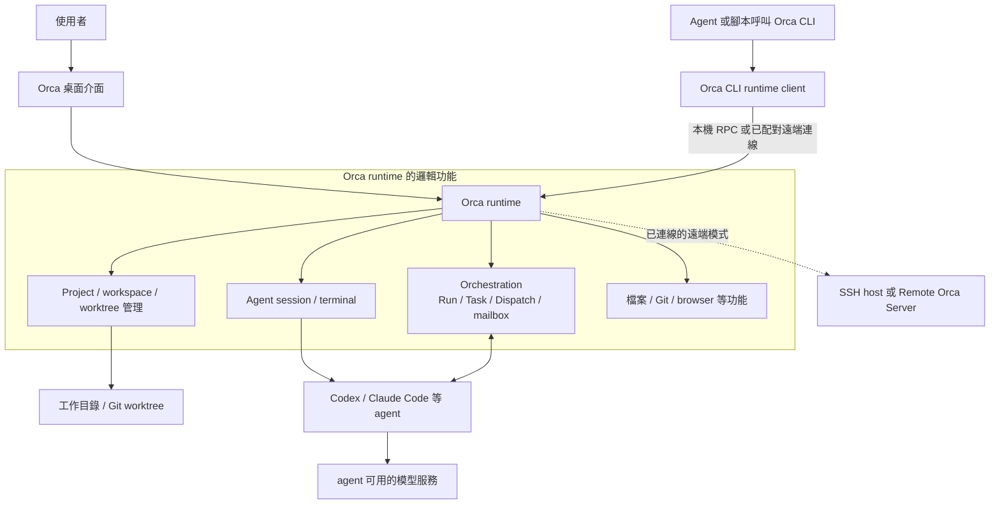
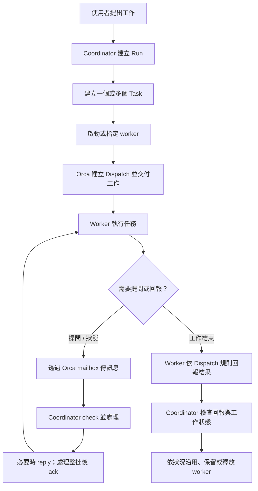
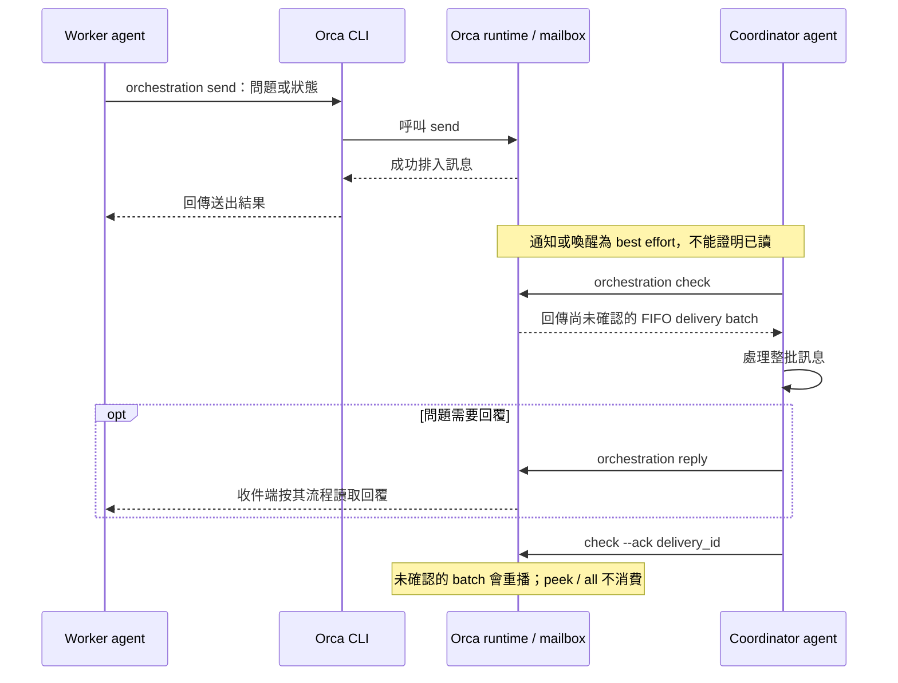
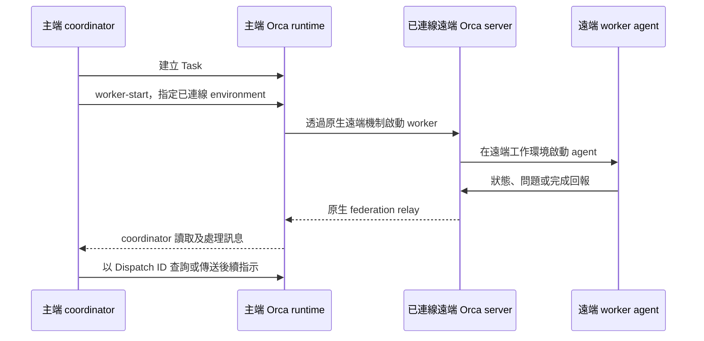
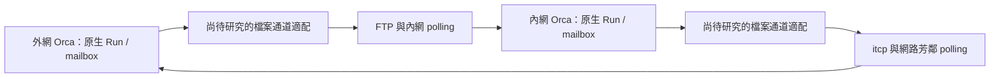

# Orca 原生架構、流程與功能限制

供會議討論使用｜研究日期：2026-10-30

## 1. 本文件看什麼版本？

本文件介紹 **Orca 原本的設計**，不把 FTP、`itcp`、資料夾 polling 或自行設計的 JSON 當成 Orca 內建功能。本機 `orca status --json` 顯示 Orca **1.4.244**。原始碼引用固定在官方 `v1.4.244` tag 指向的 commit [`b8ec5c8`](https://github.com/stablyai/orca/tree/b8ec5c8d170bcb9988e65de547a3a4e98b2885a9)，避免 `main` 更新後內容改變。官網文件可能更新，本文會區分它與該版本原始碼；公司環境需以實際安裝版本實測。

Orca 是管理多個 AI coding agent 的工作環境：使用者在介面裡建立工作環境、啟動 agent，Orca 管理 workspace、終端、訊息與協作。**Orca 自己不是 AI 模型**；實際工作仍由 Codex、Claude Code 等 agent 和其可用的模型服務完成。[Orca 官方介紹](https://www.onorca.dev/docs)

## 2. 原生架構圖

這是**邏輯圖**，不是聲稱所有方塊在所有模式下都在同一個 process 或同一台機器。依模式不同，runtime 的狀態、UI、檔案與 agent 可位在不同主機。官方 1.4.244 原始碼中，CLI runtime client 透過本機 transport 或遠端配對路徑發出請求；orchestration RPC 聚合 Run、worker、federation、send、check、dispatch、ask 和 gate 等方法。[CLI client](https://github.com/stablyai/orca/blob/b8ec5c8d170bcb9988e65de547a3a4e98b2885a9/src/cli/runtime/client.ts)、[orchestration RPC](https://github.com/stablyai/orca/blob/b8ec5c8d170bcb9988e65de547a3a4e98b2885a9/src/main/runtime/rpc/methods/orchestration.ts)

### 核心名詞

| 名詞 | 通俗說明 |
| --- | --- |
| Workspace / worktree | agent 工作的位置。Git worktree 可讓不同工作使用各自的工作目錄；也有 folder workspace。 |
| Agent | 實際理解任務、使用工具和產生結果的程式，例如 Codex。 |
| Coordinator | 協調任務的 agent，決定工作分派及處理回覆。 |
| Run | 一次協調工作的命名空間，以及 coordinator 的 inbox。 |
| Task | 一項待完成的工作，可有相依關係。 |
| Dispatch | 某個 Task 的一次派工嘗試；用來辨別由哪個 worker、哪次嘗試回報。 |
| Mailbox / message | Orca 保存 agent 間訊息的機制；可傳狀態、問題及工作回報。 |
| Decision gate | 工作需要 coordinator 決定時，可用來阻擋任務直到決定完成。 |

Run、Task、Dispatch、Message 和 gate 的定義與範例見[官方 orchestration 文件](https://github.com/stablyai/orca/blob/b8ec5c8d170bcb9988e65de547a3a4e98b2885a9/docs/site/content/docs/cli/orchestration.mdx)。

## 3. 原生工作流程圖

以下是有監督的 orchestration 典型流程。一般單次 agent 工作不一定要建立 Task 或使用完整 orchestration。

Coordinator 可以管理多個 worker，也可以讓 Task 有相依關係。`worker_done` 有 active Dispatch 和身分限制，不能拿任意訊息假裝成受監督 worker 的完成報告。[Orca orchestration 文件](https://github.com/stablyai/orca/blob/b8ec5c8d170bcb9988e65de547a3a4e98b2885a9/docs/site/content/docs/cli/orchestration.mdx)

## 4. 原生 mailbox 循序圖

此圖示意 worker 向 coordinator 提問或回報的路徑。訊息的通知和讀取是兩件事；圖中的 `ack` 是 Orca 本地 delivery batch 的確認。

`send` 成功表示訊息持久入列，不代表對方已讀、開始執行或完成。`check` 取得待確認 FIFO batch；應處理整批後才 `ack`。`peek`／`all` 是查閱，不會自行消費 batch。[1.4.244 版 messaging 規則](https://github.com/stablyai/orca/blob/b8ec5c8d170bcb9988e65de547a3a4e98b2885a9/skill-guides/orchestration/references/messaging-and-gates.md)

## 5. 原生支援哪些執行方式？

| 方式 | Orca 本來提供的行為 | 對本案的意義 |
| --- | --- | --- |
| 本機 | UI、工作環境與 agent 在本機執行。 | 最容易先驗證 Orca 的基本 mailbox 與 agent 行為。 |
| SSH workspace | 桌面端連到 SSH 主機，工作目錄與 agent 在遠端；文件說明目前版本會在主機設定 Orca 管理的服務。 | 內網 Windows 可操作 Linux SSH 主機；須驗證公司安裝權限、版本和 agent／模型可用性。 |
| Remote Orca Server | 遠端主機擁有 runtime、workspace 和 agent；client 經可用連線配對控制。支援無畫面的 `orca serve`。 | Linux 可作為服務端；Windows 桌面或 browser client 的連線、配對與可用功能需要公司實測。 |
| Federated worker | coordinator 可在**已連線**的 Orca server 啟動遠端 worker，透過 Dispatch ID 管理回報。 | 需要相容的遠端 server 和連線；不能直接推論 FTP／`itcp` 可當成該連線。 |

來源：[Orca 執行方式](https://www.onorca.dev/docs/ways-to-run)、[SSH worktrees](https://www.onorca.dev/docs/ssh)、[Remote Orca Servers](https://www.onorca.dev/docs/remote-servers)、[固定版 orchestration 文件](https://github.com/stablyai/orca/blob/b8ec5c8d170bcb9988e65de547a3a4e98b2885a9/docs/site/content/docs/cli/orchestration.mdx)。Remote Server 文件標示為 beta；Linux 的執行環境、可連線路徑與版本相容性仍需實測。

## 6. 遠端執行循序圖

這是 Orca 已支援、server 已連線的 federated worker 概念流程；**不是**公司 FTP／`itcp` 跨網流程。

在官方 placement 說明中，Run 和 Task 仍由主端 server 管理，`--on` 選擇 worker 執行的已連線 server；後續使用 Dispatch ID。遠端失聯時狀態可能是 `unverifiable`，不能因為沒有回報就判定已停止。[1.4.244 placement 規則](https://github.com/stablyai/orca/blob/b8ec5c8d170bcb9988e65de547a3a4e98b2885a9/skill-guides/orchestration/references/placement-and-remote.md)

## 7. 它原本已有 sequence 與 ACK 嗎？

**有，但用途需要分清楚。** 查閱 1.4.244 原始碼後，Orca 的 federation relay 內部確實有 sequence 與 ACK：`federationPull` 使用 `afterSequence`，`federationAck` 使用 `throughSequence`，也檢查 caller 和 dispatch attachment。[固定版 federation relay 原始碼](https://github.com/stablyai/orca/blob/b8ec5c8d170bcb9988e65de547a3a4e98b2885a9/src/main/runtime/rpc/methods/orchestration/federation/federation-relay.ts)

這修正了之前若把 Orca 說成「沒有 sequence」的過度簡化：**沒有在已查到的公開介面找到可直接設定成 FTP／`itcp` 檔案交換的 sequence；不代表 Orca 內部沒有 sequence。** 在固定版本的 federation import 實作中，已匯入序號會跳過，遇到高於下一個預期序號的訊息則拒絕；同時檢查經認證的 caller 與 attachment。[固定版 import 原始碼](https://github.com/stablyai/orca/blob/b8ec5c8d170bcb9988e65de547a3a4e98b2885a9/src/main/runtime/rpc/methods/orchestration/federation/federation-relay.ts#L102-L133)

這與公司目前希望的「`seq` 只記 log，照收到順序處理」不同。若要直接適配 Orca 的 federation，就要維持其連續序號和確認語意；若使用只檢查、不阻擋的序號，就不能宣稱原樣維持該 federation 語意。哪一層使用哪種序號及是否需要重排，仍待分析與實測，不能只複製數字或 ACK 欄位就宣稱相容。

另外，本機 CLI transport 的程式碼使用本機 socket／named pipe 及 runtime 認證；這是 Orca CLI 與 runtime 的呼叫管道，不能直接視為公司兩端可交換的郵件格式。[固定版 local transport](https://github.com/stablyai/orca/blob/b8ec5c8d170bcb9988e65de547a3a4e98b2885a9/src/cli/runtime/transport.ts)

## 8. 原生限制與目前未確認事項

| 項目 | 已知限制或待驗證事項 |
| --- | --- |
| FTP、`itcp`、網芳 polling | 已查閱的版本 CLI、文件與相關來源沒有找到可直接設定的跨 runtime 檔案 transport；這是目前查核範圍內的結論，並非對完整程式碼的不存在證明。 |
| 完整 federation 語意 | 內部 relay 有 sequence、ACK 和身分約束，import 要求序號連續；與本案「只記 log」不同。尚未驗證能以檔案通道維持原有語意，也未證明有公開可插拔 transport。 |
| 送出、已讀、完成 | `send` 入列不等於 agent 已讀或完成；Orca 本地 batch ACK 也不等同公司跨網檔案已保存。 |
| 重啟與斷線 | Orca 有 reconnect 和 session 恢復功能；但遠端失聯不能證明工作停止，原生恢復能力不等於 FTP 跨網一定可自動恢復。 |
| `worker_done` | 受 active Dispatch 和來源身分限制，不可由另一個隔離 runtime 隨意偽造。 |
| Linux 網頁操作 | 文件提到 browser client 和 headless server；Linux 僅開 SSH 時，瀏覽器的實際連線、配對方式及功能仍需在公司環境驗證。 |
| Agent 與模型 | 每個執行端都需要適用的 agent、模型服務、工具、權限和公司允許的網路路徑；Orca 本身不提供模型。 |
| Log 與 GUI 擴充 | 已確認 Orca 有自身 log 與 mailbox；尚未找到可供外部檔案適配器寫入原生 log／GUI 的公開標準 API。 |
| 安全與權限 | 遠端配對和主機權限有自己的邊界；FTP／`itcp` 訊息可信度、公司跨網與正式環境操作規則仍要另行確認。 |
| 版本與設定 | 本機是 1.4.244；固定版本文件指出 orchestration 需在設定中啟用 Experimental 且 runtime 可達。官網與公司環境版本可能不同，CLI、SSH 與相容能力不能直接假設一致。 |

## 9. 與公司跨網需求的關係

圖中「檔案通道適配」是公司需求的研究方向，**不是已驗證的 Orca 原生功能**。下一步是在公司實測環境對照固定版本原始碼，確認能否在不破壞原生訊息、federation、權限與恢復語意的前提下接入；如果不能，需明確列出要新增或無法支援的功能。具體提案見[內外網非同步通訊設計書](orca-cross-network-mail-design.md)。
